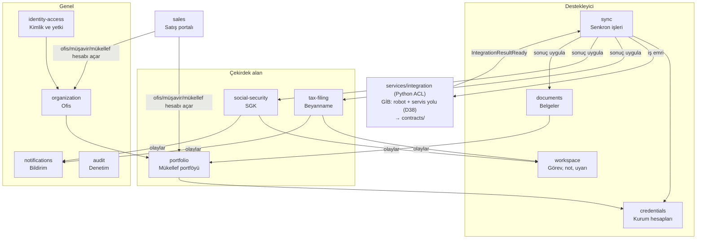
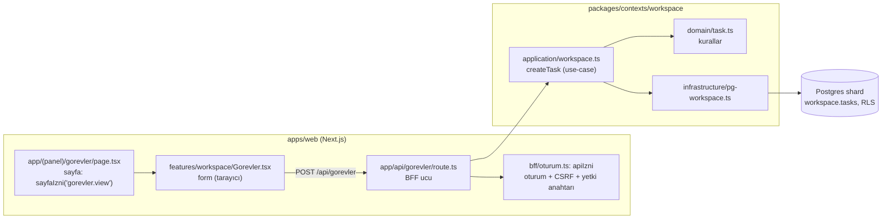

# Eworks

Mali müşavir ofisleri için çok kiracılı SaaS: GİB e-Beyanname ve SGK verisini müşavirin ve mükelleflerin kendi kurum hesaplarıyla, sunucu tarafında toplu çeker (oturum tarayıcıyla açılır; sonrasında hizmet başına robot ya da doğrulanmış HTTP, D38); beyanname, tahakkuk, SGK belgesi, görev ve uyarıları tek ekranda sunar. Kiracı = ofis; ofis → müşavir → mükellef.

> **Yeni misin?** [Başlangıç rehberi](docs/gelistirici-rehberi/baslangic.md): kur, çalıştır, değiştir, test et. Sonra [okuma sırası](docs/00-genel-bakis.md#okuma-sırası-junior).
>
> 24.10.2026'da depo yeniden yapılandı (D28): yeni yapı bu kökte, önceki tüm projeler [eski/](eski/README.md) altında arşivdir. Pull sonrası her makinede bir kez: `node tools/ajan/eski-yerel-tasi.mjs --uygula`.

## Özellik durumu

<!-- ozellik-durumu:baslangic — pnpm features üretir, elle düzenlemeyin -->
**30/111 işlem yeşil** (18 modül). 🔴 Oturum 1/4 · 🔴 Ana Sayfa 1/2 · 🔴 Firmalarım 10/15 · 🔴 e-Beyanname 5/9 · 🔴 e-Tebligat 0/2 · 🔴 SGK 3/11 · 🔴 e-Defter 0/2 · 🔴 Dilekçeler 0/4 · 🔴 Faturalar 0/4 · 🟢 Görevler 4/4 · 🟢 Notlar 2/2 · 🔴 Uyarılar ve bildirimler 0/2 · 🔴 Raporlar 0/8 · 🔴 Ödeme 0/9 · 🔴 Yönetim 0/11 · 🔴 Ayarlar 0/7 · 🔴 Destek 0/4 · 🔴 Satış portalı 4/11. Ayrıntı: [docs/ozellik-durumu.md](docs/ozellik-durumu.md)
<!-- ozellik-durumu:bitis -->

## Bağlam haritası



Bağlam sayfaları: [docs/baglamlar/](docs/baglamlar/README.md).

## Bir istek nasıl akar

Örnek: kullanıcı "Yeni görev" formunu gönderir.



Sayfa ve uç incedir: yetkiyi denetler, iş kuralını use-case ve domain'e bırakır. Ayrıntı: [DDD rehberi §4.4](docs/gelistirici-rehberi/ddd.md#44-bff-ve-ui--ince-kabuk).

## Dizin haritası

| Yer | Ne |
|---|---|
| `packages/contexts/<context>` | Bounded context: `src/domain`, `src/application`, `src/infrastructure`, `src/index.ts` (public API), `test/` |
| `packages/kernel` | Paylaşılan çekirdek: `TaxId` (VKN/TCKN), `Period`, `Result`, `DomainEvent`, `Clock` |
| `packages/feature-registry` | Özellik ağacı = yetki ağacı = TDD durum kaynağı |
| `packages/platform`, `packages/testing` | Teknik altyapı · test yardımcıları (sahte VKN/TCKN) |
| `apps/web`, `apps/sales`, `apps/worker` | Portal + BFF · satış portalı · arka plan işçisi |
| `services/integration` | Python ACL: GİB girişi (otomatik CAPTCHA, ddddocr), robot ve servis yolu, sahte GİB (`services/ocr` iskelet, kullanılmıyor) |
| `contracts/` | Yayımlanmış dil: ACL çıktıları ve olay yükleri (JSON Schema) |
| `supabase/` | `migrations/control`, `migrations/tenant`, pgTAP testleri, sentetik seed |
| `deploy/` | Docker Compose ve Kubernetes — [deploy/README.md](deploy/README.md) |
| `tools/` | `arch` (katman kuralları), `features` (özellik durumu), `ajan` (Claude ↔ Codex senkronu), `claude` (kancalar), `git-hooks`, `docs` |
| `docs/` | [Genel bakış ve okuma sırası](docs/00-genel-bakis.md), hedef mimari, karar kaydı, bağlamlar, ajan bağlamı + ekip hafızası |
| `eski/` | Yeniden yapılanma öncesi depo (arşiv) |

## Çalıştırma

Gerekenler: Git, Docker Desktop (en az 6 GB bellek), Node 24 (`.nvmrc`), pnpm (corepack ile). Adım adım ve sorun giderme: [başlangıç rehberi](docs/gelistirici-rehberi/baslangic.md).

```bash
corepack enable && pnpm install             # bağımlılıklar + git kancaları
pnpm verify                                 # tip, mimari kurallar, birim testleri, belgeler — commit'ten önce her zaman
node tools/deploy/yigin.mjs up              # tüm yığın Docker'da → http://localhost:8080 (demo@eworks.test / .env'deki DEMO_SIFRE)
node tools/deploy/yigin.mjs gelistir        # geliştirme: altyapı portları 127.0.0.1'de, ardından
pnpm --filter @eworks/web dev               #   web Docker'sız, anında yenilenir → http://127.0.0.1:8765
node tools/deploy/yigin.mjs test            # entegrasyon + pgTAP + Python testleri
node tools/deploy/yigin.mjs e2e             # arayüz kabul testleri (dört ekran)
node tools/deploy/yigin.mjs down            # durdur (--sil: verileri de sil)
```

VS Code ile çalıştırma ve hata ayıklama: [başlangıç §5–7](docs/gelistirici-rehberi/baslangic.md#5-vs-code-ile-çalıştırma); kipler (demo / gelistirme / debug / uretim) ve ayarları: [yığın kipleri](docs/gelistirici-rehberi/kipler.md); canlı sunucu: [VPS kurulumu](docs/gelistirici-rehberi/vps-kurulum.md). Docker ayrıntısı (servisler, portlar, kipler): [deploy/README.md](deploy/README.md). Durum ve açık konular: [docs/ai/durum.md](docs/ai/durum.md).

## Katkı

TDD: önce `feature-registry` anahtarı, sonra `@F:<anahtar>` etiketli kırmızı kabul testi ([docs/ai/test.md](docs/ai/test.md)). Örnekli rehberler: [DDD](docs/gelistirici-rehberi/ddd.md), [TDD](docs/gelistirici-rehberi/tdd.md); terimler: [terimler.md](docs/gelistirici-rehberi/terimler.md). Kurallar: [CLAUDE.md](CLAUDE.md) ve [docs/ai/kurallar.md](docs/ai/kurallar.md). Claude Code ya da Codex ile çalışma: [docs/gelistirici-rehberi/claude-codex.md](docs/gelistirici-rehberi/claude-codex.md). Canlı GİB doğrulaması: [docs/gelistirici-rehberi/canli-dogrulama.md](docs/gelistirici-rehberi/canli-dogrulama.md).
