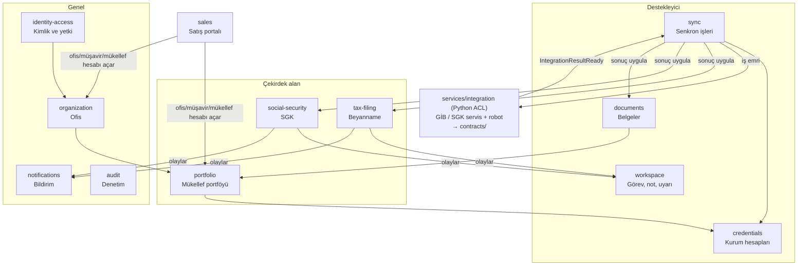
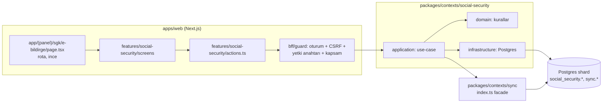

# Eworks

Mali müşavir ofisleri için çok kiracılı SaaS: GİB e-Beyanname ve SGK verisini müşavirin ve mükelleflerin kendi kurum hesaplarıyla — **web servis birincil, sunucu robotu yedek** — toplu çeker; beyanname, tahakkuk, SGK belgesi, görev ve uyarıları tek ekranda sunar. Kiracı = ofis; ofis → müşavir → mükellef.

> 24.10.2026'da depo yeniden yapılandı (D28): yeni yapı bu kökte, önceki tüm projeler [eski/](eski/README.md) altında arşivdir. Pull sonrası her makinede bir kez: `node tools/ajan/eski-yerel-tasi.mjs --uygula`.

## Özellik durumu

<!-- ozellik-durumu:baslangic — pnpm features üretir, elle düzenlemeyin -->
**26/107 işlem yeşil** (18 modül). 🔴 Oturum 1/4 · 🔴 Ana Sayfa 1/2 · 🔴 Firmalarım 10/15 · 🔴 e-Beyanname 5/9 · 🔴 e-Tebligat 0/2 · 🔴 SGK 3/11 · 🔴 e-Defter 0/2 · 🔴 Dilekçeler 0/4 · 🔴 Faturalar 0/4 · 🟢 Görevler 4/4 · 🟢 Notlar 2/2 · 🔴 Uyarılar ve bildirimler 0/2 · 🔴 Raporlar 0/8 · 🔴 Ödeme 0/9 · 🔴 Yönetim 0/11 · 🔴 Ayarlar 0/7 · 🔴 Destek 0/4 · 🔴 Satış portalı 0/7. Ayrıntı: [docs/ozellik-durumu.md](docs/ozellik-durumu.md)
<!-- ozellik-durumu:bitis -->

## Bağlam haritası



Bağlam sayfaları: [docs/baglamlar/](docs/baglamlar/README.md).

## Bir istek nasıl akar



## Dizin haritası

| Yer | Ne |
|---|---|
| `packages/contexts/<context>` | Bounded context: `src/domain`, `src/application`, `src/infrastructure`, `src/index.ts` (public API), `test/` |
| `packages/kernel` | Paylaşılan çekirdek: `TaxId` (VKN/TCKN), `Period`, `Result`, `DomainEvent`, `Clock` |
| `packages/feature-registry` | Özellik ağacı = yetki ağacı = TDD durum kaynağı |
| `packages/platform`, `packages/testing` | Teknik altyapı · test yardımcıları (sahte VKN/TCKN) |
| `apps/web`, `apps/sales`, `apps/worker` | Portal + BFF · satış portalı · arka plan işçisi |
| `services/integration`, `services/ocr` | Python ACL (kurum servis/robot) · CAPTCHA OCR |
| `contracts/` | Yayımlanmış dil: ACL çıktıları ve olay yükleri (JSON Schema) |
| `supabase/` | `migrations/control`, `migrations/tenant`, pgTAP testleri, sentetik seed |
| `deploy/` | Docker Compose ve Kubernetes |
| `tools/` | `arch` (katman kuralları), `features` (özellik durumu), `ajan` (Claude ↔ Codex senkronu), `claude` (kancalar), `git-hooks`, `docs` |
| `docs/` | [Genel bakış ve okuma sırası](docs/00-genel-bakis.md), hedef mimari, karar kaydı, bağlamlar, ajan bağlamı + ekip hafızası |
| `eski/` | Yeniden yapılanma öncesi depo (arşiv) |

## Çalıştırma

Node 24 ve pnpm gerekir (`.nvmrc`; yerel Node eskiyse `node:24` container'ında).

```bash
corepack enable
pnpm install          # git kancalarını da kurar (tools/git-hooks)
pnpm verify           # tip denetimi, mimari kurallar, testler, ekip hafızası, ajan senkronu, belge bağlantıları
pnpm features         # özellik durumunu test sonuçlarından üretir
```

Uygulamalar (`apps/*`) ve yerel yığın (Compose) Faz 0'da eklenecek; durum: [docs/ai/durum.md](docs/ai/durum.md).

## Katkı

TDD: önce `feature-registry` anahtarı, sonra `@F:<anahtar>` etiketli kırmızı kabul testi ([docs/ai/test.md](docs/ai/test.md)). Kurallar: [CLAUDE.md](CLAUDE.md) ve [docs/ai/kurallar.md](docs/ai/kurallar.md). Claude Code ya da Codex ile çalışma: [docs/gelistirici-rehberi/claude-codex.md](docs/gelistirici-rehberi/claude-codex.md).
