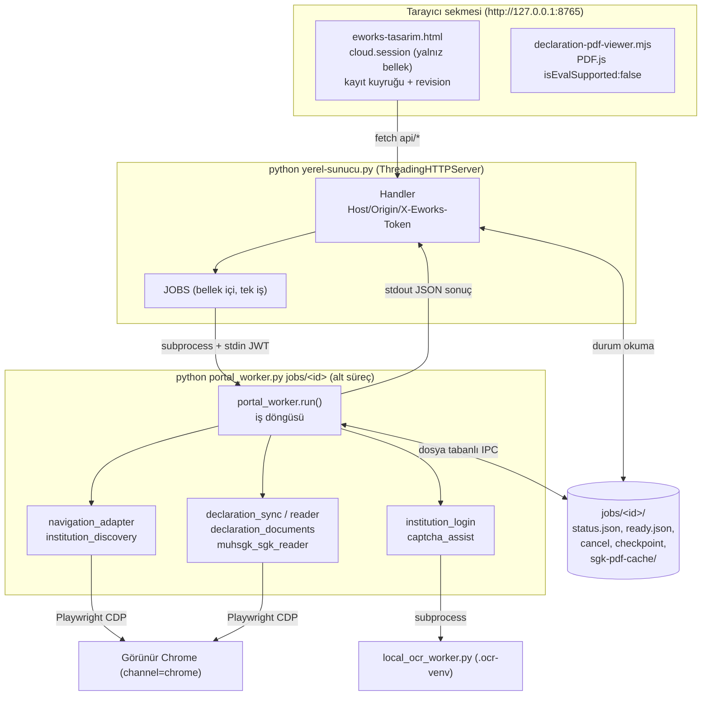

# 2.1 Sistem mimarisi

> Önce: [Genel bakış](../00-genel-bakis.md) · İlgili: [Bileşen ilişkileri](02-bilesen-iliskileri.md), [Veri modeli](03-veri-modeli.md)

## Mimari stil

**Yerel kalın istemci + BaaS (Supabase).** Uygulama sunucusu yoktur. İş mantığı üç yerde yaşar:

| Katman | Nerede | Sorumluluk |
|---|---|---|
| Sunum + iş mantığı | `eworks-tasarim.html` (tarayıcı) | Ekranlar, firma/görev/not yönetimi, birleştirme kuralları, Supabase çağrıları, kayıt kuyruğu |
| Yerel orkestrasyon | `yerel-sunucu.py` | Statik dosya sunumu, iş başlatma/izleme, robot sonucunun şema doğrulaması |
| Entegrasyon (ACL) | `Eworks-Python-Robot/*` | GİB ekranlarını okuma, normalizasyon, PDF indirme/yükleme |
| Kalıcılık + güvenlik | Supabase | Auth, RLS, sürümlü commit RPC, Vault, Storage, Edge Function |

## Çalışma zamanı görünümü

### Süreç ve zaman sınırları

- Köprü portu sabit: `127.0.0.1:8765` (`yerel-sunucu.py` sonu). Host başlığı `127.0.0.1:8765`/`localhost:8765` dışındaysa 403 (DNS rebinding koruması).
- Her köprü süreci başlangıçta rastgele `TOKEN` üretir (`secrets.token_urlsafe(32)`), sayfa bunu `GET api/connection` ile alır.
- İş zaman aşımı: sözleşme işi ~930 sn, beyanname senkronu ~7230 sn.
- Aynı anda tek iş çalışır (`JOBS` sözlüğü + kilit). Sayfa yenilenirse oturum kaybolur, yeniden giriş gerekir.

## Teknoloji yığını

| Katman | Teknoloji | Sürüm/sabitleme |
|---|---|---|
| Ön yüz | HTML + vanilla JS, inline CSS, supabase-js **yok** (çıplak `fetch`) | — |
| PDF görüntüleme | pdfjs-dist | 6.4.299, vendor + bütünlük özeti |
| Köprü | Python stdlib `http.server`, `xlrd` | Python 3.11+ (Baslat.ps1 3.13 yolunu sabit kodlar), `xlrd>=2,<3` |
| Robot | playwright, requests, supabase, python-dotenv, pypdf, tzdata | Aralık sabitleme (`>=x,<y`), kilit dosyası yok |
| OCR | pytesseract + OpenCV + numpy + Pillow (ana venv), ddddocr (ayrı `.ocr-venv`) | `ddddocr==1.6.1` |
| Veri | Supabase Postgres, Vault, Storage | SQL betikleri elle |
| Sunucu işlevi | Deno Edge Function, `npm:@supabase/supabase-js@2` | Ana sürüm dışında sabitlenmemiş |
| İşletim sistemi | Windows (PowerShell başlatıcı, `.ocr-venv/Scripts/python.exe`, `CREATE_NO_WINDOW`) | — |

## Dağıtım görünümü

| Öğe | Nasıl kurulur | Nerede çalışır |
|---|---|---|
| SQL şeması | `supabase-kurulum.sql` → `supabase-gib-vault.sql` → `supabase-firma-gib-vault.sql` → `supabase-beyanname-belgeleri.sql` SQL Editor'e elle | Supabase projesi |
| Eski CLI tabloları | `Eworks-Python-Robot/gib_sozlesmeler-kurulum.sql`, `sistem_loglari-kurulum.sql` | Supabase (yalnız eski CLI kullanır) |
| Edge Function | `supabase functions deploy gib-account` veya Dashboard; `verify_jwt=false`; gizli: `SUPABASE_SERVICE_ROLE_KEY`, `EWORKS_ALLOWED_ORIGINS` | Supabase Edge |
| Portal + köprü + robot | Klasör kopyası, `pip install`, `Baslat.ps1` | Müşavirin Windows bilgisayarı |
| Yapılandırma | `SUPABASE_URL`/publishable key **üç yerde** elle: `eworks-tasarim.html` (~1297), `cloud_credentials.py` (5-6), robot `.env` (eski CLI) | — |

Docker ile yerel Supabase denemesi: [../../docker/README.md](../../../../eski/hkazaz/docker/README.md) (robot Docker'da çalışmaz: görünür Chrome + CAPTCHA).

## Bağlam sınırları (DDD diliyle)

Kod DDD ile yazılmamıştır; aşağıdaki ayrım, Mükellef Takip ile karşılaştırma ve olası taşıma için yapılmıştır.

| Örtük bağlam | Eworks'teki yeri | Mükellef Takip karşılığı |
|---|---|---|
| Kimlik | Supabase Auth | `identity` |
| Mükellef/firma | `payload.firms` | `taxpayers` |
| GİB veri alımı (ACL) | Robot modülleri | `data-intake`, `tax-filing` |
| Beyanname/belge | `payload.notes` + Storage | `tax-filing`, `documents` |
| SGK | `sgkCoverage`, MUHSGK okuyucu | `social-security` |
| Görev/hatırlatma | `payload.tasks`, `alertsRead` | `workspace`, `notifications` |
| Kurum şifresi | Vault + Edge Function | `VaultService` (şifreli saklama, otomatik giriş yok) |
