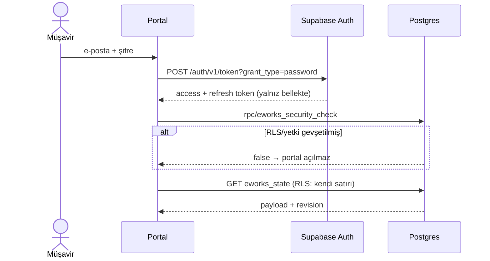
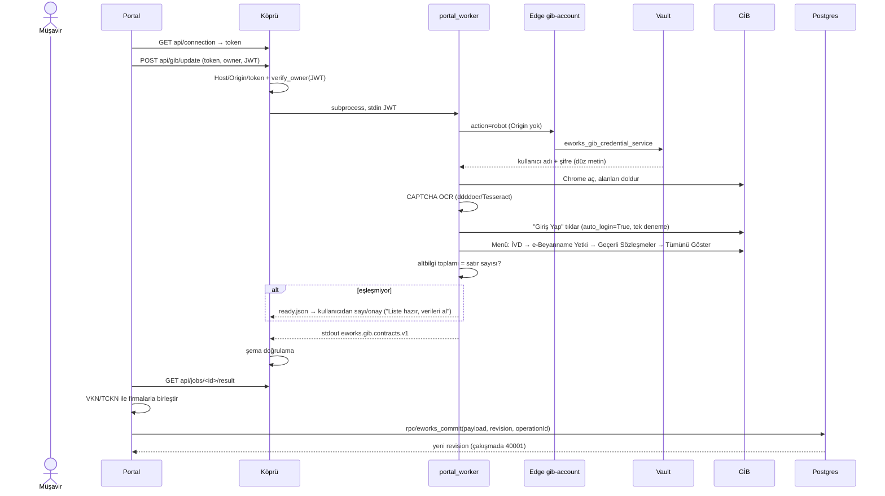
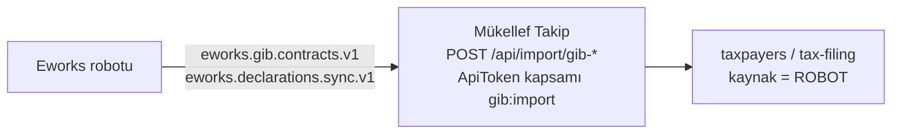

# 2.2 Bileşen ilişkileri ve akışlar

> Önce: [Sistem mimarisi](01-sistem-mimarisi.md) · İlgili: [Veri modeli](03-veri-modeli.md), [Güvenlik mimarisi](04-guvenlik-mimarisi.md)

## Bağımlılık matrisi

Satırdaki bileşen, sütundakini çağırır/kullanır.

| ↓ çağıran / çağrılan → | Portal (HTML) | Köprü | Robot | Edge `gib-account` | Postgres (RLS/RPC) | Storage | GİB |
|---|---|---|---|---|---|---|---|
| **Portal** | — | `api/*` (HTTP) | — | `status`, `save` | `eworks_state` okuma, `eworks_commit`, `eworks_security_check` | PDF okuma (authenticated) | — |
| **Köprü** | statik dosya sunar | — | `subprocess` + stdin + dosya IPC | — | `/auth/v1/user` (`verify_owner`) | — | — |
| **Robot** | — | stdout JSON, `jobs/<id>/*.json` | — | `robot` (şifre alma) | `eworks_state` okuma (bilinen belgeler) | PDF yükleme + geri okuma | Playwright |
| **Eski CLI** (`main_orchestrator.py`) | — | — | modülleri paylaşır | — | `gib_sozlesmeler`, `sistem_loglari` (supabase-py) | — | Playwright |

Gizli bağlar (sözleşmesi yazılı olmayan):
- Robot, portalın JSONB iç şeklini bilir: `payload.notes[].attachments` (`declaration_documents.py:17-26`), firma kimlikleri (`firm_credentials`).
- Firma Vault fonksiyonu firmayı `eworks_state.payload->'firms'` içinde arar (`supabase-firma-gib-vault.sql`).
- Köprü, robot klasörünü `sys.path` ile içe alır (`yerel-sunucu.py:11-13`).
- `HEADERS`/`FIELDS` sözleşme alan listesi üç yerde tekrar eder (`yerel-sunucu.py:16-17`, `portal_worker.py:22-27`, `gib_automation.py:22`).

## Arayüz sözleşmeleri

### Portal ↔ köprü (aynı köken)

| Uç nokta | Yöntem | Başlıklar | Gövde sınırı | Açıklama |
|---|---|---|---|---|
| `/api/connection` | GET | Host | — | `{token, ready, mode}` döner |
| `/api/gib/update` | POST | Host, Origin, `X-Eworks-Token`, `X-Eworks-Owner`, `Authorization` | 4 KB | Sözleşme işi başlatır |
| `/api/declarations/sync` | POST | aynı | 64 KB | Beyanname senkron işi (kapsam: dönem + mükellef listesi) |
| `/api/declarations/review` | POST | aynı | 4 KB | Elle konan `declaration-review-source.json`'u okur |
| `/api/jobs/<id>` | GET | Token, Owner | — | İş durumu |
| `/api/jobs/<id>/result` | GET | Token, Owner | — | Doğrulanmış sonuç |
| `/api/jobs/<id>/{continue,cancel,focus}` | POST | Host, Origin, Token | 4 KB | Kullanıcı "liste hazır", iptal, pencereyi öne getir |

### Köprü ↔ robot

- Başlatma: `python portal_worker.py jobs/<id>`; stdin: `{"accessToken": "<JWT>"}`; `jobs/<id>/request.json`: `ownerId`, kapsam.
- Ara durum: robot `status.json`, `ready.json`, `worker.json` (pid) yazar; köprü `cancel`, `focus-<pid>.request` dosyası bırakır.
- Sonuç: stdout'ta tek JSON. Şemalar:
  - `eworks.gib.contracts.v1` — `{schema, sourceType:'gib_live', rows:[...], ...}` (`portal_worker.py:321`)
  - `eworks.declarations.sync.v1` — beyanname listesi + belge referansları
  - Yan ürünler (diske): `eworks.advisor.contract-evidence.v1`, `eworks.gib.navigation.v1`
- Köprü sonucu tekrar doğrular (`yerel-sunucu.py:74-93`); geçersizse iş "hata" olur.

### Robot ↔ Supabase

| Çağrı | Kimlik | Kaynak |
|---|---|---|
| `POST /functions/v1/gib-account {action:'robot'[,firmId]}` | Kullanıcı JWT, Origin **yok** | `cloud_credentials.py:27-43`, `firm_credentials.py` |
| `GET /rest/v1/eworks_state` | Kullanıcı JWT + publishable key | `declaration_documents.py:17-26` |
| `POST /storage/v1/object/eworks-declarations/<uid>/<kimlik>/<kayıtId>/<tür>-<sha256>.pdf` | Kullanıcı JWT | `declaration_documents.py:61-82` |
| `GET /storage/v1/object/authenticated/...` (geri okuma) | Kullanıcı JWT | aynı |

## Akış 1 — Oturum açma

## Akış 2 — GİB sözleşme güncelleme ("Bilgileri Güncelle")

Notlar:
- Otomatik giriş 21.10 sürümüyle geldi (`8cb6397`); `Kullanim.md` ve `robot-config.json` hâlâ "CAPTCHA'yı kullanıcı tamamlar" der → [G-01](../04-eksikler-ve-riskler/02-guvenlik-riskleri.md#g-01).
- Kaynakta artık bulunmayan firma otomatik silinmez.

## Akış 3 — Beyanname senkronu ve PDF'ler

1. Portal kapsamı (dönem aralığı + mükellef kimlikleri) `POST api/declarations/sync` ile gönderir (≤64 KB, `declaration_sync.py:48-69` doğrular).
2. Robot e-Beyanname'ye (OAuth) girer (`institution_login.py`), listeyi sayfa sayfa okur (`declaration_reader.py`), checkpoint dosyası tutar.
3. Her kayıt için beyanname/tahakkuk PDF'ini indirir (`declaration_document_adapter.py`), `%PDF` + yapı doğrular, SHA-256 hesaplar, daha önce yüklenmemişse Storage'a yükler ve geri okuyup özeti karşılaştırır (`declaration_documents.py`).
4. MUHSGK ise SGK tahakkuk/hizmet listesi PDF'lerini ayıklar (`muhsgk_sgk_reader.py`), çalışan sayısını çıkarır (`sgk_employee_count.py`).
5. Sonuç `eworks.declarations.sync.v1` olarak köprüye döner; portal `notes`/`sgkCoverage`/`declarationLastSync` alanlarını günceller ve `eworks_commit` yapar.

## Akış 4 — GİB şifresini kaydetme

Portal → Edge `action=save` (Origin izinli listede) → `eworks_gib_credential_service('save')` → `vault.create_secret`/`update_secret`. Tarayıcı `status` ile yalnız `{configured, updatedAt}` görür. Firma bazlı şifre: aynı akış, `firmId` ile `eworks_firm_gib_credential_service`.

## Mükellef Takip ile entegrasyon noktası (öneri)

Şema adları sürümlüdür; entegrasyonda şemanın kendisi sözleşme olarak dondurulmalı ve JSON Schema dosyası olarak yazılmalıdır (bugün yalnızca kod içinde örtük).
