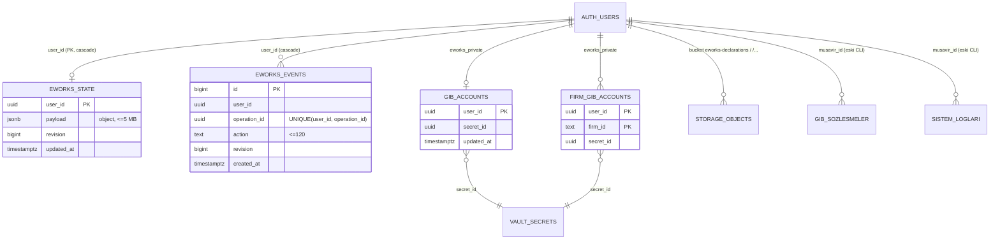

# 2.3 Veri modeli

> Önce: [Bileşen ilişkileri](02-bilesen-iliskileri.md) · İlgili: [Güvenlik mimarisi](04-guvenlik-mimarisi.md)

## Genel yaklaşım

**Kullanıcı başına tek belge.** Bir müşavirin tüm verisi (`firms`, `tasks`, `notes` …) `public.eworks_state` tablosunda tek satırın `payload jsonb` sütunundadır. Her kayıtta belgenin tamamı yeniden yazılır; eşzamanlılık `revision` (iyimser kilit) + danışma kilidi ile çözülür.

## Tablolar

### `public.eworks_state` — `E1/Eworks-Portal/supabase-kurulum.sql`

| Sütun | Tür | Not |
|---|---|---|
| `user_id` | uuid PK → `auth.users` ON DELETE CASCADE | Kiracı = kullanıcı |
| `payload` | jsonb, `jsonb_typeof='object'` | `firms` ve `tasks` dizi olmak zorunda |
| `revision` | bigint | Her commit +1 |
| `updated_at` | timestamptz | |

- RLS açık; politika `eworks_state_owner` (FOR ALL, `auth.uid()=user_id`).
- `anon`/`authenticated`'dan tüm yetkiler alınır, yalnız `SELECT` verilir. **Yazma yalnızca `eworks_commit` ile.**

### `public.eworks_events`

Commit günlüğü (içerik değil, yalnızca `operation_id`, `action`, `revision`). `UNIQUE(user_id, operation_id)` idempotensi sağlar: aynı işlem tekrar gelirse önceki revision döner. Yalnız okuma politikası vardır.

### RPC'ler

| Fonksiyon | Tür | Davranış |
|---|---|---|
| `eworks_commit(p_payload, p_expected_revision, p_operation_id, p_action)` | SECURITY DEFINER, `search_path=''` | `auth.uid()` zorunlu; ≤5 MB; danışma kilidi; idempotent; revision uyuşmazlığında `40001` |
| `eworks_security_check()` | SECURITY DEFINER, stable | RLS açık mı, `anon` yetkisi yok mu, politika `auth.uid()=user_id` mi → portal açılış kapısı |
| `eworks_gib_credential_service(p_owner, p_action, p_credentials)` | SECURITY DEFINER, yalnız `service_role` | `status` / `save` / `robot` |
| `eworks_firm_gib_credential_service(..., p_firm_id)` | aynı | Firma `payload->'firms'` içinde aranır |

### `eworks_private.gib_accounts`, `eworks_private.firm_gib_accounts` — Vault SQL

Şema ve tablolar `anon`/`authenticated`/`public`'ten tümüyle kapalı; RLS açık, politika yok (bilinçli: yalnız `service_role` erişir). Değer `vault.secrets` içinde `{"username","password"}` JSON'u olarak şifreli tutulur. `auth.users` silinince satır cascade ile gider ama **`vault.secrets` kaydı yetim kalır**.

### Storage: `eworks-declarations` — `supabase-beyanname-belgeleri.sql`

- Özel kova, yalnız `application/pdf`, 20 MB sınır.
- Yol: `<auth.uid()>/<mükellef kimliği>/<kayıtId>/<tür>-<sha256>.pdf`.
- Politikalar: SELECT ve INSERT, ilk klasör = `auth.uid()`; INSERT ayrıca 3 seviyeli yol + `.pdf` ister. UPDATE/DELETE politikası **bilerek yok** (içerik adresli, değişmez).

### Eski CLI tabloları — `E1/Eworks-Python-Robot/*.sql`

| Tablo | Sütunlar | Not |
|---|---|---|
| `gib_sozlesmeler` | `musavir_id`, `mukellef_vkn_tckn` (`^[0-9]{10,11}$`), `mukellef_unvan`, `sozlesme_no`, `durum`, `veriler jsonb`; PK (musavir, vkn, sozlesme) | RLS select/insert/update kendi satırı; `create policy` idempotent değil |
| `sistem_loglari` | `id`, `musavir_id`, `islem_adi(≤120)`, `durum(≤40)`, `mesaj(≤2000)`, `created_at` | Kullanıcı yazabilir → kurcalamaya açık |

Portal bu tabloları **kullanmaz**; yalnızca `main_orchestrator.py`.

## `payload` JSONB şeması (örtük)

Şema yazılı değildir; `eworks-tasarim.html` (~1344) ve robot okuyucularından çıkarılmıştır.

| Anahtar | Tür | İçerik |
|---|---|---|
| `firms` | dizi | `{id, name, taxNumber, identityNumber, contracts[], sourceType, ...}` — VKN/TCKN eşleşme anahtarı |
| `tasks` | dizi | Görevler/hatırlatmalar |
| `notes` | dizi | `{ownerId, identity, recordId, sourceType, page, attachments[]}` — beyanname kayıtları ve PDF referansları |
| `institutionReviews` | dizi | Kurum ekranı gözden geçirme sonuçları (`ownerId` + modül ile süzülür) |
| `institutionScopes` | nesne | Firma bazlı tarama kapsamı |
| `overrides` | nesne | Kullanıcının elle düzeltmeleri |
| `uploaded` | dizi | Yüklenen dosya metaverisi |
| `ledgers` | nesne | e-Defter durumları |
| `alertsRead` | dizi | Okunmuş uyarılar |
| `declarationLastSync` | nesne \| null | Son beyanname senkron zamanı/kapsamı |
| `sgkCoverage` | dizi | SGK belge kapsamı, çalışan sayıları |

**Kişisel veri:** `firms[].identityNumber` (TCKN), unvanlar, beyanname kayıtları, SGK çalışan sayıları. Kişisel verinin tamamı tek satırda, uygulama düzeyinde ek şifreleme olmadan durur (Supabase disk şifrelemesi dışında).

## Yerel diskteki veri (Supabase dışı)

| Yol (`E1/Eworks-Portal/` altında) | İçerik | Ömür |
|---|---|---|
| `jobs/<id>/advisor-contract-evidence.json` | Sözleşme listesi, VKN/TCKN | **Silinmez** |
| `jobs/<id>/declarations-sync-result.json`, checkpoint'ler | Kimlik listeleri, beyanname kayıtları | Silinmez |
| `jobs/<id>/sgk-pdf-cache/<kayıtId>/*.pdf` | Ham SGK PDF'leri | Silinmez |
| `jobs/<id>/declaration-query-warning.json` | GİB uyarı metni | Silinmez |
| `gib-sozlesmeler.json` / `.xls` | Eski dışa aktarım | Elle |

Hepsi `.gitignore`'da; ancak iş istasyonunda düz metin kalır → [G-04](../04-eksikler-ve-riskler/02-guvenlik-riskleri.md#g-04).

## Migration durumu

Migration aracı yoktur. Betikler SQL Editor'e elle yapıştırılır; çoğu `if not exists`/`drop policy if exists` ile tekrar çalıştırılabilir, `gib_sozlesmeler-kurulum.sql` değildir. Sürüm tablosu, geri alma, ortam (dev/prod) ayrımı yok. `hkazaz/docker/mert/supabase/migrations/` altında yerel deneme için tarih önekli kopyalar üretilmiştir (depoya alınmamış).
