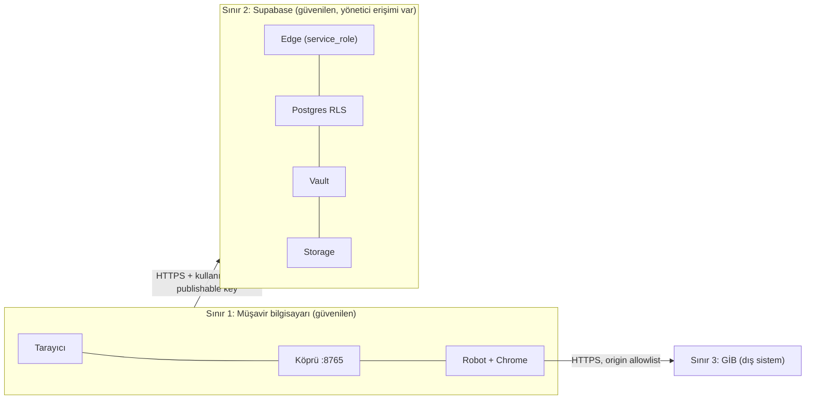

# 2.4 Güvenlik mimarisi (mevcut kontroller)

> Önce: [Veri modeli](03-veri-modeli.md) · Açıklar ve riskler: [04-eksikler-ve-riskler/02-guvenlik-riskleri.md](../04-eksikler-ve-riskler/02-guvenlik-riskleri.md)

Bu sayfa **var olan** kontrolleri anlatır. Eksikler ve riskler ayrı sayfadadır.

## Veri sınıflandırması

| Sınıf | Örnek | Nerede |
|---|---|---|
| Çok gizli | GİB kullanıcı adı + şifresi | Vault (şifreli), robot belleği (kısa süre) |
| Gizli | Supabase JWT/refresh token, köprü `TOKEN` | Tarayıcı belleği, robot belleği (stdin) |
| Kişisel veri (KVKK) | VKN/TCKN, unvan, beyanname/tahakkuk, SGK hizmet listesi (çalışan bilgisi) | `eworks_state.payload`, Storage, yerel `jobs/` |
| Genel | Menü/navigasyon gözlemleri, şema sürümleri | `jobs/`, kod |

## Güven sınırları

## Kontroller

### Kimlik doğrulama
- Supabase Auth e-posta/şifre. Oturum yalnızca sekme belleğinde (`cloud.session`); `localStorage` kullanılmaz → sayfa yenilenince oturum düşer.
- Edge Function `verify_jwt=false`, ancak her istekte `admin.auth.getUser(token)` ile doğrular (`index.ts:24-27`).
- Köprü, iş başlatan POST'larda JWT'yi `/auth/v1/user` ile doğrular ve `X-Eworks-Owner` ile eşleştirir (`cloud_credentials.verify_owner`).

### Yetkilendirme
- RLS: her tablo `auth.uid()=user_id`; yazma yalnız SECURITY DEFINER RPC ile, `search_path=''`.
- **Açılış kapısı:** `eworks_security_check()` RLS veya yetkiler gevşetilmişse `false` döner, portal yüklenmez (fail-closed).
- Vault tabloları ve şifre RPC'leri yalnız `service_role`; Edge kullanıcı kimliğini istemciden değil JWT'den alır (`p_owner = user.user.id`).
- Storage: yol ilk klasörü `auth.uid()`; UPDATE/DELETE yok.

### Sır yönetimi
- Service-role anahtarı yalnız Edge ortam değişkeninde. Robot `sb_secret_` önekli anahtarı reddeder (`logger_service.py:42`).
- GİB şifresi Vault'ta; tarayıcı `save`/`status` yapabilir, **geri okuyamaz**: `robot` eylemi `Origin` başlığı varsa 403 (`index.ts:45`).
- Robot, şifreyi doldurduktan sonra bellekteki değişkeni temizler (`cloud_credentials.py:62`, `institution_login.py` `finally`).
- JWT robota komut satırı/ortam değişkeni ile değil **stdin** ile geçer (süreç listesinde görünmez).
- Depoda gerçek anahtar yok; şablon değerler. `.gitignore` `.env*`, anahtar, PDF, XLS, `jobs/`, profil klasörlerini dışlar.

### Uygulama güvenliği
- Köprü: yalnız `127.0.0.1`'e bağlanır; Host kontrolü (DNS rebinding); POST'ta Origin + token; gövde sınırları (4 KB / 64 KB); statik dosya beyaz listesi + `vendor/pdfjs` yol kısıtı (`resolve` + `is_relative_to`).
- Yanıt başlıkları: `X-Content-Type-Options: nosniff`, `Referrer-Policy: no-referrer`, `Cache-Control: no-store`.
- Edge: Origin allowlist (`EWORKS_ALLOWED_ORIGINS`), 8 KB akış içi gövde sınırı, alan uzunluk doğrulaması, hata metinleri genelleştirilmiş.
- Ön yüz: `safe()` HTML kaçışlama (≈160 kullanım), PDF.js `isEvalSupported:false`, PDF.js vendor bütünlük özeti.
- Robot: GİB host allowlist (`trusted`/`safe_origin`), VKN/TCKN regex, UUID doğrulama, PDF `%PDF` + yapı kontrolü, SHA-256 geri okuma.

### Denetim ve log
- `eworks_events`: her commit için `operation_id`, `action`, `revision`.
- `logger_service._safe_message`: Bearer, JWT, `password=`, 10-11 haneli kimlik maskeleme. Tanılama dosyalarında uzun token/kimlik maskeleme.
- Vault okuma (`robot` eylemi) için **ayrı denetim kaydı yoktur** → [G-03](../04-eksikler-ve-riskler/02-guvenlik-riskleri.md#g-03).

### Hata yönetimi
- Fail-closed: kısmi/uyuşmayan sonuç kaydedilmez; köprü robot çıktısını şema düzeyinde yeniden doğrular.
- İstisnalar çoğunlukla tür adına indirgenir (iç ayrıntı sızmaz).

## Bilinçli kabul edilmiş sınırlar (kaynak belgelerde yazılı)

- Supabase proje yöneticileri Vault sırlarını çözebilir; uçtan uca şifreleme değildir (`Supabase-GIB-Hesap-Kurulum.md`).
- Köprünün token/owner kontrolleri internet için kimlik doğrulama değildir; sunucu internete açılmamalıdır (`Kullanim.md:49-50`).
- Kullanıcı silinince Vault sırları elle temizlenmelidir (`Supabase-GIB-Hesap-Kurulum.md:57-60`).
