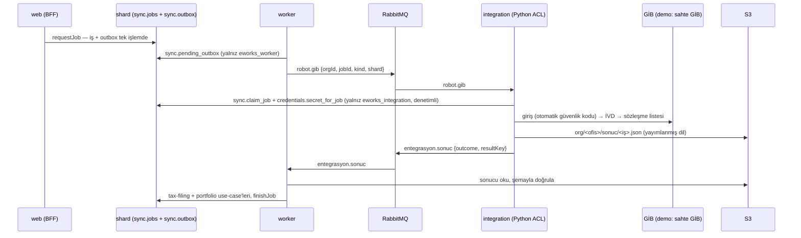

# sync — Senkron işleri

> Durum: **D aşaması (2026-10-25)**: kurum işi (iş kaydı + transactional outbox), durum makinesi, işçi taşıyıcısı ve sonuç uygulayıcısı, takılı iş temizliği, Python ACL ile uçtan uca GİB sözleşme listesi akışı (sahte GİB'e karşı). Gece planı, hız politikası ekranı, iptal yok. Kaynak: [06 §2](../hedef-mimari/06-kaynak-kod-yapisi-ddd-tdd.md#2-bounded-context-haritası-ve-ortak-dil), [02 §5](../hedef-mimari/02-kurum-entegrasyon-robotu.md). Kod: `packages/contexts/sync` — dışarıya yalnız `src/index.ts`.

| | |
|---|---|
| Sorumluluk | Entegrasyon kaydı, taşıma yolu (servis/robot, D19), iş planlama, istek bütçesi, iş/adım durumu, sonuç dağıtımı |
| Aggregate'ler (kök) | `SyncJob` (tablo `sync.jobs`); `Integration`, `RatePolicy`, `NightPlan` henüz yok |
| Yayınladığı mesajlar | `robot.<kurum>` (iş istendi, [şema](../../contracts/events/sync.is_istendi.v1.schema.json)); tükettiği: `entegrasyon.sonuc` ([şema](../../contracts/events/integration.sonuc.v1.schema.json)) |
| Özellik anahtarları | `firmalar.gib_sozlesmeler.sync`, `beyanname.senkron.*`, `yonetim.zamanlama.*`, `yonetim.hiz_politikasi.*` |
| Veritabanı şeması | `sync` (shard) |

## Akış

## Kurallar

- Durum makinesi (`domain/job.ts`): `queued → running → succeeded | failed | wrong_password`; `queued → cancelled | failed`. Sonuç durumları kesindir; tekrar gelen sonuç etkisizdir (en az bir kez teslim).
- Aynı hesapta aynı türde süren iş varsa yenisi açılmaz, mevcut iş döner (çift tıklama ikinci robot oturumu açmaz).
- Hesap yoksa, şifresi hatalıysa ya da kilitliyse iş açılmaz; **hatalı şifreli hesap yeniden denenmez** (05 §4) — yeni bilgi girilince hesap yeniden etkinleşir.
- İş kaydı ve kuyruk mesajı aynı işlemde yazılır (transactional outbox); işçi yalnız sunucu onayından sonra "yayımlandı" işaretler.
- İşi sahiplenme ve kurum sırrını okuma yalnız entegrasyon rolünün (`eworks_integration`) çağırabildiği, denetim kaydı bırakan veritabanı fonksiyonlarıyladır. Kullanıcı iş durumunu değiştiremez; sonucu yalnız işçi yazar.
- 20 dakikadan uzun "çalışıyor" kalan iş başarısız sayılır (işçi her dakika denetler).
- İstemciye giden iş görünümünde kurum yanıtı, şifre ve kişisel veri yoktur; yalnız durum, sabit Türkçe metin ve sayısal özet.

## BFF uçları ve ekranlar

- `POST /api/sync/gib-sozlesmeler` (`firmalar.gib_sozlesmeler.sync`), `GET /api/sync/isler/:id` (işin türüne ait yetki; başka ofisin işi 404).
- Bileşen: `apps/web/src/features/sync/KurumIsi.tsx` (başlat + iki saniyede bir durum yoklaması).

## Testler

- Birim: `test/domain/job.test.ts`, `test/application/jobs.test.ts`; işçi: `apps/worker/test/uygulayici.test.ts`.
- Entegrasyon (gerçek yığın): `test/infrastructure/isler.int.test.ts` (outbox yalnız işçiye, iş bir kez sahiplenilir, sır yalnız entegrasyon rolüne, kullanıcı sonucu değiştiremez, başka ofis görmez).
- Python ACL: `services/integration/tests/` (robot akışı süreç içi sahte GİB'e karşı gerçek tarayıcıyla).
- Kabul: `apps/web/e2e/gib-sozlesmeler.e2e.ts` — uçtan uca, sahte GİB'e karşı. `firmalar.gib_sozlesmeler.sync` canlı GİB kaydı girilene dek kırmızıdır (D33).

## Açık işler

- İptal (`beyanname.senkron.cancel`), gece planı, hız politikası ekranı, `Integration` kaydı (resmi web servis / robot seçimi, D19; bugün erişim yolu ACL'nin ortam parametresi, D38), adım bazlı durum.
- Zaman aşımına uğrayan robot işi şu an yalnız takılı iş temizliğiyle kapanır; entegrasyon tarafında zaman aşımı sonucu yayımlanmalı.
