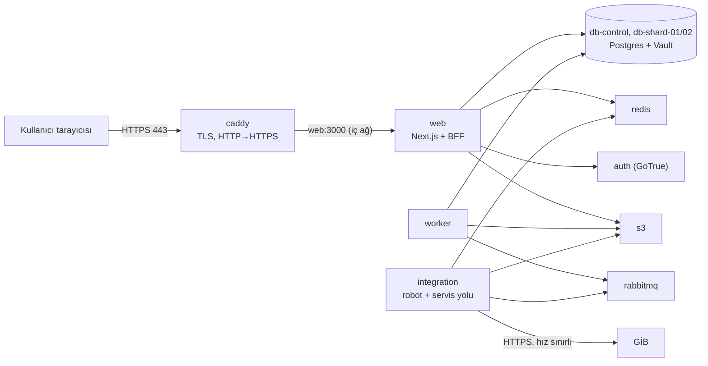

<!-- gezinti — node tools/docs/gezinti.mjs --yaz üretir, elle düzenlemeyin -->
[README](../../README.md) › [Genel bakış](../00-genel-bakis.md) › [Başlangıç rehberi](baslangic.md) › **VPS kurulumu**
<!-- /gezinti -->

# VPS kurulumu: canlı build ve üretim

Bu rehber Eworks'ü tek bir Linux sunucuya (VPS) Docker Compose ile kurmayı anlatır: imajlar sunucuda kaynaktan derlenir, alan adına otomatik HTTPS sertifikası alınır, dışarıya yalnız 80/443 açılır. Kurulumu yapan kişinin Linux komut satırına ve SSH'a temel düzeyde aşina olduğu varsayılır. Kubernetes seçeneği: [deploy/README.md](../../deploy/README.md#kubernetes) (iskelet, henüz kümede koşulmadı).

> **Canlı veri uyarısı.** Üretimde robot **gerçek GİB'e** bağlanır ve gerçek mükellef verisi işlenir (KVKK). Sunucu Türkiye'de olmalı (D4), kurum trafiği sabit ve kayıtlı bir IP'den çıkmalı (D14). Kurumla konuşan işlemler canlı doğrulama kaydı girilene kadar "Geliştiriliyor" görünür ([canli-dogrulama.md](canli-dogrulama.md), D33).

## 1. Ne kurulur



| Katman | Dosya | Ne yapar |
|---|---|---|
| Temel yığın | `deploy/compose/compose.yml` | Tüm servisler, kaynak sınırları, salt okunur container'lar |
| Üretim katmanı | `deploy/compose/compose.uretim.yml` | Caddy (otomatik HTTPS), web'in portu kapalı, `EWORKS_ORTAM=uretim`, güvenli çerez, sahte GİB yok |
| Ters vekil | `deploy/compose/caddy/Caddyfile` | Alan adı → `web:3000`, sıkıştırma, HSTS |

Dışarıdan yalnız Caddy'nin 80 ve 443 portu erişilebilir; veritabanları, kuyruk, depo ve web'in kendisi yalnız Docker'ın iç ağındadır.

## 2. Gerekenler

| Gereken | Not |
|---|---|
| VPS | Ubuntu 24.04 LTS, Türkiye'de. Boyut: pilot (≤ 5 ofis) için [hedef-mimari/04](../hedef-mimari/04-dagitim-compose-kubernetes.md) "Küçük" satırı; yalnız deneme için en az 4 vCPU / 8 GB / 60 GB SSD |
| Alan adı | Örn. `portal.ornek.com.tr`; DNS'te **A kaydı** VPS'in IP adresini göstermeli (sertifika için şart) |
| Erişim | SSH anahtarıyla giriş yapan, `sudo` yetkili bir kullanıcı |

## 3. Sunucuyu hazırla (bir kez)

```bash
# Sistem ve temel araçlar
sudo apt-get update && sudo apt-get upgrade -y
sudo apt-get install -y ca-certificates curl git ufw unattended-upgrades

# Güvenlik duvarı: yalnız SSH, HTTP, HTTPS (HTTP/3 için 443/udp)
sudo ufw allow OpenSSH
sudo ufw allow 80/tcp && sudo ufw allow 443/tcp && sudo ufw allow 443/udp
sudo ufw enable

# Docker Engine + Compose eklentisi (resmî depo)
sudo install -m 0755 -d /etc/apt/keyrings
sudo curl -fsSL https://download.docker.com/linux/ubuntu/gpg -o /etc/apt/keyrings/docker.asc
echo "deb [arch=$(dpkg --print-architecture) signed-by=/etc/apt/keyrings/docker.asc] https://download.docker.com/linux/ubuntu $(. /etc/os-release && echo "$VERSION_CODENAME") stable" | sudo tee /etc/apt/sources.list.d/docker.list
sudo apt-get update && sudo apt-get install -y docker-ce docker-ce-cli containerd.io docker-buildx-plugin docker-compose-plugin
sudo usermod -aG docker "$USER"     # çıkıp yeniden SSH ile gir (docker grubu yönetici yetkisine eşdeğerdir; yalnız kurulum kullanıcısına ver)

# Node.js 24 (yalnız yönetim betiği için; uygulama container'da çalışır)
curl -fsSL https://deb.nodesource.com/setup_24.x | sudo -E bash -
sudo apt-get install -y nodejs
```

Docker yayımlanan portlarda `ufw` kurallarını atlar; bu yüzden üretim katmanında Caddy dışında **hiçbir servis port yayımlamaz** (bir test bunu denetler: `tools/deploy/test/kipler.test.mjs`).

## 4. Kodu al ve ayarla

```bash
git clone https://github.com/hakangoktas69/Ortakcalisma.git eworks && cd eworks
git switch main                                  # üretim main'den kurulur (dev → main birleşimini kod sahibi yapar)
node tools/deploy/yigin.mjs sirlar               # deploy/compose/.env: güçlü rastgele parolalar ve anahtarlar
chmod 600 deploy/compose/.env
```

`deploy/compose/.env` dosyasına ekle (`nano deploy/compose/.env`):

```bash
EWORKS_ALAN_ADI=portal.ornek.com.tr
PUBLIC_URL=https://portal.ornek.com.tr
GIB_SAHTE_SUNUCU=
GIB_ISTEK_DK=30          # ilk haftalarda temkinli; sonra 60 (D25)
GIB_ERISIM_YOLU=robot    # canlı kayıt girilene kadar önerilen; doğrulanınca servis (D38, 02 §1b)
```

- `PUBLIC_URL` tarayıcıdaki adresle **aynı** olmalı (giriş ve çerezler buna bağlı). Betik bunu denetler; uymazsa başlatmaz.
- `.env` sunucudan çıkmaz, commit edilmez, yedeği şifreli saklanır: kaybedilirse VKN dizini (`TAX_ID_HMAC_KEY`) ve parolalar kurtarılamaz.

## 5. Kur ve başlat (canlı build)

```bash
node tools/deploy/yigin.mjs uretim
```

Komut ne yapar:

1. Ön koşulları denetler (alan adı, `https://` adres, sahte GİB kapalı); eksikse hiçbir şeyi başlatmaz.
2. İmajları **bu sunucuda kaynaktan derler** (ilk kez 15–30 dk): web (Next.js üretim derlemesi), işçi, entegrasyon (Playwright + OCR modeli).
3. Altyapıyı başlatır, migration'ları uygular. Demo hesabı ve sahte GİB **açılmaz**.
4. Uygulamayı ve Caddy'yi başlatır; Caddy ilk istekte Let's Encrypt'ten sertifika alır (DNS doğru ve 80/443 açık olmalı).
5. Kipi `.env`'e yazar (`YIGIN_KIPI=uretim`); sonraki `up`/`down` aynı katmanlarla çalışır. Bu kipte `test`, `e2e`, `gelistir`, `debug` reddedilir (sahte GİB, test verisi ve açık portlar üretime giremez); kabukta kalmış `YIGIN_PROFIL` dikkate alınmaz.

> Sunucuda önce `up` (demo) çalıştırma: demo ofisi ve kullanıcısı (`demo@eworks.test`) üretim veritabanına yazılır. Yanlışlıkla olduysa temiz başlangıç: `node tools/deploy/yigin.mjs down --sil` (tüm veriler silinir), sonra `uretim`.

Doğrula:

```bash
curl -s https://portal.ornek.com.tr/api/saglik          # {"durum":"ok"}
curl -sI http://portal.ornek.com.tr/ | head -1          # 308 → https
docker ps --format '{{.Names}}\t{{.Ports}}'             # yalnız *-caddy-1 dışarı port yayımlar
```

## 6. İlk ofis ve yönetici

Kendi kendine kayıt yoktur (D27); ilk ofisi ve yöneticisini komutla aç. Parola komut satırına ve geçmişe yazılmasın diye ortamdan okunur:

```bash
read -rsp "Yönetici parolası: " HESAP_SIFRE && export HESAP_SIFRE && echo
node tools/deploy/yigin.mjs hesap-ac ofis --ofis "Örnek Mali Müşavirlik" --eposta yonetici@ornek.com.tr --ad "Ad Soyad"
unset HESAP_SIFRE
```

Ofise kullanıcı eklemek: `node tools/deploy/yigin.mjs hesap-ac uye --ofis-id <uuid> --eposta … --ad "…" --rol personel` (aynı `HESAP_SIFRE` yöntemi). Yönetim ekranları henüz yok (durum.md açık konu 8).

## 7. Güncelle, geri al

```bash
cd ~/eworks && git pull                      # main'deki yeni sürüm
node tools/deploy/yigin.mjs uretim           # imajlar yeniden derlenir, migration'lar uygulanır, servisler yenilenir
```

- Güncelleme sırasında web birkaç saniye-dakika yanıt vermeyebilir (tek sunucu; kesintisiz yayın yok).
- Geri almak: `git checkout <önceki-sürüm-commit>` ve yeniden `uretim`. **Migration'lar geri alınmaz** (yalnız ileri düzeltme, kurallar): şema değiştiren bir sürümden geri dönmeden önce veritabanı yedeğini geri yüklemek gerekebilir. Bu yüzden her güncellemeden önce §8'deki yedeği al.

## 8. Yedek (elle; otomasyon henüz yok)

```bash
GUN=$(date +%F) && mkdir -p ~/yedek/$GUN
for db in db-control db-shard-01 db-shard-02; do
  docker exec eworks-$db-1 pg_dumpall -U postgres | gzip > ~/yedek/$GUN/$db.sql.gz
done
docker run --rm -v eworks_s3:/veri:ro -v ~/yedek/$GUN:/yedek alpine:3.22 tar czf /yedek/s3.tgz -C /veri .
cp deploy/compose/.env ~/yedek/$GUN/env && chmod 600 ~/yedek/$GUN/env
```

Yedekler sunucu dışına, şifreli olarak taşınmalı. **Sınanmadı:** geri yükleme ve Vault'taki şifreli kurum parolalarının başka bir sunucuda çözülebilmesi (Vault anahtarının yedeklenmesi). Otomatik, şifreli, sınanmış yedek açık konudur ([durum.md](../ai/durum.md)).

## 9. İşletim

| İş | Komut |
|---|---|
| Durum | `docker ps --format '{{.Names}}\t{{.Status}}'` |
| Günlükler | `docker logs -f eworks-web-1` (ya da `-worker-1`, `-integration-1`, `-caddy-1`); günlükte kişisel veri ve şifre yoktur |
| Yeniden başlat | `node tools/deploy/yigin.mjs up` (kip `uretim` olarak kalır) |
| Durdur | `node tools/deploy/yigin.mjs down` (veriler kalır) |
| Kurum hızı | `.env`'de `GIB_ISTEK_DK`, ardından `up` |
| Erişim yolu | `.env`'de `GIB_ERISIM_YOLU`, `ERISIM_GIB_EBEYANNAME` (`robot` \| `servis`), ardından `up` |

## 10. Yapma

- `debug` ya da `gelistir` kipini sunucuda kullanma (hata ayıklama ve veritabanı portları açılır); betik bunu `--uretimden-cik` olmadan reddeder.
- `.env`'i, yedekleri, günlük dosyalarını sunucu dışına şifresiz çıkarma; repoya ekleme.
- `GIB_SAHTE_SUNUCU`'ya değer verme (betik ve uygulama zaten reddeder).
- Hesap başına farklı IP, proxy ya da VPN ile kurum denetimini atlatmaya çalışma (K-22).

<!-- gezinti — node tools/docs/gezinti.mjs --yaz üretir, elle düzenlemeyin -->

---

[README](../../README.md) › [Genel bakış](../00-genel-bakis.md) › [Başlangıç rehberi](baslangic.md) › **VPS kurulumu**
<!-- /gezinti -->
