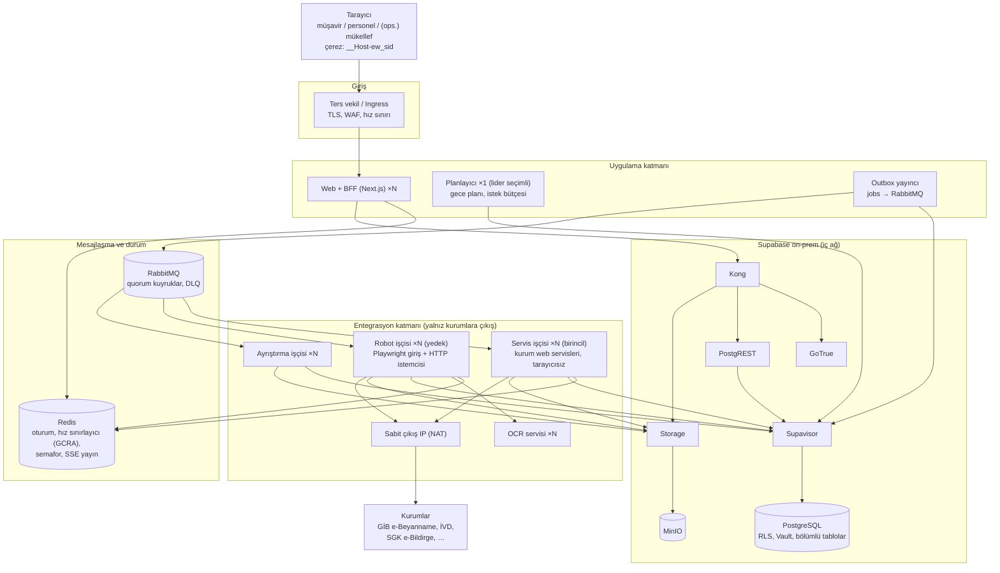
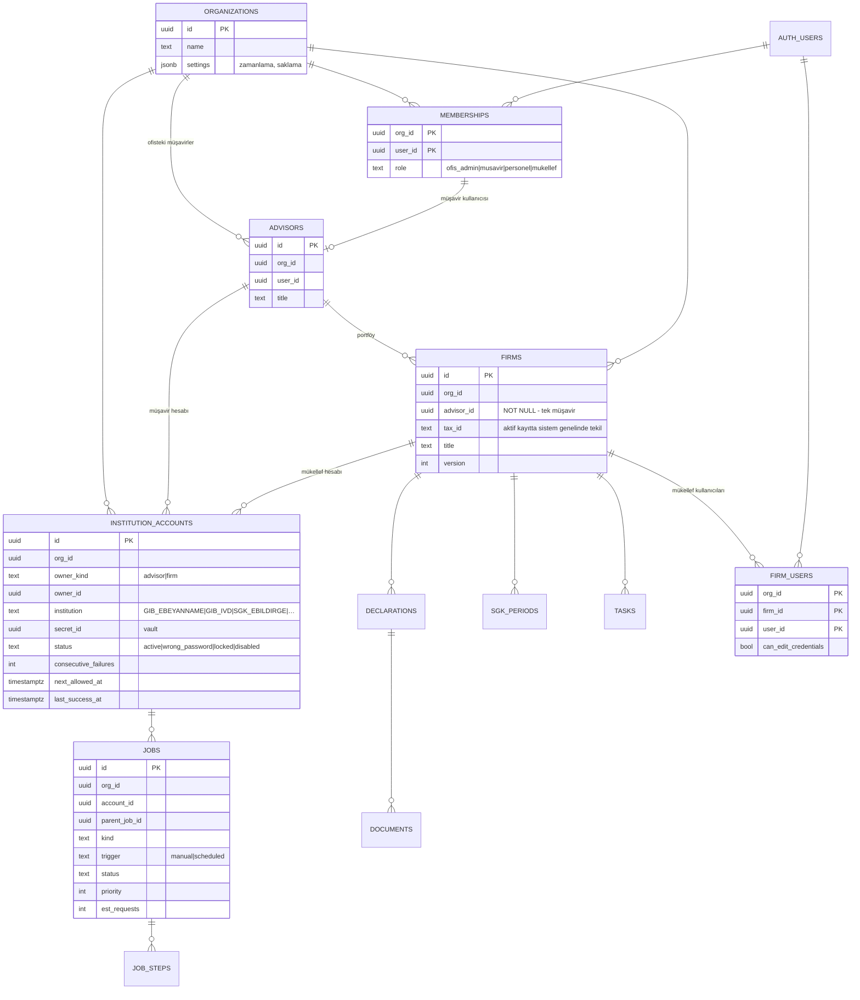
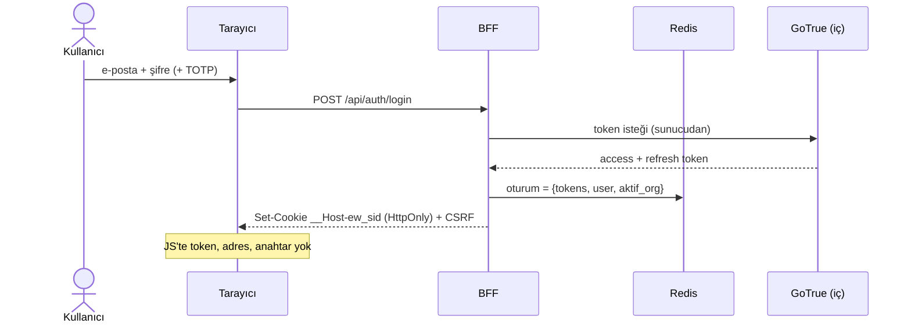
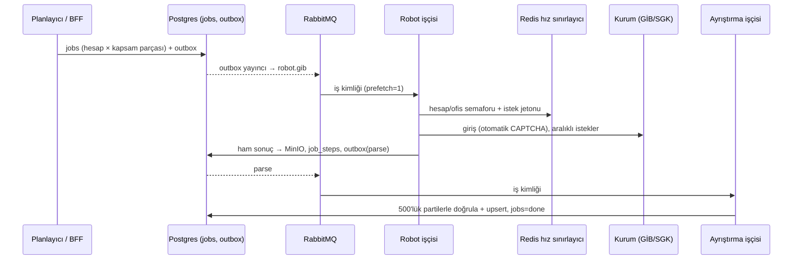

# 5.1 Hedef mimari — çok kiracılı SaaS Eworks (genel bakış)

> Önce: [Sistem mimarisi (bugün)](../arsiv/mevcut-durum/02-mimari/01-sistem-mimarisi.md) · Sonra: [5.2 Kurum entegrasyon robotu](02-kurum-entegrasyon-robotu.md), [5.3 Kaynak verimliliği ve kapasite](03-kaynak-verimliligi-ve-kapasite.md), [5.4 Dağıtım: Compose / Kubernetes](04-dagitim-compose-kubernetes.md)
> Kapsam: yalnızca **Eworks portalı** (Mükellef Takip değil). Önceki güvenlik risk listesi (G-NN) bu belgenin girdisi değildir. Durum: kararlar alındı, ayrıntılar öneri (23.10.2026).

## Alınmış kararlar (23.10.2026, Hakan)

| # | Karar |
|---|---|
| D1 | Ön yüz ve BFF **Next.js**. |
| D2 | **SaaS**: tek merkezi kurulum, kullanıcı tarafında kurulum yok (masaüstü ajanı, eklenti, yerel yazılım yok). |
| D3 | **Localhost köprüsü ve masaüstü ajanı yok.** Kurum robotu backend'de, yatay ölçeklenir, paralel çalışır. |
| D4 | Supabase **on-premise** (self-hosted). |
| D5 | Tarayıcı JavaScript'inde token, Supabase adresi/anahtarı veya arka uç servis adresi yok. |
| D6 | GİB, SGK ve diğer kurum sitelerinde **CAPTCHA varsayılanı otomatiktir** (sunucu OCR). Etkileşimli mod yoktur. **Gece toplu işleri baştan sona otomatik** çalışır. |
| D7 | Kurumlara giden istekler, paralel çalışılsa bile **dağıtık hız sınırıyla aralıklı** gönderilir. **Toplam dakikalık istek sayısı parametredir** (kurum ve hesap bazında da ayarlanabilir). |
| D8 | Kullanıcı modeli: **ofis → mali müşavirler → her müşavirin mükellefleri**. Hem müşavirin GİB hesabıyla hem de **her mükellefin kendi GİB (ve SGK) hesabıyla** işlem yapılır. Örnek: 5 müşavir × 300 mükellef = **1.505 kurum hesabı** tek ofiste. |
| D9 | Tüm servisler bellek/CPU açısından tutumlu çalışır. Büyük veri **küçük parçalar** halinde işlenir. |
| D10 | Kurulum **seçimli**: aynı imajlarla **Docker Compose** veya **Kubernetes**. Donanıma ve kullanıcı ölçeğine göre seçilir. |
| D11 | **(24.10)** Pilot **30 istek/dk** ile başlar ve hatasız geçen her aralıkta kademeli artar. **Bağlantı hatası alındıkça hız düşürülür** ([5.2 §4.3](02-kurum-entegrasyon-robotu.md#43-kademeli-başlangıç-ve-hataya-göre-düşüş-d11)). |
| D12 | **(24.10)** **Mükellefler de portala girer** (`mukellef` rolü, ilk sürümde). |
| D13 | **(24.10)** Eworks'teki **tüm SGK ekranları ilk sürümde**. SGK verisi resmî SGK sitelerinden, **müşavirin yenileme talebiyle** mükellefleri için topluca çekilir ([5.2 §2.3](02-kurum-entegrasyon-robotu.md#23-sgk-kapsamı-d13)). |
| D14 | **(24.10)** Çıkış IP'si: talep edilen "hesap başına ayrı IP (spoofing)" uygulanmaz. Sabit, az sayıda kayıtlı IP kullanılır (gerekçe §11). |
| D15 | **(24.10)** PDF'ler varsayılan **7 gün** saklanır; süre sistem parametresidir. Yönetici **toplu temizlik** yapabilir ([5.2 §9](02-kurum-entegrasyon-robotu.md#9-belge-pdf-saklama-ve-toplu-temizlik-d15)). |
| D16 | **(24.10)** Bir mükellef **yalnız bir müşavirle** çalışır; bir müşavir çok mükellefe hizmet verir ([5.5 §2](05-yetki-ve-hesap-modeli.md#2-müşavirmükellef-ilişkisi-d16)). |
| D17 | **(24.10)** Sayfa ve işlem bazında **hiyerarşik yetki**. Personelin firma kapsamını ve yetkilerini müşavir/ofis yöneticisi belirler. Müşavir izin verirse personel müşavirin kurum hesabını kullanır ([5.5 §3](05-yetki-ve-hesap-modeli.md#3-hiyerarşik-yetki-modeli-d17)). |
| D18 | **(24.10)** Mükellef onay verirse müşavir onun GİB/SGK/diğer bilgilerini kaydedip kullanır. Mükellef müşavirin hiçbir bilgisini kullanamaz ([5.5 §4](05-yetki-ve-hesap-modeli.md#4-kurum-hesabı-kullanımı-d17-d18)). |
| D19 | **(24.10)** Kurum entegrasyonlarında **web servisleri birincil** yoldur. **Robot yedek** (stepne) olarak kalır ve servis olmayan entegrasyonlarda kullanılır ([5.2](02-kurum-entegrasyon-robotu.md)). |
| D20 | **(24.10)** Kaynak kod **DDD**'ye göre yapılanır: bounded context'ler domain paketi, BFF ucu, ön yüz özelliği, DB şeması ve testlerde aynı adla görünür ([5.6](06-kaynak-kod-yapisi-ddd-tdd.md)). |
| D21 | **(24.10)** Depoyu açan yazılımcı projenin resmini hemen anlamalıdır: README haritası, bağlam sayfaları, özellik durumu ([5.6 §5](06-kaynak-kod-yapisi-ddd-tdd.md#5-depoyu-açan-resmi-görür-d21)). |
| D22 | **(24.10)** Geliştirme **TDD** ile yapılır. Ön yüzde modül, sayfa ve işlemler test durumuna göre işaretlenir; **tamamlanmayanlar kırmızıdır** ([5.6 §7–8](06-kaynak-kod-yapisi-ddd-tdd.md#8-özellik-durumu-ve-ön-yüzde-kırmızıyeşil-işaretleme-d22)). |
| D23 | **(24.10)** İş verisi **10 yıl** saklanır; müşavir devrinde eski ofiste kalan veri de 10 yıl, salt okunur ([5.7 §3](07-veri-saklama-ve-sharding.md#3-shard-içinde-zamana-göre-bölümleme-ve-10-yıl-saklama-d23)). |
| D24 | **(24.10)** Veritabanında **sharding baştan**: kontrol düzlemi + `org_id` ile kiracı shard'ları, shard içinde zamana göre bölümleme ([5.7](07-veri-saklama-ve-sharding.md)). |
| D25 | **(24.10)** Kurum istek hızı **60 istek/dk ile başlar** (D11'deki 30'un yerine); hatasızken artar, bağlantı hatasında düşer. |
| D26 | **(24.10)** Ölçek varsayımı: **500 ofis**, hesap başına **60 istek/dk**, gece penceresi **20:00–09:00** ([5.3](03-kaynak-verimliligi-ve-kapasite.md)). |
| D27 | **(24.10)** **Satış portalı** (`eski/mukellef-takip/satis` deseni) yeni yapının içindedir; **ofis, müşavir ve mükellef hesapları satış portalından açılır**; mükellef onayı satış sözleşmesiyle alınır ([5.8 §2](08-depo-yeniden-yapilanmasi.md#2-satış-portalı-d27)). |
| D28 | **(24.10)** Depodaki **tüm klasörler `eski/` altına** taşınır, yeni yapı **depo kökünde** kurulur, hafıza/kanca/ekip hafızası yolları güncellenir ([5.8](08-depo-yeniden-yapilanmasi.md)). **Uygulandı (24.10, `yeniden-yapilanma` dalı)**. |
| D29 | **(24.10)** Sistem canlıda değil: **veri taşıma yok**, doğrudan yeni sistem kullanılır. `eski/mert/eworks` yeniden yapılandırılan projenin kaynağıdır (M-15 kapandı). |
| D30 | **(24.10)** Kırmızı (tamamlanmamış) özellikler **tüm ortamlarda tüm kullanıcılara** görünür ([5.6 §8.4](06-kaynak-kod-yapisi-ddd-tdd.md#84-ortam-davranışı)). |
| D31 | **(24.10)** Yeni yapıda da Claude/Codex vb. ajanların **bağlam ve hafıza dosyaları git ile paylaşılır ve sürümlenir**. Claude veya Codex ile yapılan değişiklik öteki aracın dosyalarını **otomatik ve karşılıklı** günceller; iş bitirme betikleri her iki tarafı da kurar ([5.9](09-yapay-zeka-ajan-baglami.md)). |
| D32 | **(24.10)** **Mükellef Takip arşivdir:** `eski/mukellef-takip` altında geliştirme sürmez; CI iş akışı yalnız elle tetiklenir ([ADR 0001](../adr/0001-depo-yeniden-yapilanmasi.md)). |
| D33 | **(25.10)** **Kurumla konuşan özellikler canlı doğrulama ister:** sahte kurum sunucusuna karşı kabul testleri geçse bile, Hakan'ın hesabıyla canlı koşu yapılıp `packages/feature-registry/canli-dogrulamalar.json`'a kaydı (tarih, kim, sayılarla sonuç, sürüm) girilene kadar kırmızı kalırlar ([5.6 §8](06-kaynak-kod-yapisi-ddd-tdd.md#8-özellik-durumu-ve-ön-yüzde-kırmızıyeşil-işaretleme-d22)). |
| D34 | **(25.10)** **Shard erişimi doğrudan `pg` ile:** BFF ve işçi shard'a PostgREST yerine doğrudan bağlanır; RLS her işlemde kullanıcı JWT claim'leriyle (`authenticated` rolü) uygulanır ([5.7 §2.1](07-veri-saklama-ve-sharding.md#21-yönlendirme)). |
| D35 | **(25.10)** **Nesne deposu S3 uyumlu, Compose'da SeaweedFS:** MinIO topluluk imajları yayından kalktığı için (zorunlu değişiklik). Kod S3 portuna yazılır. |
| D36 | **(25.10)** **Beyanname ve SGK verisi aynı GİB oturumunda, sözleşme kanıtıyla:** robot önce sözleşme listesini okur; e-Beyanname ve MUHSGK'nın SGK bildirimleri yalnız o listede geçerli "Aracılık ve Sorumluluk" sözleşmesi olan mükellef için sorgulanır, işçi kanıtı yeniden denetler (eski kurum incelemesi kuralı). SGK hizmet listesinden yalnız tekil çalışan sayısı çıkar; kişi bilgisi ACL dışına çıkmaz. SGK'nın kendi sistemleri sonraki fazdır ([baglamlar/tax-filing](../baglamlar/tax-filing.md), [social-security](../baglamlar/social-security.md)). |

## 1. Hedefler ve kısıtlar

| # | Gereksinim | Mimariye etkisi |
|---|---|---|
| H1 | Yüzlerce eşzamanlı kullanıcı; ofis → müşavir → mükellef | Kiracı = ofis. Müşavir bazında mükellef portföyü. Rol + atama tabanlı yetki |
| H2 | Ofis başına binlerce kurum hesabı (D8) | Kurum hesabı birinci sınıf varlıktır (`institution_accounts`). İşler hesap bazında planlanır |
| H3 | Kurumun IP'yi engellememesi (D7) | **Darboğaz CPU değil, izin verilen istek hızıdır.** Kapasite planı istek bütçesine göre yapılır ([5.2](02-kurum-entegrasyon-robotu.md), [5.3](03-kaynak-verimliligi-ve-kapasite.md)) |
| H4 | Tarayıcıda açık bilgi yok (D5) | BFF. Oturum Redis'te, tarayıcıda yalnız `__Host-` HttpOnly çerez |
| H5 | Supabase on-prem (D4) | İç ağda, dışarıya kapalı. Yedek, güncelleme ve izleme bizde |
| H6 | Kaynak tutumluluğu (D9) | Her servis için kaynak sınırı, sayfalama, akış (stream), parçalı iş, küçük mesaj |
| H7 | Compose veya K8s (D10) | 12-faktör imajlar, aynı ortam değişkenleri, sağlık uçları, zarif kapanış |

## 2. Bugünden hedefe

| Konu | Bugün | Hedef |
|---|---|---|
| Kiracı | Supabase kullanıcısı | `organizations` (ofis) + `memberships` (rol) + müşavir portföyü |
| Kurum hesapları | Müşavir başına 1 GİB hesabı (+ firma Vault denemesi) | `institution_accounts`: müşavir ve mükellef hesapları, GİB/SGK/diğer, Vault'ta |
| Veri modeli | Kullanıcı başına tek JSONB (5 MB) | İlişkisel tablolar, `org_id`, `version`, bölümleme |
| Ön yüz | 244 KB tek HTML, doğrudan Supabase | Next.js; tarayıcı yalnız BFF'e konuşur |
| Robot | Müşavirin PC'si, görünür Chrome, tek iş | Backend işçileri, kuyruk, merkezi hız sınırlayıcı, otomatik CAPTCHA |
| Kuyruk | Yok (bellek içi tek iş) | **RabbitMQ** (iş dağıtımı) + Postgres `jobs` (durumun kaynağı) |
| Zamanlama | Yok | Gece toplu planlayıcı (istek bütçesine göre) |
| Kurulum | SQL Editor'e elle | Migration + CI. Compose veya Helm |

## 3. Bileşen mimarisi

| Bileşen | Görev | Durum |
|---|---|---|
| Web + BFF (Next.js) | Ekranlar (SSR), `/api/*`, oturum, SSE | Durumsuz, yatay |
| Planlayıcı | Gece/periyodik işleri istek bütçesine sığacak şekilde üretir | Tek etkin örnek (Redis/PG kilidiyle lider) |
| Outbox yayıncı | `jobs` tablosundaki yeni işleri RabbitMQ'ya güvenilir biçimde aktarır | Tek etkin örnek |
| RabbitMQ | `robot.<kurum>`, `parse`, `dlq` kuyrukları. Mesajda yalnız kimlik (ID) bulunur | Kalıcı (quorum) |
| Redis | Oturum, **merkezi hız sınırlayıcı**, semaforlar, SSE pub/sub | Kalıcılık açık, her anahtarda TTL |
| Servis işçisi (birincil) | Kurum web servislerini çağırır (SOAP/REST), sonucu MinIO/DB'ye yazar. Tarayıcı yok, küçük imaj | Durumsuz, yatay |
| Robot işçisi (yedek) | Web servisi olmayan veya servisi geçici çalışmayan entegrasyonlarda tarayıcıyla giriş + veri çekme | Durumsuz, yatay |
| OCR servisi | CAPTCHA çözümü (ddddocr, Tesseract yedek) | Durumsuz |
| Ayrıştırma işçisi (Python, ACL) | Ham sonuç → doğrulama → yayımlanmış dil (`contracts/`). Alan tablolarına **yazmaz** ([5.6 §4](06-kaynak-kod-yapisi-ddd-tdd.md#4-katmanlar--ön-yüzden-veritabanına-bir-istek)) | Durumsuz |
| Uygulayıcı (Node, `apps/worker`) | Yayımlanmış dildeki sonucu ilgili bağlamın application katmanıyla parçalı uygular (alan kuralları burada) | Durumsuz |
| Supabase | Auth, PostgREST, Storage, Vault, Postgres | İç ağ |

## 4. Tarayıcı ve BFF — "açık bilgi yok"

1. **Tek köken.** Tarayıcı yalnız `https://app.<alan>`'a konuşur. Supabase, Kong ve MinIO dışarıdan çözülmez.
2. **Oturum sunucuda.** `POST /api/auth/login` → BFF, GoTrue token'larını Redis'e yazar → tarayıcıya `__Host-ew_sid; HttpOnly; Secure; SameSite=Strict`. Yenileme ve çıkış sunucuda yapılır.
3. **Gizli ayar yok.** `NEXT_PUBLIC_*` yasaktır (CI kapısı). Üretimde kaynak haritası yayımlanmaz.
4. **Veri erişimi kullanıcı JWT'siyle** yapılır, böylece RLS geçerlidir. `service_role` yalnız ayrı yönetim modülünde kullanılır.
5. **Dosyalar ve canlı akış** BFF üzerinden verilir: `GET /api/documents/:id` akışı ve `GET /api/events` (SSE).
6. **CSRF belirteci** kullanılır. Ayrıca nonce'lu CSP (`connect-src 'self'`) ve `frame-ancestors 'none'` ayarlanır.

## 5. Kullanıcı, rol ve hesap modeli

Roller, hiyerarşik sayfa/işlem yetkileri, personel atamaları, hesap kullanım izinleri ve mükellef onayı: **[5.5 Yetki ve hesap modeli](05-yetki-ve-hesap-modeli.md)**. Özet:

| Rol | Kapsam | Not |
|---|---|---|
| `ofis_admin` | Ofisin tümü | Kullanıcı, yetki, zamanlama |
| `musavir` | **Kendi portföyü** (her mükellefin tek müşaviri vardır, D16) | Kendi personelinin yetkilerini ve firma kapsamını belirler |
| `personel` | Müşavirin/yöneticinin atadığı firmalar | Sayfa ve işlem bazında verilen yetkiler. Müşavir izin verirse müşavirin kurum hesabıyla iş başlatır (D17) |
| `mukellef` | Yalnız bağlı olduğu firma(lar) | Onay verirse müşavir onun kurum bilgilerini kullanır. **Müşavirin hiçbir bilgisini kullanamaz** (D18) |

Kurallar:
- Her tabloda `org_id` bulunur. Bileşik yabancı anahtar `(org_id, id)` ile kurulur. RLS `app.can_see_firm(firm_id)` ile çalışır; fonksiyon portföy, personel ataması ve `firm_users`'ı indeksli tablolardan değerlendirir.
- **Kurum hesabı kimlik bilgileri** Vault'tadır. Alan şeması kuruma göre değişir: GİB için kullanıcı kodu + şifre; SGK için kullanıcı adı, işyeri kodu, sistem şifresi ve işyeri şifresi. Bu bilgileri yalnız entegrasyon işçilerinin DB rolü, işin `account_id`'si ile ve tek tek okuyabilir. Kullanım hakkı iş başlarken yeniden doğrulanır.
- **Hesap kilitlenme koruması:** Kurum "şifre hatalı" derse hesap `wrong_password` olur ve **bir daha denenmez**. Müşavire bildirim gider. Art arda başarısız girişlerde (CAPTCHA dışı nedenler) `next_allowed_at` üstel olarak ertelenir. Amaç, mükellefin kurum hesabının kilitlenmesini önlemektir.

Ölçek örneği: 1 ofis = 5 müşavir + 1.500 mükellef → 1.505 GİB hesabı, SGK işyeri olan mükellefler için ayrıca SGK hesapları. 20 ofis ≈ 30.000+ kurum hesabı. Planlama bu sayılara göre yapılır ([5.3](03-kaynak-verimliligi-ve-kapasite.md)).

## 6. Ana akışlar

### 6.1 Giriş (portal)

### 6.2 Kurum senkron işi (özet)

Ayrıntı: [5.2 Kurum entegrasyon robotu](02-kurum-entegrasyon-robotu.md).

## 7. Teknoloji seçimi

| Katman | Seçim |
|---|---|
| Ön yüz + BFF | Next.js (App Router, TypeScript), sunucu tarafı `@supabase/supabase-js` |
| İş kuyruğu | RabbitMQ (quorum kuyruk, DLQ, öncelik, prefetch=1). Durumun kaynağı Postgres `jobs` |
| Hız sınırı, semafor, oturum | Redis 7 (Lua ile GCRA) |
| Robot | Python 3.12, Playwright + Chromium (yalnız giriş ve gerektiği yerde), `httpx` (veri çekme) |
| OCR | ddddocr (+ Tesseract yedek), ayrı servis |
| Ayrıştırma | Python 3.12, akışlı PDF okuma (`pypdf` sayfa sayfa) |
| Veri | Supabase on-prem: PostgreSQL, GoTrue, PostgREST, Storage + MinIO, Vault, Supavisor |
| Gözlemlenebilirlik | OpenTelemetry → Prometheus + Grafana + Loki |
| Dağıtım | Docker Compose **veya** Kubernetes (Helm). Bkz. [5.4](04-dagitim-compose-kubernetes.md) |

## 8. Bugünkü koddan ne taşınır

| Bugünkü parça | Hedef | İşlem |
|---|---|---|
| `navigation_adapter`, `institution_discovery`, `institution_login`, `declaration_document_adapter`, `notice_adapter` | Robot işçisi, kurum adaptörleri | Taşı. Görünür Chrome / Windows varsayımları kalkar, hot-reload yerine sürümlü imaj |
| `captcha_assist`, `local_ocr*` | OCR servisi + robot CAPTCHA durum makinesi | Böl |
| `portal_worker` döngüsü, checkpoint, iptal | Robot işçisi | Dosya IPC yerine `jobs`/`job_steps` + RabbitMQ + Redis |
| `declaration_reader/adapter`, `muhsgk_sgk_reader`, `sgk_employee_count`, `declaration_documents`, `source_record_id` | Ayrıştırma işçisi | Taşı. Girdi MinIO'daki ham sonuç |
| `cloud_credentials`, `firm_credentials`, Edge `gib-account` | `institution_accounts` + Vault | Yeniden yaz. Edge Function kalkar |
| Portal birleştirme kuralları | BFF servisleri / SQL | Yeniden yaz |
| `eworks-tasarim.html` | Next.js sayfaları | Yeniden yaz |
| `yerel-sunucu.py`, `Baslat.ps1`, `.ocr-venv`, `eworks_state` | — | Yeni yapıya alınmaz (veri taşıma yok, D29); `eski/` altında referans kalır |
| `test_*.py` | İşçi depoları + sahte kurum sunucusu | Taşı, entegrasyon testine çevir |

## 9. Geliştirme planı (kaba, 2–3 geliştirici)

Sistem canlıda olmadığı için veri taşıma ve kademeli geçiş yoktur (D29). Doğrudan yeni sistem kurulur.

| Faz | İçerik | Süre |
|---|---|---|
| 0 | Depo yeniden yapılanması ([5.8](08-depo-yeniden-yapilanmasi.md)); imajlar, Compose profili, Helm iskeleti, on-prem Supabase (kontrol düzlemi + 2 shard sunucusu), RabbitMQ, Redis, MinIO, CI/CD; `feature-registry` tam ağaç (hepsi kırmızı) | 3 hf |
| 0b | Web servis envanteri (GİB, SGK) — **analiz sürüyor** | Faz 0 ile paralel |
| 1 | Kontrol düzlemi + shard şemaları, `ShardRouter`, RLS + pgTAP, bölümleme (`pg_partman`); BFF oturum; **satış portalı** (ofis/müşavir/mükellef hesabı açma, sözleşme onayı); hiyerarşik yetki, personel atama, hesap kullanım izinleri, müşavir devri; kurum hesapları (Vault) | 5 hf |
| 2 | Mükellef, hesap, görev, not ekranları | 3 hf |
| 3 | **Servis işçisi** (web servisleri) + hız sınırlayıcı + semaforlar + hesap kilitlenme koruması; **robot işçisi** (yedek yol) servisi olmayan ekranlar için; sahte kurum sunucusu | 5 hf |
| 4 | Beyanname/PDF/SGK işleri, ayrıştırma + uygulayıcı, gece planlayıcı (20:00–09:00), SSE, saklama/arşiv işleri | 4 hf |
| 5 | Gözlemlenebilirlik, kurum değişiklik alarmı, yük testleri (500 ofis profili), shard taşıma tatbikatı, pilot (60 istek/dk'dan başlayarak) | 3 hf |

Toplam ≈ 5,5–6 ay.

## 10. Açık konular

1. **Hız ve ölçek tutarlılığı:** 500 ofis ≈ 750.000 hesap. Gece penceresinde hepsini taramak için gereken toplam hız, 60 istek/dk başlangıç hızının çok üzerinde ([5.3 §1a](03-kaynak-verimliligi-ve-kapasite.md#1a-500-ofis-ölçeğinde-hesap-d26)). Netleşmesi gerekenler: "hesap başına 60 istek/dk" ile "60 istek/dk ile başla" kapsamları (toplam mı, kurum mu, servis mi robot mu, hesap mı?) ve web servis analizinden çıkacak kurum servis limitleri.
2. **Shard başlangıç donanımı:** 2 fiziksel shard sunucusu + kontrol düzlemi önerisi ([5.7 §2.3](07-veri-saklama-ve-sharding.md#23-shard-sayısı-ve-büyüme)).

Süren iş: GİB/SGK web servis envanteri ve kurum erişim bilgileri analiz ediliyor (Hakan, 24.10).

Kapanan konular (24.10): pilot hızı (D11 → D25), mükellef erişimi (D12), SGK kapsamı (D13), çıkış IP'si (D14), PDF saklama (D15), müşavir–mükellef ilişkisi (D16), yetki modeli (D17), hesap kullanımı (D18), web servis/robot (D19), mükellef onay biçimi (satış sözleşmesi, D27), devirde veri saklama (10 yıl, D23; itiraz süresi parametre, varsayılan 7 gün), kurumdan izin (web servis analizinde), kaynak gerçeği (D29), Claude bağlamının yeri (D28), geçiş planı (D29), yeni kodun yeri (D28), pilotta kırmızılar (D30), Mükellef Takip'in durumu (arşiv, D32), depo taşıma tarihi (24.10, duyuru önceden yapıldı). Güncel açık konu listesi: [docs/ai/durum.md](../ai/durum.md).

## 11. IP sahteciliği hakkında (D14)

Talep, portaldaki her müşavir/mükellef hesabı için ayrı (sanal/sahte) çıkış IP'si kullanmaktı. Bu mimaride **yer almaz**:

- **Teknik olarak çalışmaz.** Kaynak IP sahteciliği (spoofing) yalnız tek yönlü UDP/ICMP paketlerinde mümkündür. HTTPS (TCP + TLS) iki yönlü el sıkışma ister; yanıt sahte adrese gider, bağlantı hiç kurulmaz. Pratikte "hesap başına IP" ancak yüzlerce/binlerce gerçek IP kiralayıp (vekil/proxy havuzu) dönüşümlü kullanmakla olur.
- **Amacı kurumun erişim denetimini atlatmaktır.** Kurumun aynı kaynaktan gelen yoğun trafiği tanıyıp sınırlamasını, isteği binlerce farklı kullanıcıdan geliyormuş gibi göstererek engellemek, kamu sisteminin kötüye kullanım korumasını aşmaya yöneliktir. Bunun tasarımına yardımcı olmuyorum. Ayrıca fark edildiğinde tüm IP bloğunun ve hesapların engellenmesine yol açar ve ürünün sürekliliğini riske sokar.

Bunun yerine kapasite şu yollarla artırılır:
1. kurumun **resmî web servisleri** (SGK'da öncelikli);
2. kurumdan **IP izin listesi veya kurumsal entegrasyon** izni (sabit, bildirilmiş IP'lerle);
3. **HTTP hibrit yöntem** ve **artımlı senkron** ile iş başına istek sayısını düşürmek;
4. ölçülmüş eşiğe kadar kademeli hız artışı (D11).

Bu yolların kapasiteye etkisi: [5.3 §1](03-kaynak-verimliligi-ve-kapasite.md#1-kapasite-hesabı--robot).
