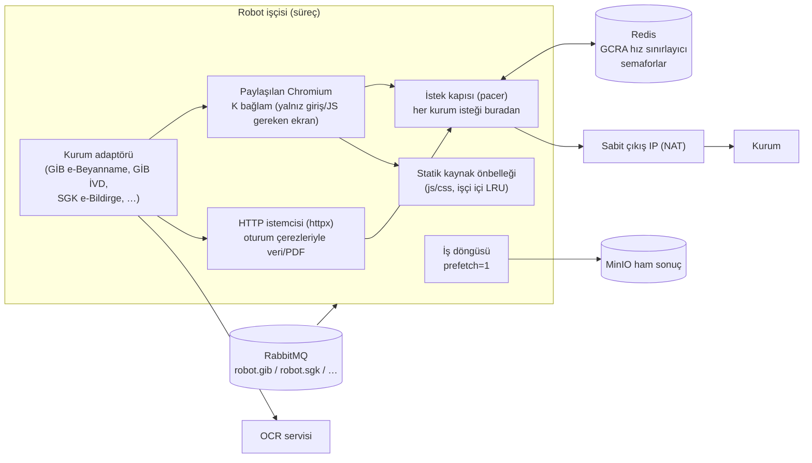
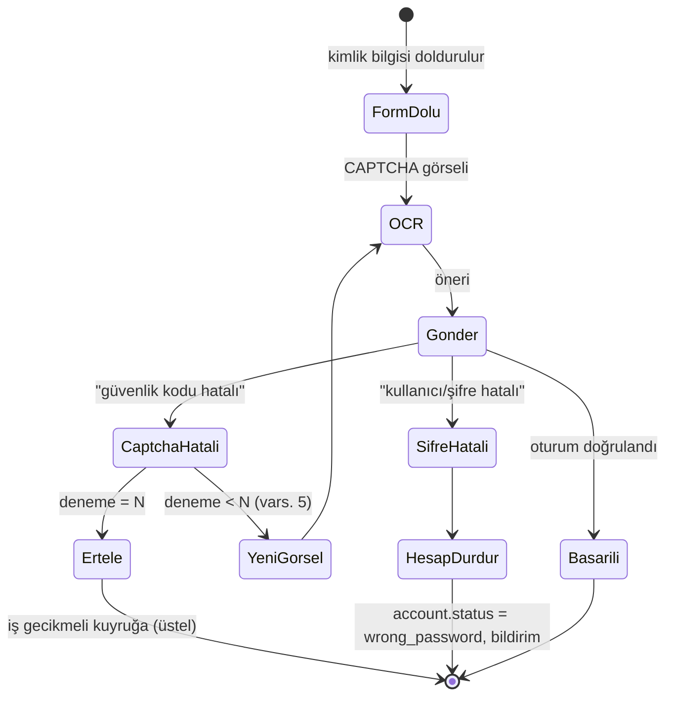
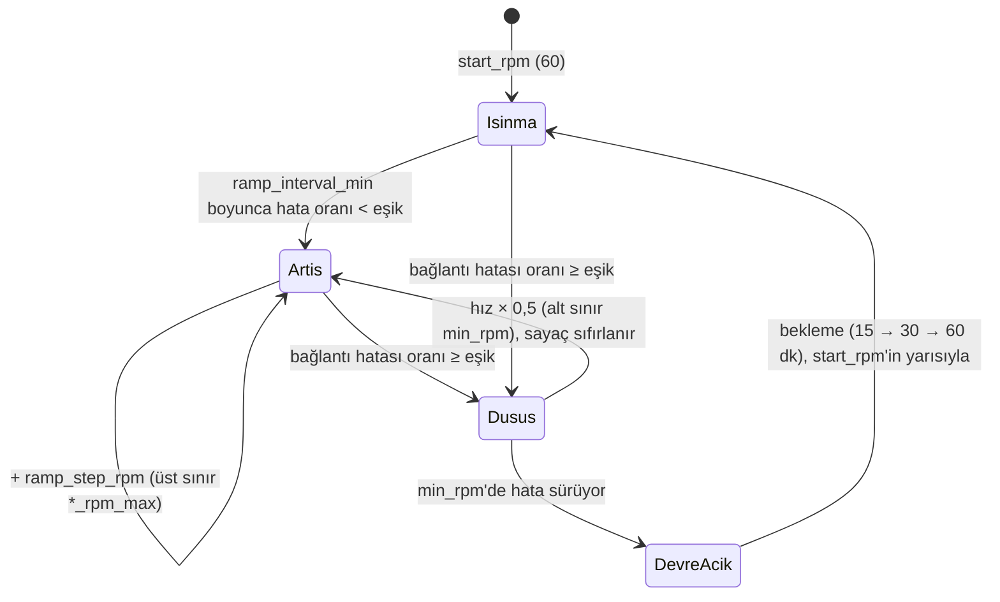

# 5.2 Kurum entegrasyonları — web servis öncelikli, robot yedek (backend, paralel, hız sınırlı)

> Önce: [5.1 Genel bakış](01-cok-kiracili-hedef-mimari.md) · Sonra: [5.3 Kaynak verimliliği ve kapasite](03-kaynak-verimliligi-ve-kapasite.md)
> Kararlar: **D19 (web servis birincil, robot yedek)**, D3 (backend robot), D6 (otomatik CAPTCHA, gece toplu işleri tam otomatik), D7 (aralıklı istek, dakikalık parametre), D8 (müşavir + mükellef hesapları), D9 (kaynak tutumluluğu), D11 (30 istek/dk ile başla, kademeli artır, bağlantı hatasında düşür), D13 (SGK tüm ekranlar, müşavir tetiklemeli toplu çekim), D14 (sabit çıkış IP'si), D15 (PDF saklama parametresi, toplu temizlik).
> **Not (25.10.2026, D35):** Bu belgede "MinIO" geçen yerler S3 uyumlu nesne deposunu anlatır. MinIO topluluk imajları yayından kalktığı için Compose'da **SeaweedFS** kullanılır; kod S3 portuna yazılır, depo değiştirilebilir.

## 1. İlke: darboğaz istek bütçesidir

Kurum sitelerine dakikada gönderilebilecek istek sayısı sabit bir parametredir (D7). Bu nedenle:

- Robotun **ne kadar iş bitireceğini** CPU veya tarayıcı sayısı değil, **istek bütçesi** belirler.
- Bütçeden fazla paralel tarayıcı açmak işi hızlandırmaz. Yalnız beklemede bellek tüketir (D9'a aykırı).
- Her iş ve her adım **istek maliyetiyle** tasarlanır. Gereksiz istek (görsel, yazı tipi, analitik, tekrar yüklenen statik dosya) bütçeden yer.

## 1a. Yol seçimi: web servis birincil, robot yedek (D19)

Her entegrasyon (kurum × veri türü) için iki taşıma yolu tanımlanabilir:

| Yol | Ne zaman | Özellik |
|---|---|---|
| **Web servis** (`transport = service`) | Kurumun resmî servisi varsa — **varsayılan** | SOAP/REST istemcisi. CAPTCHA yok, tarayıcı yok, istek başına çok daha az kaynak ve bütçe tüketir. **Servis işçisi** çalıştırır (küçük imaj) |
| **Robot** (`transport = robot`) | Servis yoksa; ya da servis geçici çalışmıyorsa ve yedek politikası izin veriyorsa | Playwright + HTTP hibrit, otomatik CAPTCHA. **Robot işçisi** çalıştırır (Chromium imajı) |

Entegrasyon kaydı (`integrations` tablosu, yönetici ekranından):

| Alan | Değerler | Açıklama |
|---|---|---|
| `primary_transport` | `service` \| `robot` | Servis varsa `service` |
| `fallback_policy` | `none` \| `on_service_unavailable` \| `manual` | Varsayılan `manual`: servis çalışmadığında işler bekler; yönetici "robotla dene" diyebilir. `on_service_unavailable`: servis devre kesicisi açıkken robota otomatik geçer |
| `enabled` | evet/hayır | Entegrasyonu tümden kapatma |

Kurallar:
- Yedek yol **aynı hız bütçesini** paylaşır. Robota geçmek kuruma giden toplam hızı artırmaz.
- Aynı iş için iki yol **aynı anda** çalışmaz. Geçiş, iş düzeyinde ve kayıtlı nedenle yapılır.
- Her iki yol da aynı **normalize çıktı şemasını** üretir (`eworks.<kurum>.<veri>.v1`). Ayrıştırma işçisi ve ekranlar yoldan habersizdir.
- Servis kimlik bilgileri robotla aynı Vault kaydından okunur (ör. SGK işyeri kullanıcı adı, işyeri kodu, sistem ve işyeri şifresi). Kuruma göre ek servis yetkisi gerekiyorsa hesap kaydına alan eklenir.
- **Envanter:** Her kurum ekranı için resmî servis var mı, hangi yetki/başvuruyla erişilir, ne döndürür? Bu tablo Faz 0'da çıkarılır ve `integrations` tablosuna işlenir. Servisi olmayanlar robotla başlar. Servis açıldığında yalnız `primary_transport` değişir.

## 2. Bileşenler

> Aşağıdaki şema robot yolunu gösterir. Servis işçisi aynı iş döngüsü, istek kapısı ve kuyruk yapısını kullanır, ama tarayıcı ve OCR içermez.

### 2.1 Kurum adaptörü sözleşmesi

Her kurum ve ekran tek bir adaptör arayüzüne uyar. Bugünkü `institution_records.py` sözleşmesi buraya genişletilir.

| Yöntem | Görev |
|---|---|
| `login(account, ctx)` | Giriş + otomatik CAPTCHA. Oturum çerezlerini döndürür |
| `plan(account, scope)` | İşi alt adımlara böler ve her adımın **tahmini istek sayısını** verir |
| `fetch(step, session)` | Adımın verisini çeker (tercihen HTTP istemcisi), ham sonucu akışla MinIO'ya yazar |
| `is_session_valid(session)` | Oturum yeniden kullanılabilir mi |
| `classify_error(resp)` | `wrong_password`, `captcha_failed`, `rate_limited`, `maintenance`, `ui_changed`, `transient` |

Kurumlar (ilk sürüm önerisi):
- **GİB e-Beyanname (müşavir hesabı):** sözleşmeler, beyanname listeleri, PDF.
- **GİB İnternet Vergi Dairesi (mükellef hesabı):** beyanname, borç, e-tebligat, tahakkuk.
- **SGK e-Bildirge (mükellef işyeri hesabı):** tahakkuk, hizmet listesi.

Her ekranın hangi hesap türüyle erişildiği adaptör kaydında tutulur.

### 2.2 "Tarayıcı yalnız gerektiğinde" (hibrit)

- **Giriş** (CAPTCHA, JS ile üretilen alanlar) Playwright ile yapılır.
- Girişten sonra oturum çerezleri alınır. **Listeler ve PDF'ler mümkün olduğunca `httpx` ile** çekilir. Bir HTTP isteği, bir tarayıcı sayfa yüklemesine göre birkaç kat daha az CPU, bellek ve **kurum isteği** harcar (sayfanın tüm alt kaynakları yüklenmez).
- JS'e bağımlı ekranlarda tarayıcı kullanılır, ama görsel, yazı tipi, medya ve analitik istekleri `route.abort()` ile kesilir. CAPTCHA görseli istisnadır.
- Hangi ekranın HTTP ile çekilebileceği, ekran ekran sahte kurum fikstürleriyle doğrulanıp adaptörde işaretlenir.

### 2.3 SGK kapsamı (D13)

İlk sürümde Eworks'teki **tüm SGK ekranları** SGK'nın resmî sitelerinden beslenir. Bugünkü portalda bu ekranlar ve bağlı oldukları SGK uygulamaları şunlardır:

| Eworks ekranı (bugünkü sayfa kimliği) | SGK kaynağı | Veri |
|---|---|---|
| SGK Kontrol Listesi (`sgk-check`) | Aşağıdakilerin özeti | Firma bazında eksik/hatalı/bekleyen durum |
| e-Bildirge (`sgk-bildirge`) | e-Bildirge V2 (`sgk.gov.tr/EBildirgeV2`) | Onaylı bildirgeler, tahakkuk fişleri, hizmet listeleri (PDF), çalışan sayısı |
| İşe Giriş Çıkış (`sgk-entry`) | Sigortalı Tescil (`sgk.gov.tr/SigortaliTescil`) | İşe giriş/işten ayrılış bildirgeleri |
| SGK e-Rapor (`sgk-report`) | Çalışılmadığına Dair Bildirim (Vizite) | İstirahat raporları, onay bekleyenler |
| İş Kazası (`sgk-accident`) | İş Kazası ve Meslek Hastalığı e-Bildirim | Bildirimler |
| Firma kartı "SGK Bilgileri" | — | İşyeri hesabı tanımı: kullanıcı adı, işyeri kodu, sistem şifresi, işyeri şifresi (Vault) |

**Tetikleme:**
- SGK verisi **müşavirin yenileme talebiyle** çekilir: "SGK bilgilerini güncelle" düğmesi, müşavirin portföyündeki SGK hesabı olan tüm mükellefler için ve ekran ekran.
- Talep, mükellef × SGK uygulaması × dönem alt işlerine bölünür. İşler `robot.sgk.high` kuyruğuna girer ve SGK hız bütçesiyle aralıklı yürür.
- İlerleme portalda canlı (SSE) izlenir: "212 / 300 işyeri, 4 hata".
- Ofis isterse aynı iş planlayıcı tarafından gece de üretilebilir (ofis ayarı, varsayılan kapalı).

**Hesap yapısı:** SGK erişimi mükellefin **işyeri** hesabıyla yapılır. Bir mükellefin birden çok işyeri (şube) olabilir; her işyeri ayrı bir `institution_accounts` kaydıdır (`institution = SGK_EBILDIRGE`, `owner_kind = firm`, işyeri sicil no ile).

**Yol (D19):** SGK entegrasyonları **web servisleriyle** yapılır. SGK'nın işverenlere sunduğu servisler (ör. Vizite, sigortalı işe giriş/çıkış; Mükellef Takip'te Vizite ve 4A için SOAP istemcisi zaten var ve örnek alınabilir) birincil yoldur. Servisi olmayan veya servisle alınamayan SGK verisi (ör. bazı e-Bildirge PDF'leri) robotla alınır. Hangi ekranın hangi yolla besleneceği Faz 0 envanterinde kesinleşir (§1a).

**Hassas veri notu:** e-Rapor verisi sağlık bilgisi içerir (KVKK özel nitelikli). Ayrı sütun şifrelemesi ve yalnız gerekli alanların saklanması tasarımda baştan yer alır.

## 3. Otomatik CAPTCHA (D6)

- **Etkileşimli mod yoktur.** Gece toplu işleri baştan sona otomatiktir.
- Her CAPTCHA denemesi (görsel + gönderim) istek bütçesinden düşer.
- **Kalite ölçümü:** Kurum ve CAPTCHA türü bazında OCR başarı oranı izlenir. Oran eşiğin altına düşerse (ör. < %60) alarm verilir; model, ön işleme veya alternatif motor devreye alınır.
- **Oturum yeniden kullanımı:** Başarılı girişten sonra çerezler şifreli olarak Redis'te, kurumun izin verdiği süre kadar (ölçülerek, ör. 15–20 dk) tutulur. Aynı hesabın sonraki alt adımları yeniden giriş yapmaz. Hesap başına 1 eşzamanlılık kuralı bunu güvenli kılar.
- Kimlik bilgisi Vault'tan **iş başında tek kayıt** olarak okunur, bellekte tutulur ve iş bitince silinir. Loglara ve ham sonuca yazılmaz.

## 4. Hız sınırı ve aralıklı istek

### 4.1 Parametreler

Ayarlar `integration_rate_policies` tablosunda tutulur (yönetici ekranından değişir) ve Redis'e önbelleklenir. **Yeniden başlatma gerekmez.** Varsayılanlar ortam değişkeniyle verilir.

| Parametre | Kapsam | Örnek | Açıklama |
|---|---|---|---|
| `global_rpm_max` | Tüm kurumlar toplam | 120 | **Sistemden çıkan toplam istek/dakika üst sınırı** (D7'deki ana parametre). Etkin hız bunu geçmez |
| `start_rpm` | Tümü | **60** | Pilot ve yeniden başlangıç hızı (D25; ilk karar D11'de 30'du) |
| `min_rpm` | Kurum bazında | 5 | Hata durumunda inilebilecek en düşük hız. Altında devre kesici devreye girer |
| `ramp_step_rpm` / `ramp_interval_min` | Kurum bazında | +5 / 30 dk | Hatasız geçen her aralıkta etkin hız bu kadar artar (`*_max`'a kadar) |
| `error_window_min` / `error_threshold` | Kurum bazında | 5 dk / %2 | Bağlantı hatası oranı bu eşiği aşarsa hız düşürülür (§4.3) |
| `institution_rpm_max[k]` | Kurum bazında | GİB: 90, SGK: 30 | Toplamın kuruma düşen payının üst sınırı |
| `login_per_minute[k]` | Kurum bazında | 10 | Dakikalık yeni giriş sayısı (CAPTCHA dahil) |
| `account_rpm_max` / `account_min_interval_ms` | Hesap başına | **60 / 1000** | Hesap başına en fazla 60 istek/dk (D26) = ardışık iki istek arası en az 1 sn |
| `jitter_ms` | Tümü | 200–800 | Düzenli aralık örüntüsünü kırmak için rastgele ek gecikme |
| `max_sessions[k]` | Kurum bazında | 20 | Kurumda aynı anda açık oturum |
| `per_account_concurrency` | Hesap | 1 | Sabit; aynı hesapla ikinci oturum açılmaz |
| `per_org_concurrency` | Ofis | 5 | Adil paylaşım |
| `night_window` | Planlayıcı | **20:00–09:00** (D26) | Toplu işlerin çalıştığı pencere |
| `night_rpm_share` | Planlayıcı | %90 | Gece bütçesinin toplu işlere ayrılan payı (kalan kısım anlık kullanıcı istekleri için) |

### 4.2 Algoritma

- Tek merkez **Redis**'tir. Tüm işçi örnekleri (Compose ve K8s) aynı sayaçları kullanır.
- **GCRA (generic cell rate algorithm)**, Redis üzerinde Lua betiği olarak çalışır. Etkin hız 60 istek/dk ise her 1 sn'de bir istek yuvası açılır. İstekler **eşit aralıklı** gider ve patlama (burst) olmaz. Çağıran, kendi yuvasına kalan süreyi alır ve bekler.
- Bir istek göndermeden önce kapı sırayla şu yuvaları alır (birinde bile yer yoksa bekler):
  1. global;
  2. kurum;
  3. hesap (en kısa aralık).
- **Uzun bekleme yönetimi:** Bekleme belirli bir eşiği (ör. 30 sn) aşarsa iş tarayıcı bağlamını kapatır ve "gecikmeli" olarak kuyruğa geri döner. Böylece bekleyen işler bellek tutmaz (D9).
- **Tarayıcı istekleri de kapıdan geçer:** Playwright `context.route("https://*.gib.gov.tr/**")` ile her istek önce kapıda bekletilir, sonra `route.continue_()` ile devam eder. Kesilen kaynak türleri bütçeden düşmez. Statik js/css işçi içi önbellekten verilir (`route.fulfill`).

### 4.3 Kademeli başlangıç ve hataya göre düşüş (D11)

Etkin hız kurum bazında Redis'te tutulur ve kalıcıdır. AIMD (toplamsal artış, çarpımsal düşüş) yöntemi kullanılır:

**Bağlantı hatası sayılanlar** (oran `error_window_min` penceresinde, o kurumun tüm istekleri üzerinden hesaplanır):
- TCP bağlantı reddi/zaman aşımı, bağlantı sıfırlanması (reset), TLS el sıkışma hatası, DNS hatası;
- HTTP 429, 502, 503, 504;
- yanıt süresinin ani artışı (son 5 dk p95 > 3× taban);
- kurumun "çok fazla istek", "erişim engellendi" veya "bakım" sayfası.

**Sayılmayanlar:** CAPTCHA hatası, "şifre hatalı", iş verisi bulunamadı. Bunlar hesap ya da iş düzeyinde ele alınır, hızı etkilemez.

Davranış:
- Tek bir 429/403-engelleme yanıtı eşik beklenmeden **anında** hızı yarıya indirir.
- Devre kesici açıkken o kurumun işleri kuyrukta bekler, yeni oturum açılmaz ve ekibe alarm gider.
- Etkin hız, son düşüş nedeni, hata oranı ve kuyruk derinliği panoda kurum bazında görünür. Yönetici etkin hızı elle de sabitleyebilir.

### 4.4 Çıkış IP'si

- Kurum istekleri **sabit ve az sayıda** (başlangıçta 1, yedekli 2) kayıtlı IP'den, NAT/vekil üzerinden çıkar. İşçi bir hesabın oturumu boyunca aynı IP'yi kullanır.
- Kapasiteyi IP sayısı değil, **kurumun kabul ettiği toplam hız** (`global_rpm_max`) belirler. İkinci IP yedeklilik içindir, hızı katlamak için değil.
- **Hesap başına ayrı IP (IP sahteciliği/rotasyonu) bu mimaride yer almaz.** Bkz. [5.1 §11](01-cok-kiracili-hedef-mimari.md#11-ip-sahteciliği-hakkında-d14).
- Kapasite gerektiğinde izlenecek yollar:
  1. kurumun resmî web servisleri (§2.3);
  2. kurumdan IP izin listesi veya kurumsal entegrasyon izni;
  3. artımlı senkron ve önceliklendirme.

## 5. İş planlama

### 5.1 İş birimleri

- Bir **iş = bir hesap × bir kapsam parçası** (ör. "mükellef X, GİB İVD, 2026-09 beyannameleri"). Büyük kapsamlar (geçmiş yıllar, çok dönemli tarama) **ay ay** alt işlere bölünür. Her alt iş birkaç dakikada biter. Yarıda kalırsa yalnız o parça tekrarlanır.
- Mesajda yalnız `job_id` bulunur. Kapsam ve durum Postgres'tedir, ham sonuç MinIO'dadır.
- İdempotenslik: `(account_id, kind, scope_hash)` için aynı anda tek açık iş olur. Yeniden çalıştırma `upsert` ile sonucu değiştirmez.

### 5.2 Gece planlayıcı

1. Gece penceresinin bütçesini hesaplar: `B = global_rpm × pencere_dk × night_rpm_share`.
2. Aday işleri listeler: her hesap için son başarılı senkrondan bu yana gereken kapsamlar, artımlı olarak (yalnız yeni dönem ve değişen kayıtlar).
3. Her işin **tahmini istek sayısını** (`est_requests`) adaptörün `plan()` çıktısından ve geçmiş ölçümlerden alır.
4. Öncelik sırasına göre işleri bütçe dolana kadar seçer:
   1. son günü yaklaşan beyanname dönemleri;
   2. uzun süredir senkron olmamış hesaplar;
   3. diğerleri.

   Ofisler arasında adil paylaşım uygulanır.
5. Sığmayan işler sonraki geceye devreder. Sürekli sığmama durumu "kapasite yetersiz" alarmı üretir. Çözüm yolları: resmî web servisine geçiş, kurumdan izin, kapsam azaltımı.

Gündüz kullanıcının başlattığı işler yüksek öncelikli kuyruğa girer ve gündüz bütçesini kullanır.

### 5.3 Kuyruklar (RabbitMQ)

| Kuyruk | İçerik | Ayar |
|---|---|---|
| `svc.<kurum>.high` / `svc.<kurum>.bulk` | Web servis yolu: kullanıcı / planlayıcı | quorum, prefetch=1–5 (servis işçisi hafif) |
| `robot.<kurum>.high` | Robot yolu, kullanıcı başlattı | quorum, prefetch=1 |
| `robot.<kurum>.bulk` | Robot yolu, planlayıcı | quorum, prefetch=1 |
| `robot.delay` | Ertelenen işler (TTL + DLX ile geri döner) | TTL kademeleri: 1, 5, 30 dk |
| `parse` | Ayrıştırma | quorum, prefetch=1 |
| `dlq` | N kez başarısız | elle inceleme + panoda görünür |

İşler önce Postgres'e `jobs` ve `outbox` olarak aynı işlemde yazılır. Yayıncı süreç bunları RabbitMQ'ya aktarır (transactional outbox). Böylece DB ile kuyruk tutarsızlaşmaz.

## 6. Ayrıştırma (parçalı, akışlı)

- Ham sonuç MinIO'dan **akış** olarak okunur. PDF'ler sayfa sayfa işlenir, tablo satırları 500'lük partiler halinde `upsert` edilir.
- Her parti ayrı bir işlemdir. Yarıda kalırsa son tamamlanan partiden devam edilir.
- Doğrulama (sayım, başlık, kimlik biçimi) başarısızsa o parça yazılmaz ve iş `failed_validation` olur. Kalan parçalar etkilenmez.
- Ham sonuçlar MinIO yaşam döngüsü kuralıyla (ör. 30 gün) silinir. Ayrıştırıcı düzeltmesi gerekirse bu süre içinde yeniden oynatılabilir.

## 7. Gözlemlenebilirlik

| Ölçü | Neden |
|---|---|
| Etkin hız (kurum/IP), kapı bekleme süresi | Bütçe kullanımı, darboğaz |
| İstek/iş (`actual_requests` vs `est_requests`) | Planlayıcı tahmin doğruluğu |
| Giriş başarı oranı, CAPTCHA OCR başarı oranı | D6'nın sürdürülebilirliği |
| `wrong_password` hesap sayısı (ofis bazında) | Müşavire bildirim |
| 429/503/bakım sayısı, devre kesici durumu | IP sağlığı |
| Gece planı: planlanan / biten / devreden | Kapasite yeterliliği |
| Adım başarısızlık oranı (adaptör × adım) | **Kurum arayüz değişikliği alarmı** (ör. > %20 / 15 dk → o adaptör durdurulur) |

## 8. Robot işçisi kaynak kuralları (özet)

Ayrıntı: [5.3](03-kaynak-verimliligi-ve-kapasite.md).

- İşçi süreci başına **tek Chromium süreci**, en fazla K bağlam (vars. 3). Bağlam iş bitince kapanır.
- Tarayıcı her N işte bir (vars. 50) veya RSS eşiği aşılınca yeniden başlatılır (bellek sızıntısına karşı).
- Chromium bayrakları: `--disable-dev-shm-usage --disable-gpu --disable-extensions --mute-audio --blink-settings=imagesEnabled=false` (CAPTCHA görseli `route` ile ayrıca alınır).
- Konteyner bellek/CPU sınırı zorunludur. Sınırın %85'ine gelinince yeni iş alınmaz.
- SIGTERM'de yeni iş alınmaz. Mevcut adım bitirilir veya checkpoint'e yazılıp iş kuyruğa geri verilir.

## 9. Belge (PDF) saklama ve toplu temizlik (D15)

| Parametre | Varsayılan | Kapsam |
|---|---|---|
| `document_retention_days` | **7** | Sistem geneli. Ofis bazında daha kısa bir değer tanımlanabilir |
| `raw_result_retention_days` | 7 | Ham robot sonuçları (MinIO `raw/`) |
| `purge_batch_size` | 1.000 nesne | Temizlik işinin parça büyüklüğü |

- **Neler silinir, neler kalır:** Süresi dolan PDF dosyası MinIO'dan silinir. `documents` satırı (tür, dönem, SHA-256, boyut, kaynak kayıt kimliği, `file_deleted_at`) kalır. Böylece portalda "belge alındı, dosyası süre dolduğu için silindi" görünür.
- **Yeniden indirme:** Kullanıcı silinmiş bir belgeyi açmak isterse "yeniden indir" ile tek belgelik iş kuyruğa girer (bütçe kullanır).
- **Günlük temizlik işi:** Planlayıcı her gece `file_deleted_at is null and created_at < now() - retention` olan belgeleri bulur. Bunları `purge_batch_size`'lık parçalar halinde MinIO toplu silme API'siyle siler ve satırları işaretler. Parça başına kısa işlem, kaldığı yerden devam.
- **Elle toplu temizlik (yönetici):** Ayarlar ekranında "Belgeleri temizle". Filtreler: ofis, müşavir, mükellef, belge türü, tarih aralığı veya **tümü**.
  - Önce kaç dosyanın ve ne kadar alanın silineceği gösterilir (önizleme).
  - Onay için ofis adı yazılır.
  - İşlem arka planda parçalı yürür ve ilerleme canlı izlenir.
  - Kim, ne zaman, hangi filtreyle, kaç dosya sildi bilgisi denetim kaydına yazılır.
- Parametre değişikliği bir sonraki temizlik işinde geçerli olur. Süre kısaltıldığında ilk koşu büyük olabilir, bu da yine parçalı yürür.
- Depolama etkisi: 7 günlük saklamada MinIO yalnız son bir haftanın PDF'lerini tutar. 1 TB yerine onlarca GB yeterli olur ([5.3](03-kaynak-verimliligi-ve-kapasite.md)).
