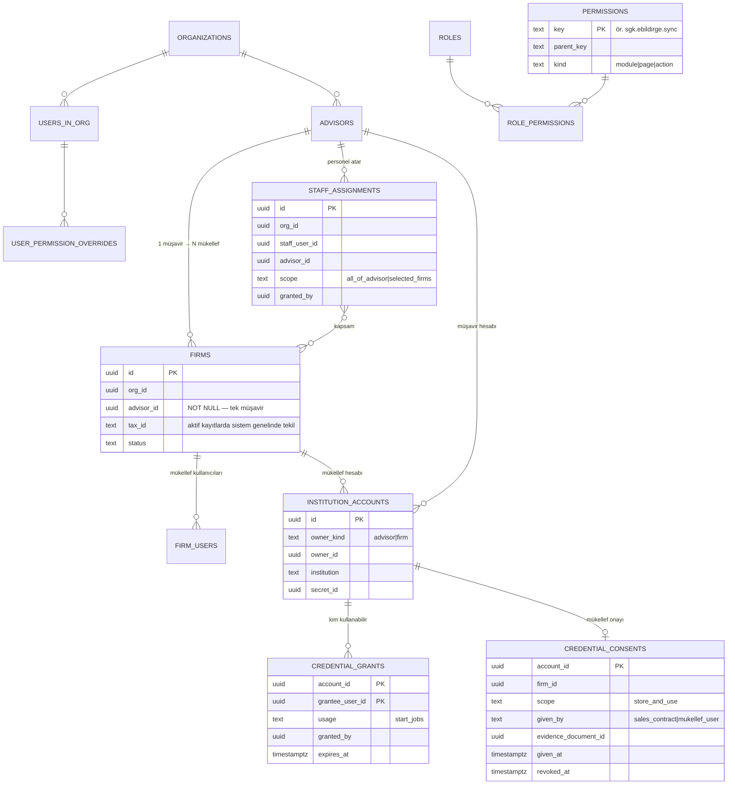
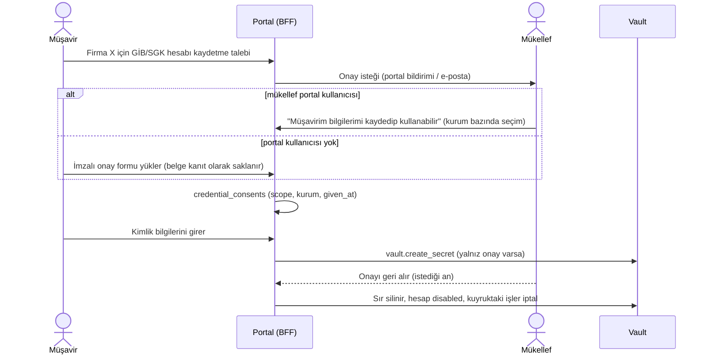

<!-- gezinti — node tools/docs/gezinti.mjs --yaz üretir, elle düzenlemeyin -->
[README](../../README.md) › [Genel bakış](../00-genel-bakis.md) › [01 Hedef mimari](01-cok-kiracili-hedef-mimari.md) › **05 Yetki ve hesap**
<!-- /gezinti -->

# 5.5 Yetki ve hesap modeli

> Önce: [5.1 Genel bakış](01-cok-kiracili-hedef-mimari.md) · İlgili: [5.2 Kurum entegrasyonları](02-kurum-entegrasyon-robotu.md)
> Kararlar: D12 (mükellef girişi), **D16–D18** (24.10.2026, Hakan).

| # | Karar |
|---|---|
| D16 | **Bir mükellef bir ve yalnız bir müşavirle çalışır.** Bir müşavir birden çok mükellefe hizmet verir. |
| D17 | **Hiyerarşik, sayfa ve işlem bazında yetki.** Personelin hangi mükelleflerde hangi sayfa/işlemi yapacağını müşavir veya ofis yöneticisi belirler. Müşavir izin verirse personel, **müşavirin kurum hesabını** kullanarak iş başlatabilir. |
| D18 | **Mükellef izin verirse** müşavir, mükellefin GİB/SGK/diğer entegrasyon bilgilerini kaydedip kullanabilir. **Mükellef, müşavirin hiçbir kurum veya portal bilgisini kullanamaz.** |

## 1. Varlıklar ve ilişkiler



## 2. Müşavir–mükellef ilişkisi (D16)

- `firms.advisor_id` **zorunludur** ve tek değerlidir. Firma bir ofise ve o ofisin tek bir müşavirine bağlıdır.
- **Sistem genelinde tekillik:** Aynı VKN/TCKN aynı anda yalnız bir aktif firmada bulunabilir (`unique (tax_id) where status = 'active'`). Bu kiracılar arası tek kısıttır. Kontrol, sonucu yalnız "var/yok" olarak döndüren bir `security definer` fonksiyonla yapılır; başka ofisin verisi görünmez.
- **Kayıt çakışması:** Bir müşavir, başka bir müşaviri olan mükellefi eklemeye çalışırsa sistem kaydı açmaz. Ekranda genel bir mesaj gösterilir: "Bu mükellef başka bir müşavirle çalışıyor. Devir talebi oluşturabilirsiniz." Diğer ofisin adı gösterilmez.
- **Müşavir değişikliği (devir) akışı:**
  1. Yeni müşavir talep oluşturur.
  2. Mükellef portalda onaylar ya da onay satış sözleşmesiyle gelir (D27).
  3. Eski müşavire bildirim gider. Belirlenen süre (ör. 7 gün) içinde itiraz yoksa ya da eski müşavir onaylarsa firma eski ofiste arşivlenir, yeni ofiste aktif olur.
  4. Kurum hesabı onayları (§5) **taşınmaz**. Yeni müşavir için mükellefin yeniden onay vermesi gerekir.
  5. Eski ofisteki geçmiş veri o ofiste salt okunur kalır ve saklama süresine tabidir.
- Bir mükellef kullanıcısı (kişi) birden çok firmanın yetkilisi olabilir (`firm_users`). Her firmanın yine tek müşaviri vardır; firmalar farklı müşavirlerde olabilir.

## 3. Hiyerarşik yetki modeli (D17)

### 3.1 Yetki ağacı

Yetkiler `modül → sayfa → işlem` ağacıdır. Üst düğüme verilen yetki alt düğümlere miras kalır. Alt düğümde ayrıca **açık engelleme** (deny) tanımlanabilir.

```
firmalar
  firmalar.liste            .view
  firmalar.kart             .view .edit .archive
  firmalar.kurum_hesaplari  .view_status .edit_credentials .grant_use
beyanname
  beyanname.liste           .view .export
  beyanname.belge           .view .download
  beyanname.senkron         .start
sgk
  sgk.kontrol               .view
  sgk.ebildirge             .view .download .sync
  sgk.ise_giris_cikis       .view .sync
  sgk.erapor                .view .sync .approve      (sağlık verisi — ayrı yetki)
  sgk.is_kazasi             .view .sync
gorevler                    .view .create .assign .close
raporlar                    .view .export
yonetim
  yonetim.kullanicilar      .view .invite .edit_permissions
  yonetim.zamanlama         .view .edit
  yonetim.belge_temizligi   .run
  yonetim.hiz_politikasi    .view .edit             (yalnız sistem yöneticisi)
```

Ağaç kodda tek bir kayıt dosyasında (`permissions.ts`) tanımlanır ve migration ile `permissions` tablosuna eşitlenir. Her Next.js sayfası ve her `/api` ucu, bu kayıttan **tek bir yetki anahtarı** bildirir. CI kapısı, anahtarı olmayan sayfa/uç bırakmaz.

### 3.2 Roller (şablon) ve kişiye özel ayar

| Rol şablonu | Varsayılan yetkiler | Varsayılan kapsam |
|---|---|---|
| `ofis_admin` | Tümü (sistem yönetimi hariç) | Ofisin tüm firmaları |
| `musavir` | İş yetkilerinin tümü + kendi personelini yönetme | **Kendi portföyü** |
| `personel` | Görüntüleme + görev. Senkron başlatma kapalı | `staff_assignments` ile verilen firmalar |
| `mukellef` | Kendi firmasında görüntüleme, belge indirme, kendi hesap bilgisini girme ve onay | `firm_users` ile bağlı firmalar |

- **Etkin yetki** = rol şablonu ∪ kişiye özel izinler − kişiye özel engellemeler. Hesaplama ağaçta mirasla yapılır.
- **Etkin kapsam** = kullanıcının görebileceği firma kümesi (rolüne göre portföy, atama veya `firm_users`).
- Bir işlem yalnız şu üçü birlikte sağlandığında yapılabilir: **etkin yetki** VE **kapsam içindeki firma** VE (kurum hesabı kullanılıyorsa) **hesap kullanım hakkı** (§4).

### 3.3 Kim kime yetki verebilir

| Veren | Kime | Sınır |
|---|---|---|
| `ofis_admin` | Ofisteki herkes (mükellef hariç) | Kendi yetkileri kadar |
| `musavir` | **Kendi personeli** (kendi `staff_assignments` kayıtları) ve kendi mükellef kullanıcıları | Yalnız kendi portföyü. Kendi yetkilerinden fazlası verilemez |
| `personel`, `mukellef` | — | Yetki veremez |

- **Yetki yükseltme yasaktır.** Veren, sahip olmadığı bir yetkiyi veya kendi kapsamı dışındaki bir firmayı veremez. Bu kural sunucu tarafında kontrol edilir.
- Her yetki değişikliği denetim kaydına yazılır: kim, kime, hangi anahtar, eski ve yeni değer.

### 3.4 Uygulama katmanları

| Katman | Ne denetler |
|---|---|
| Next.js sayfa (sunucu bileşeni) | Sayfa anahtarı (`*.view`). Yoksa 403 sayfası. Menü yalnız yetkili sayfaları gösterir |
| BFF `/api` ucu | İşlem anahtarı + firma kapsamı + hesap kullanım hakkı. **Asıl karar noktası** |
| PostgreSQL RLS | Veri kapsamı: `app.can_see_firm(firm_id)` (portföy, atama veya `firm_users`). Yetki ağacından bağımsız ikinci savunma |
| Robot/servis işçisi | İş kaydındaki `requested_by` için hesap kullanım hakkını iş başlarken **yeniden doğrular** (iş kuyruktayken hak geri alınmış olabilir) |

Performans: Etkin yetki ve kapsam, girişte ve değişiklikte hesaplanır ve Redis'te oturumla birlikte tutulur (`perm_version`). Yetki değişikliğinde sürüm artar ve kullanıcının oturumu bir sonraki istekte yeniden hesaplanır. Kapsam büyük olabilir (1.500 firma). RLS fonksiyonu indeksli tablolardan (`advisors`, `staff_assignments`, `firm_users`) okur, firma listesini oturuma gömmez.

## 4. Kurum hesabı kullanımı (D17, D18)

### 4.1 Sahiplik ve kullanım kuralları

| Hesap sahibi | Kaydedebilir/güncelleyebilir | İş başlatmak için kullanabilir | Asla kullanamaz |
|---|---|---|---|
| **Müşavir** (`owner_kind = advisor`) | Müşavirin kendisi, `ofis_admin` | Müşavirin kendisi; müşavirin **açık izin** verdiği personel (`credential_grants`) | **Mükellef rolündeki hiçbir kullanıcı** |
| **Mükellef** (`owner_kind = firm`) | Mükellefin kendisi; **mükellef onayı varsa** müşavir (`credential_consents`) | Mükellef onayı varsa müşavir ve müşavirin bu firmada yetkili personeli | Başka firmanın kullanıcıları |

- **Şifreyi kimse görmez.** "Kullanma" yalnız sunucuda bu hesapla iş başlatmak demektir. Şifre hiçbir yanıtta dönmez. Kaydeden kişi bile değeri geri okuyamaz, yalnız "kayıtlı / son başarılı giriş / durum" bilgisini görür.
- **Personelin müşavir hesabını kullanması:** Müşavir, hesap ekranında personel ve isteğe bağlı bitiş tarihi seçerek `credential_grants` kaydı oluşturur. İzin geri alınabilir. Kuyruktaki işler başlamadan önce yeniden doğrulandığı için geri alınan izinle iş çalışmaz.
- **Mükellefin müşavir hesabını kullanamaması** (D18), üç katmanda zorlanır:
  1. Veritabanı kısıtı: `credential_grants.grantee_user_id`, mükellef rolündeki bir kullanıcı olamaz (tetikleyici).
  2. BFF: Mükellef oturumu `owner_kind = advisor` hesaplarının varlığını bile görmez (listeleme RLS'i).
  3. İşçi: İş başlarken `requested_by` mükellef rolündeyse ve hesap müşavirinse iş reddedilir.
- Mükellef kendi firmasının işlerini başlatabilirse (yetki `*.sync` verildiyse), yalnız **kendi firmasının** hesaplarıyla başlatabilir.

### 4.2 Mükellef onayı (D18)



- Onay **kurum bazında** verilir. Örneğin yalnız SGK verilip GİB verilmeyebilir.
- Onay yoksa müşavir bilgiyi kaydedemez; mükellef kendi bilgisini kendisi girebilir. Bu durumda müşavirin o hesapla iş başlatabilmesi yine onaya bağlıdır.
- Onay, müşavir değişikliğinde (§2) düşer.
- Onay geri alınınca Vault kaydı **silinir** (devre dışı bırakmakla yetinilmez) ve denetim kaydı yazılır.

## 5. Denetim kaydı

Şu olaylar `audit_log`'a yazılır (içerik değil, kimlik ve tür):
- yetki/rol/atama değişikliği;
- kurum hesabı kaydetme, güncelleme, silme;
- hesap kullanım izni verme/geri alma;
- mükellef onayı verme/geri alma;
- **her iş başlatmada hangi hesabın kim adına kullanıldığı**;
- müşavir devri.

Müşavir, kendi hesaplarının kimler tarafından ne zaman kullanıldığını görebilir. Mükellef, kendi hesaplarının kullanım geçmişini görebilir.

<!-- gezinti — node tools/docs/gezinti.mjs --yaz üretir, elle düzenlemeyin -->

---

[README](../../README.md) › [Genel bakış](../00-genel-bakis.md) › [01 Hedef mimari](01-cok-kiracili-hedef-mimari.md) › **05 Yetki ve hesap**
<!-- /gezinti -->
