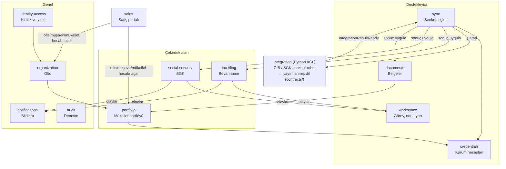
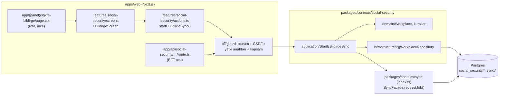
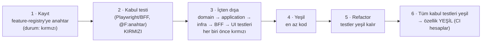

<!-- gezinti — node tools/docs/gezinti.mjs --yaz üretir, elle düzenlemeyin -->
[README](../../README.md) › [Genel bakış](../00-genel-bakis.md) › [01 Hedef mimari](01-cok-kiracili-hedef-mimari.md) › **06 Kaynak kod (DDD/TDD)**
<!-- /gezinti -->

# 5.6 Kaynak kod yapısı — DDD ve TDD

> Önce: [5.1 Genel bakış](01-cok-kiracili-hedef-mimari.md), [5.5 Yetki ve hesap modeli](05-yetki-ve-hesap-modeli.md)
> Bugünkü koddaki karşılıkları ve örnekli uygulama: [DDD rehberi](../gelistirici-rehberi/ddd.md), [TDD rehberi](../gelistirici-rehberi/tdd.md)
> Kararlar (24.10.2026, Hakan): **D20** kaynak kod DDD'ye göre yeniden yapılanır (ön yüz, BFF, ortak kısımlar dahil) · **D21** depoyu açan yazılımcı projenin resmini hemen anlamalıdır · **D22** geliştirme TDD ile yapılır; ön yüzde modül, sayfa ve işlemler test durumuna göre işaretlenir, **tamamlanmayanlar kırmızıdır**.

## 1. İlkeler

1. **Dizinler iş alanını anlatır, teknolojiyi değil.** Üst düzeyde `sgk`, `beyanname`, `portföy` görülür. `controllers`, `services`, `utils` gibi teknik yığınlar üst düzeyde yer almaz.
2. **Her bounded context her katmanda aynı adla görünür:** domain paketi, BFF uçları, ön yüz özelliği, veritabanı şeması, testler, belge sayfası. `social-security` adı dört yerde de aynıdır.
3. **Tek alan dili:** Alan kuralları TypeScript'te, framework'ten bağımsız yazılır. Python yalnız **anti-corruption layer**'dır (kurum servisi/robot + ham format ayrıştırma). Kuruma özgü hiçbir kavram alan modeline sızmaz.
4. **Bağımlılık yönü içe doğrudur:** `domain` ← `application` ← `infrastructure` / `ui`. Bağlamlar birbirine yalnız `index.ts` (public API) ve olaylar üzerinden erişir. Araçla zorlanır (§6).
5. **Kod yazmadan önce test** (§7). Bir özelliğin "tamam" sayılması testlerine bağlıdır ve ön yüzde görünür (§8).

## 2. Bounded context haritası ve ortak dil



| Context | Sorumluluk | Aggregate'ler (kök) | Yayınladığı olaylar |
|---|---|---|---|
| `identity-access` | Kullanıcı, oturum, MFA, yetki ağacı, rol şablonları, kişiye özel izin, personel ataması | `User`, `Role`, `PermissionOverride`, `StaffAssignment` | `PermissionsChanged` |
| `sales` (D27) | Satış portalı: satış kullanıcıları, ofis/müşavir/mükellef hesabı açma, sözleşme ve mükellef onayı kaydı, dondurma, shard ataması. **Mükellef iş verisini görmez** | `SalesUser`, `SalesAccount`, `SalesContract` | `OrganizationProvisioned`, `TaxpayerProvisioned` |
| `organization` | Ofis, müşavir, üyelik, davet | `Organization`, `Advisor`, `Invitation` | `AdvisorAdded` |
| `portfolio` | Mükellef kartı, müşavir bağı (tek müşavir), mükellef kullanıcıları, **devir** | `Taxpayer`, `AdvisorTransfer` | `TaxpayerRegistered`, `TaxpayerTransferred` |
| `credentials` | Kurum hesabı, Vault, kullanım izni, mükellef onayı, kilitlenme koruması | `InstitutionAccount`, `CredentialGrant`, `CredentialConsent` | `AccountLockedOut`, `ConsentRevoked` |
| `sync` | Entegrasyon kaydı, taşıma yolu, iş planlama, istek bütçesi, iş/adım durumu, sonuç dağıtımı | `Integration`, `SyncJob`, `RatePolicy`, `NightPlan` | `SyncJobCompleted`, `SyncJobFailed` |
| `tax-filing` | e-Beyanname sözleşmeleri, beyannameler, tahakkuklar, son gün kuralları | `FilingContract`, `Declaration` | `DeclarationsImported`, `DeadlineApproaching` |
| `social-security` | SGK işyeri, e-Bildirge, işe giriş/çıkış, e-Rapor, iş kazası, kontrol listesi | `Workplace`, `EBildirgeDocument`, `EmploymentEvent`, `SickLeaveReport`, `WorkAccident` | `SgkDataImported`, `SickLeavePending` |
| `documents` | PDF metaverisi, saklama, toplu temizlik, yeniden indirme | `Document`, `RetentionPolicy`, `PurgeRun` | `DocumentsPurged` |
| `workspace` | Görev, not, uyarı/okundu, kontrol listeleri (okuma modeli) | `Task`, `Note` | — |
| `notifications` | Portal ve e-posta bildirimleri | `Notification` | — |
| `audit` | Değiştirilemez denetim kaydı | `AuditEntry` | — |
| `integration` (Python) | ACL: kurum web servisi / robot, ham format ayrıştırma, otomatik CAPTCHA, hız kapısı | — (alan modeli yok) | `IntegrationResultReady` (yayımlanmış dil) |

**Ortak dil sözlüğü (UI Türkçe ↔ kod İngilizce)**

| Türkçe | Kod | Not |
|---|---|---|
| Ofis | `Organization` | Kiracı |
| Mali müşavir | `Advisor` | |
| Personel | `Staff` | |
| Mükellef | `Taxpayer` | Önceki belgelerdeki `firms` tablosunun yeni adı: `portfolio.taxpayers` |
| Mükellef kullanıcısı | `TaxpayerUser` | `firm_users` → `portfolio.taxpayer_users` |
| Müşavir devri | `AdvisorTransfer` | |
| VKN / TCKN | `TaxId` (paylaşılan çekirdek) | 10/11 hane, TCKN kontrol haneli |
| Dönem | `Period` | `2026-09`, `2026-Q3`, `2026` |
| Kurum | `Institution` | `GIB_EBEYANNAME`, `GIB_IVD`, `SGK_EBILDIRGE`, … |
| Kurum hesabı | `InstitutionAccount` | |
| Kullanım izni | `CredentialGrant` | Müşavir → personel |
| Mükellef onayı | `CredentialConsent` | Mükellef → müşavir |
| Entegrasyon, taşıma yolu | `Integration`, `Transport` (`service` / `robot`) | |
| Senkron işi / adımı | `SyncJob` / `SyncStep` | |
| İstek bütçesi, hız politikası | `RequestBudget`, `RatePolicy` | |
| e-Beyanname sözleşmesi | `FilingContract` | |
| Beyanname, tahakkuk | `Declaration`, `Accrual` | |
| İşyeri (SGK) | `Workplace` | Sicil no |
| e-Bildirge / işe giriş-çıkış / e-Rapor / iş kazası | `EBildirgeDocument` / `EmploymentEvent` / `SickLeaveReport` / `WorkAccident` | e-Rapor sağlık verisidir |
| Belge, saklama süresi, temizlik | `Document`, `RetentionPolicy`, `PurgeRun` | |
| Görev, not | `Task`, `Note` | |
| Yetki anahtarı | `PermissionKey` | `sgk.ebildirge.sync` |
| Özellik durumu | `FeatureStatus` | `red` / `green` (§8) |

## 3. Depo yapısı

Tek monorepo kullanılır: TypeScript tarafı **pnpm workspaces + Turborepo**, Python tarafı **uv**.

```
eworks/
├─ README.md                    ← "projenin resmi": bağlam haritası, dizin haritası, 5 dakikada çalıştırma, özellik durumu
├─ CLAUDE.md · AGENTS.md        ← ajan bağlamı
├─ CODEOWNERS                   ← bağlam başına sahip
├─ docs/
│  ├─ 00-genel-bakis.md
│  ├─ baglamlar/<context>.md    ← her bağlam: sorumluluk, aggregate, kural, olay, uç, ekran, test
│  ├─ adr/NNNN-*.md
│  ├─ ozellik-durumu.md         ← CI üretir (§8), elle düzenlenmez
│  └─ ai/ (+ memory/)
├─ contracts/                   ← YAYIMLANMIŞ DİL (Python ACL ↔ TS alan)
│  ├─ integration/eworks.gib.ebeyanname.contracts.v1.schema.json
│  ├─ integration/eworks.sgk.ebildirge.documents.v1.schema.json
│  └─ events/*.schema.json      ← bağlamlar arası olay yükleri
├─ packages/                    ← TypeScript, framework'süz alan + uygulama katmanı
│  ├─ kernel/                   ← paylaşılan çekirdek: TaxId, Period, Money, OrgId, Result, DomainEvent, Clock
│  ├─ contexts/
│  │  ├─ identity-access/
│  │  ├─ organization/
│  │  ├─ portfolio/
│  │  ├─ credentials/
│  │  ├─ sync/
│  │  ├─ tax-filing/
│  │  ├─ social-security/
│  │  │  ├─ src/domain/          ← aggregate, value object, kural, olay, repository PORT
│  │  │  ├─ src/application/     ← komut/sorgu use-case'leri, işlem sınırı, yetki anahtarı bildirimi
│  │  │  ├─ src/infrastructure/  ← Supabase/Postgres repository, outbox yazımı
│  │  │  ├─ src/index.ts         ← PUBLIC API (facade + olay tipleri + yetki anahtarları)
│  │  │  └─ test/                ← domain (saf) + application (in-memory) + infra (gerçek PG)
│  │  ├─ documents/ · workspace/ · notifications/ · audit/
│  │  └─ sales/                 ← satış portalı bağlamı (D27)
│  ├─ platform/                 ← teknik altyapı, alan bilgisi yok: config (zod), supabase sunucu istemcisi,
│  │                              redis, rabbitmq, outbox, logger (PII maskeleme), otel
│  ├─ feature-registry/         ← özellik ağacı = yetki ağacı = TDD durum kaynağı (§8)
│  └─ testing/                  ← test yardımcıları: sahte VKN/TCKN üretici, in-memory repo, PG test kabı
├─ apps/
│  ├─ web/                      ← Next.js: SUNUM + BFF
│  │  ├─ src/app/               ← yalnız rota (ince): (panel)/sgk/e-bildirge/page.tsx → features'ı çağırır
│  │  ├─ src/features/<context>/ ← ön yüzde aynı bağlamlar
│  │  │  ├─ screens/            ← sayfa bileşenleri (server component)
│  │  │  ├─ components/         ← bağlama özel bileşenler
│  │  │  ├─ actions.ts          ← server actions → packages/contexts/<context> application
│  │  │  └─ test/               ← bileşen + Playwright senaryoları (@F:<anahtar>)
│  │  ├─ src/bff/               ← BFF altyapısı: oturum (Redis), CSRF, yetki koruyucusu, SSE, hata eşleme
│  │  ├─ src/app/api/<context>/ ← BFF uçları (route handler): doğrula → yetki → use-case → yanıt
│  │  └─ src/shared/ui/         ← tasarım sistemi; FeatureGate/FeatureBadge (§8) burada
│  ├─ sales/                    ← Next.js: SATIŞ PORTALI (ayrı imaj, turuncu; ofis/müşavir/mükellef hesabı açar, D27)
│  └─ worker/                   ← Node: outbox yayıncı, planlayıcı, entegrasyon sonucu uygulayıcı, temizlik, bölüm/arşiv bakımı
│                                 (her iş ilgili bağlamın application katmanını çağırır)
├─ services/                    ← Python (uv)
│  ├─ integration/              ← ACL
│  │  ├─ src/eworks_integration/
│  │  │  ├─ core/               ← iş döngüsü, hız kapısı (Redis GCRA istemcisi), Vault okuma, MinIO, hata sınıfları
│  │  │  ├─ transports/service/ ← SOAP/REST istemci altyapısı
│  │  │  ├─ transports/robot/   ← Playwright, CAPTCHA durum makinesi, HTTP hibrit
│  │  │  └─ institutions/
│  │  │     ├─ gib/ebeyanname/  ← service.py · robot.py · parse.py · to_contract.py
│  │  │     ├─ gib/ivd/
│  │  │     └─ sgk/{ebildirge,sigortali_tescil,vizite,is_kazasi}/
│  │  └─ tests/                 ← unit, contract (JSON Schema), fake_institutions/ (sahte kurum sunucusu)
│  └─ ocr/
├─ supabase/
│  ├─ migrations/               ← bağlam önekli: 20261101_0001_portfolio__taxpayers.sql
│  ├─ tests/<context>/*.sql     ← pgTAP: RLS, kısıtlar, fonksiyonlar
│  └─ seed/                     ← yalnız demo/sentetik veri
├─ deploy/                      ← compose/ ve k8s/ (5.4)
└─ tools/
   ├─ arch/                     ← dependency-cruiser + import-linter kuralları
   └─ features/                 ← test sonuçlarından özellik durumu üreten araç (§8)
```

**Veritabanında da bağlam görünür** (sharding: kontrol düzlemi / kiracı shard'ı ayrımı için [5.7](07-veri-saklama-ve-sharding.md)): Her bağlamın kendi Postgres şeması vardır: `identity_access`, `organization`, `portfolio`, `credentials`, `sync`, `tax_filing`, `social_security`, `documents`, `workspace`, `notifications`, `audit`.
- Başka bağlamın tablosuna kod içinden sorgu atılmaz; facade veya olay kullanılır.
- Yabancı anahtar yalnız kimlik (ID) sütunlarına kurulabilir.
- RLS yardımcıları `app` şemasındadır.

## 4. Katmanlar — ön yüzden veritabanına bir istek



| Katman | Yer | Yapabilir | Yapamaz |
|---|---|---|---|
| Rota | `apps/web/src/app` | Sayfa/ucu bağlar, `features` ekranını çağırır | İş kuralı, veri erişimi |
| Sunum (UI) | `apps/web/src/features/<ctx>` | Görüntü, form doğrulama (UX), server action çağrısı | `platform` veya `infrastructure` import; başka bağlamın `features` klasörü (yalnız `shared/ui`) |
| BFF | `apps/web/src/bff`, `src/app/api` | Oturum, CSRF, yetki koruyucusu, use-case çağrısı, DTO eşleme | İş kuralı (use-case'e aittir) |
| Application | `packages/contexts/<ctx>/application` | Use-case, işlem sınırı, başka bağlamın `index.ts` facade'ı, olay yayımı | Next.js/HTTP bilgisi |
| Domain | `packages/contexts/<ctx>/domain` | Saf kural, aggregate, VO, olay tipi, port arayüzü | Supabase, Redis, `process.env`, tarih/rastgele (Clock/IdGen portu ile) |
| Infrastructure | `packages/contexts/<ctx>/infrastructure` | Port uygulamaları (Postgres, outbox) | Başka bağlamın tabloları |
| Platform | `packages/platform` | Teknik istemciler | Alan bilgisi |
| Kernel | `packages/kernel` | Saf ortak değer nesneleri | Hiçbir şeye bağımlı değil |
| ACL (Python) | `services/integration` | Kurumla konuşma, ham format → `contracts/` | Alan kuralı (ör. son gün hesabı), doğrudan alan tablolarına yazma |

Değişiklik (5.1–5.2'ye göre): Ayrıştırma işçisi artık **ham formatı yayımlanmış dile çevirir** (Python, ACL). Alan tablolarına yazmaz. Sonucu alan kurallarıyla tablolara uygulayan, `apps/worker` içindeki ilgili bağlamın application katmanıdır. Böylece alan kuralları tek dilde ve tek yerde kalır.

## 5. "Depoyu açan resmi görür" (D21)

| Ne | Nerede | İçerik |
|---|---|---|
| Proje haritası | `README.md` (ilk ekran) | Bağlam haritası diyagramı, dizin haritası (yukarıdaki ağacın kısa hâli), "bir istek nasıl akar" diyagramı, 5 dakikada çalıştırma, **özellik durumu özeti** (kaç modül/sayfa/işlem kırmızı/yeşil) |
| Bağlam sayfası | `docs/baglamlar/<ctx>.md` | Sorumluluk, ortak dil, aggregate ve kurallar, olaylar, BFF uçları, ekranlar, yetki anahtarları, test dosyaları, açık işler |
| Özellik durumu | `docs/ozellik-durumu.md` (CI üretir) + `pnpm features` | Modül → sayfa → işlem ağacı, her düğümde 🔴/🟢 ve test sayısı |
| Karar kayıtları | `docs/adr/` | Neden böyle |
| Komutlar | kök `package.json` | `pnpm dev` (tüm yığın, Compose), `pnpm test`, `pnpm test:<ctx>`, `pnpm features`, `pnpm arch`, `pnpm verify` |
| Sahiplik | `CODEOWNERS` | Bağlam başına sorumlu |

Yeni bir yazılımcı için okuma sırası: `README.md` → `docs/00-genel-bakis.md` → çalıştığı bağlamın `docs/baglamlar/<ctx>.md`'si → `packages/contexts/<ctx>/src/index.ts`.

## 6. Mimari kuralların otomatik denetimi

| Kural | Araç | CI |
|---|---|---|
| Katman yönü (`domain` dışarıya bağımlı değil vb.) | dependency-cruiser | `pnpm arch` |
| Bağlamlar arası yalnız `index.ts` | dependency-cruiser | `pnpm arch` |
| İstemci bileşeni sunucu koduna erişemez | `server-only` paketi + ESLint | `pnpm lint` |
| `NEXT_PUBLIC_*` yasak | ESLint/grep kapısı | `pnpm lint` |
| Her rota/uç/server action bir yetki anahtarı bildirir; anahtar `feature-registry`'de var | rota taraması testi (`apps/web/src/bff/yetki-anahtarlari.test.ts`) | `pnpm test` |
| Python ACL alan paketini import etmez, kurumlar birbirini import etmez | import-linter | `uv run lint-imports` |
| Python çıktısı `contracts/` şemasına uyar; TS uygulayıcı aynı şemayı okur | sözleşme testleri (iki tarafta) | `pnpm test`, `uv run pytest` |
| Migration'lar bağlam önekli; RLS'siz tablo yok | pgTAP + betik | `pnpm test:db` |

## 7. TDD süreci (D22)

### 7.1 Akış

Her özellik (yetki ağacındaki bir işlem, ör. `sgk.ebildirge.sync`) şu sırayla geliştirilir:



- **Dıştan içe kabul, içten dışa birim:** Önce kullanıcı gözünden bir kabul testi yazılır (kırmızı). Sonra alan kuralı testleriyle içeriden başlanır.
- Kural ihlali, hata ve yetkisizlik senaryoları da test olarak yazılır: başka ofisin kaydı → 404, yetkisiz → 403, mükellefin müşavir hesabını kullanması → reddedilir.
- **Hata düzeltme de TDD'dir:** önce hatayı yeniden üreten test yazılır.

### 7.2 Test katmanları

| Katman | Araç | Yer | Gerçek bağımlılık |
|---|---|---|---|
| Domain | Vitest | `packages/contexts/<ctx>/test/domain` | Yok (saf, milisaniyeler) |
| Application | Vitest | `…/test/application` | In-memory repository, sahte saat |
| Infrastructure | Vitest + Testcontainers | `…/test/infrastructure` | Gerçek Postgres |
| Veritabanı (RLS, kısıt) | pgTAP | `supabase/tests/<ctx>` | Gerçek Postgres (Supabase rolleri) |
| BFF ucu | Vitest (route handler çağrısı) | `apps/web/src/app/api/<ctx>/…test.ts` | Oturum sahte, use-case gerçek + PG |
| UI bileşeni | Vitest + Testing Library | `apps/web/src/features/<ctx>/test` | Yok |
| Kabul / uçtan uca | Playwright (telefon/tablet/laptop/büyük ekran) | `apps/web/src/features/<ctx>/test/*.e2e.ts` | Çalışan yığın, sahte kurum sunucusu |
| ACL (Python) | pytest | `services/integration/tests` | Sahte kurum sunucusu (HTML/SOAP fikstür), Redis |
| Sözleşme | JSON Schema doğrulama | Her iki tarafta | — |

Kapsam eşikleri: domain + application %90 satır / %80 dal, ACL ayrıştırıcıları %90. Eşik düşürülmez. **Gerçek kişisel veri hiçbir fikstüre girmez** (sahte, geçerli VKN/TCKN üretici `packages/testing`).

### 7.3 Testi özelliğe bağlama

Her test, ait olduğu özelliğin anahtarıyla etiketlenir:

```ts
// Vitest / Playwright
describe('[F:sgk.ebildirge.sync] e-Bildirge toplu güncelleme', () => { … })
test('@F:sgk.ebildirge.sync müşavir portföyündeki işyerleri için iş açar', …)
```
```python
# pytest
@pytest.mark.feature("sgk.ebildirge.sync")
def test_ebildirge_servis_yaniti_sozlesmeye_cevrilir(): …
```

## 8. Özellik durumu ve ön yüzde kırmızı/yeşil işaretleme (D22)

### 8.1 Tek kaynak: `packages/feature-registry`

Yetki ağacı (5.5 §3.1) ile özellik ağacı **aynı ağaçtır**. Her düğüm bir modül, sayfa veya işlemdir:

```ts
// packages/feature-registry/src/features.ts
export const features = defineFeatures({
  'sgk': { title: 'SGK', kind: 'module' },
  'sgk.ebildirge': { title: 'e-Bildirge', kind: 'page' },
  'sgk.ebildirge.view': { title: 'Görüntüle', kind: 'action', acceptance: true },
  'sgk.ebildirge.sync': { title: 'Toplu güncelle', kind: 'action', acceptance: true },
  'sgk.ebildirge.download': { title: 'PDF indir', kind: 'action', acceptance: true },
  // …
})
```

### 8.2 Durumun hesaplanması (elle işaretlenmez)

CI'da tüm test koşucuları (Vitest, Playwright, pytest, pgTAP) sonuçlarını JUnit/JSON olarak bırakır. `tools/features` bunları `@F:` etiketlerine göre toplar ve `feature-status.json` üretir:

| Durum | Koşul | Renk |
|---|---|---|
| **Kırmızı** (tamamlanmadı) | Anahtara bağlı kabul testi yok, **veya** biri başarısız/atlanmış (`skip`, `todo`) | 🔴 kırmızı |
| **Yeşil** (tamamlandı) | En az bir kabul testi var ve anahtara bağlı tüm testler geçiyor | 🟢 yeşil |

Ana düğümler (modül, sayfa) alt düğümlerden hesaplanır. Hepsi yeşilse yeşil olur. Biri bile kırmızıysa **kırmızı** olur ve ilerleme gösterilir (ör. "e-Bildirge 2/3").

`feature-status.json` derleme sırasında `apps/web` imajına gömülür. Aynı dosyadan `docs/ozellik-durumu.md` ve README özeti üretilir.

### 8.3 Ön yüzde işaretleme

- `shared/ui` içindeki iki bileşen bütün modül kartlarını, sayfa başlıklarını, menü öğelerini ve işlem butonlarını sarar:
  - `<FeatureGate k="sgk.ebildirge.sync">` (yetki + durum);
  - `<FeatureBadge k="…">`.
- **Kırmızı** düğüm:
  - kırmızı çerçeve ve kırmızı nokta gösterilir;
  - üzerine gelince "Geliştiriliyor — 1/3 kabul testi geçiyor" görünür;
  - butonlar devre dışı değildir (geliştirici ve test ekibi denesin diye), ama tıklanınca "tamamlanmadı" uyarısı çıkar.
- **Yeşil** düğüm: normal görünüm. İsteğe bağlı küçük yeşil nokta yalnız geliştirme/test ortamında gösterilir.
- Menüdeki modül kartlarında ilerleme sayacı bulunur (ör. "SGK 7/15").
- Renk tek başına anlam taşımaz (erişilebilirlik); kırmızı düğümde ayrıca "Geliştiriliyor" metni ve simge vardır.

### 8.4 Ortam davranışı

| Ortam | `FEATURE_STATUS_MODE` | Kırmızı özellik |
|---|---|---|
| Geliştirme / test | `show` | Kırmızı işaretli görünür, çalıştırılabilir |
| Pilot | `show` | Kırmızı işaretli görünür (D30) |
| Üretim | `show` (D30) | **Tüm kullanıcılara** kırmızı işaretli görünür. Henüz uygulanmamış işlem tıklanınca "tamamlanmadı" uyarısı verir, sunucu `501` döner. `hide` modu ileride gerekirse kullanılmak üzere korunur |

## 9. Geçiş

- Yeni yapı **bu deponun kökünde** sıfırdan kurulur; mevcut tüm klasörler `eski/` altına taşınır (D28, [5.8](08-depo-yeniden-yapilanmasi.md)). Veri taşıma yoktur (D29). Bugünkü `eski/mert/eworks` kodu **referans** olarak kalır.
- Taşınacak Python modülleri (5.1 §8), testleriyle birlikte `services/integration/institutions/...` altına alınır. Testler önce yeni sahte kurum sunucusuyla kırmızıya çevrilir, sonra uyarlanır.
- İlk iş (Faz 0): iskelet, mimari kurallar, `feature-registry`'nin tam ağacı. Bugünkü portalın tüm ekranları ve işlemleri kayda girer ve **hepsi kırmızı** başlar. Böylece ilerleme ilk günden ölçülür.

<!-- gezinti — node tools/docs/gezinti.mjs --yaz üretir, elle düzenlemeyin -->

---

[README](../../README.md) › [Genel bakış](../00-genel-bakis.md) › [01 Hedef mimari](01-cok-kiracili-hedef-mimari.md) › **06 Kaynak kod (DDD/TDD)**
<!-- /gezinti -->
