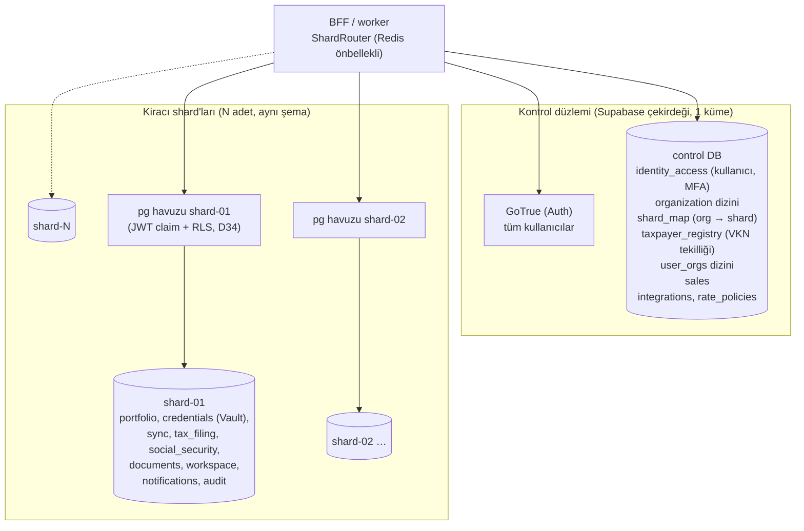

<!-- gezinti — node tools/docs/gezinti.mjs --yaz üretir, elle düzenlemeyin -->
[README](../../README.md) › [Genel bakış](../00-genel-bakis.md) › [01 Hedef mimari](01-cok-kiracili-hedef-mimari.md) › **07 Veri ve sharding**
<!-- /gezinti -->

# 5.7 Veri saklama (10 yıl) ve sharding

> Önce: [5.3 Kapasite](03-kaynak-verimliligi-ve-kapasite.md), [5.6 Kaynak kod yapısı](06-kaynak-kod-yapisi-ddd-tdd.md)
> Kararlar (24.10.2026, Hakan): **D23** iş verisi **10 yıl** saklanır (müşavir devrinde eski ofisteki veri dahil) · **D24** veritabanında **sharding baştan** uygulanır · **D26** ölçek: **500 ofis**, gece penceresi **20:00–09:00**.

## 1. Neden baştan sharding

Kaba hacim tahmini (500 ofis × 1.505 hesap ≈ 750.000 kurum hesabı; doğrulanacak):

| Veri | Yıllık satır (tahmin) | 10 yıl |
|---|---|---|
| Beyanname/tahakkuk (`tax_filing`) | ~20–25 milyon (mükellef başına yılda ~30 kayıt) | ~250 milyon |
| SGK (bildirge, giriş/çıkış, rapor, kaza) | ~20–30 milyon | ~250 milyon |
| Denetim kaydı (`audit`) | ~50–100 milyon | ~0,5–1 milyar |
| İş/adım (`sync.job_steps`) | çok yüksek | 90 gün tutulur (aşağıda) |

Toplam yüz milyonlarca satır ve birkaç TB veri birikir. Bu hacmi tek PostgreSQL ile taşımak mümkündür, ama yedekleme ve geri yükleme süresi, vakum, indeks bakımı ve tek sunucu sınırı **büyüdükten sonra** çözülmesi zor sorunlardır. Bu nedenle veri modeli ilk günden **kiracı (ofis) bazında bölünebilir** kurulur ve sharding baştan devreye alınır.

## 2. Model: kontrol düzlemi + kiracı shard'ları

| Bileşen | Ne tutar | Neden orada |
|---|---|---|
| **Kontrol düzlemi** (tek) | Kullanıcı ve kimlik (GoTrue), ofis dizini, `shard_map`, kullanıcının hangi ofislerde olduğu (`user_orgs`), sistem genelinde VKN tekilliği (`taxpayer_registry`, VKN/TCKN'nin HMAC özeti), satış portalı verisi, entegrasyon kaydı ve hız politikaları | Kiracılar arası, küçük ve yavaş büyüyen veri |
| **Kiracı shard'ı** (N adet) | Bir ofisin **tüm** iş verisi: mükellefler, kurum hesapları (Vault), işler, beyanname, SGK, belgeler, görevler, bildirimler, denetim. Ofis üyelikleri ve yetkileri de buradadır (RLS yerel çalışsın diye) | Büyüyen veri. Bir ofisin bütün verisi tek shard'da durur |

**Shard anahtarı `org_id`'dir.** Bir ofisin verisi asla iki shard'a bölünmez, iş akışları shard'lar arası sorgu gerektirmez. Mükellef tek müşaviredir (D16), dolayısıyla tek ofise ve tek shard'a aittir.

### 2.1 Yönlendirme

- `ShardRouter`, oturumdaki aktif ofisin shard'ını kontrol düzlemindeki `directory.organizations`'tan okur (süreç içinde kısa süre önbelleklidir). **D34 (25.10):** BFF ve işçi shard'a PostgREST üzerinden değil doğrudan `pg` havuzuyla bağlanır; her işlemde `set local role authenticated` + `request.jwt.claims` (GoTrue JWT'sinden doğrulanmış kimlik ve etkin ofis) yazılır, RLS her shard'da yerel çalışır. Giriş rolleri (`eworks_app`, `eworks_worker`, `eworks_integration`) NOINHERIT'tir; rol değiştirmeden tabloya erişemezler.
- GoTrue tektir. JWT'yi BFF doğrular; kimlik RLS'e `app.uid()` ile geçer (`auth.uid()` kullanılmaz). Sistem işleri `app.is_system(org)` ile yalnız işçi rolünde ve tek ofis için geçerlidir. Shard'larda `auth.users` tablosu bulunmadığı için `user_id` sütunlarına yabancı anahtar kurulmaz.
- İş mesajları (RabbitMQ) `shard_id` taşır. İşçiler bağlantıyı shard'a göre havuzdan alır.
- Kullanıcı birden çok ofise üyeyse (ör. bir mükellef kullanıcının farklı ofislerdeki firmaları) ofis listesi `user_orgs`'tan gelir. Ofis seçilince shard değişir.

### 2.2 Kiracılar arası tek kural: VKN tekilliği (D16)

Mükellef kaydı iki aşamalı yapılır:
1. Kontrol düzleminde `taxpayer_registry`'ye **rezervasyon** (VKN özeti + `org_id`, benzersiz).
2. Shard'da kayıt.
3. Rezervasyon onayı.

Ara adımda hata olursa rezervasyon zaman aşımıyla düşer. Müşavir devri aynı kaydı yeni ofise aktarır.

### 2.3 Shard sayısı ve büyüme

- **Mantıksal shard sayısı fiziksel sunucudan fazladır.** Başlangıç: 16 mantıksal shard (ayrı veritabanları) 2 fiziksel PostgreSQL sunucusunda. Büyüdükçe mantıksal shard'lar replikasyonla yeni sunuculara taşınır. Uygulama değişmez, yalnız `shard_map` hedefi değişir.
- Yeni ofis, en az dolu mantıksal shard'a atanır (satış portalı ofis açarken).
- Çok büyüyen bir ofis, mantıksal replikasyonla tek başına başka bir shard'a taşınabilir (`org_id` ile süzülen yayın).
- Kapasite eşiği (öneri): bir fiziksel sunucuda veri > 2 TB veya p95 sorgu > 100 ms olduğunda yeni sunucu eklenir ve mantıksal shard'lar dağıtılır.

### 2.4 Citus neden ilk seçim değil

Citus, PostgreSQL'i `org_id` ile şeffaf biçimde dağıtır ve güçlü bir seçenektir. Ancak:
- Supabase'in self-hosted yığını (GoTrue, Storage, Realtime, Supabase Postgres imajı ve uzantıları) tek bir standart PostgreSQL varsayar;
- dağıtık tablolarda RLS, uzantı ve migration davranışının ayrıca doğrulanması gerekir;
- işletim karmaşıklığı artar.

Uygulama düzeyinde kiracı sharding'i Compose ve Kubernetes'te aynı biçimde çalışır. Yine de şema **Citus'a hazır** kurulur: tüm kiracı tablolarında birincil anahtar `(org_id, id)` ile başlar ve tüm yabancı anahtarlar `org_id` içerir. Böylece ileride Citus'a geçmek veri modelini değiştirmez.

## 3. Shard içinde zamana göre bölümleme ve 10 yıl saklama (D23)

| Veri sınıfı | Bölümleme | Sıcak (hızlı disk) | Soğuk | Silme |
|---|---|---|---|---|
| İş verisi: beyanname, tahakkuk, SGK kayıtları, mükellef kartı geçmişi | Yıl (dönem yılı) | Son 2 yıl | 3–10 yıl: ayrı tablespace (ucuz disk), salt okunur | **10 yıl** dolunca bölüm ayrılır, şifreli arşiv dökümü nesne deposuna alınır, sonra silinir |
| Denetim kaydı | Ay | Son 12 ay | 1–10 yıl soğuk | 10 yıl |
| Müşavir devrinde eski ofiste kalan veri | (aynı bölümler) | — | Salt okunur, eski ofiste | **10 yıl** (devir tarihinden) |
| `sync.job_steps` (adım günlüğü) | Gün | 90 gün | — | 90 gün (iş özeti `sync.jobs`'ta 10 yıl) |
| PDF dosyaları (MinIO) | — | 7 gün (D15) | — | Parametre |
| Ham entegrasyon sonucu | — | 7 gün | — | Parametre |

- Bölüm yönetimi `pg_partman` ile yapılır: önceden bölüm açma, eski bölümleri ayırma ve tablespace taşıma, bakım işi `apps/worker` planlayıcısında.
- Saklama süreleri `retention_policies` tablosunda veri sınıfı bazında **parametredir** (varsayılanlar yukarıda).
- Sorgular dönem/yıl filtresi taşır. Böylece PostgreSQL yalnız ilgili bölümlere bakar (partition pruning). Ekranlarda varsayılan görünüm son 2 yıldır; eski yıllar seçilerek açılır.
- **Müşavir devri itiraz süresi** parametredir (`advisor_transfer_objection_days`, varsayılan 7 gün).

## 4. İşletim

| Konu | Uygulama |
|---|---|
| Migration | `tools/db/migrate`: kontrol düzlemi + tüm shard'lar. Önce "kanarya" shard'a, sonra diğerlerine paralel uygulanır. Her shard'ın kendi sürüm tablosu vardır. CI'da 2 shard'lı test yığını kullanılır |
| Yedekleme | Fiziksel sunucu başına pgBackRest (sürekli WAL + günlük tam). Shard bazında PITR. Kontrol düzlemi ayrıca yedeklenir |
| Geri yükleme tatbikatı | Ayda bir, rastgele bir shard |
| İzleme | Shard bazında boyut, p95, bağlantı, replikasyon gecikmesi, bölüm sayısı. Ofis bazında "en büyük 20 kiracı" |
| Compose | Kontrol DB + 2 shard sunucusu (her biri birden çok mantıksal veritabanı). Uygulama shard'a doğrudan bağlanır (D34) |
| Kubernetes | CloudNativePG: kontrol kümesi + shard kümeleri |
| Test | Testlerde en az 2 shard: kiracılar arası sızıntı, yönlendirme ve VKN tekilliği testleri |

## 5. Kod yapısına etkisi (5.6'ya ek)

- `packages/platform/db/ShardRouter` ve bağlantı havuzu yöneticisi eklenir. Application katmanı shard'ı bilmez; repository'ler `OrgContext` ile çalışır.
- Bağlamların yeri:
  - **kontrol düzlemi:** `identity-access` (kullanıcı/MFA), `organization` (dizin), `sales`, `sync`'in entegrasyon kaydı ve hız politikası kısmı;
  - **kiracı shard'ı:** diğerleri.
- `supabase/migrations/control/` ve `supabase/migrations/tenant/` olarak iki migration dizini tutulur.

<!-- gezinti — node tools/docs/gezinti.mjs --yaz üretir, elle düzenlemeyin -->

---

[README](../../README.md) › [Genel bakış](../00-genel-bakis.md) › [01 Hedef mimari](01-cok-kiracili-hedef-mimari.md) › **07 Veri ve sharding**
<!-- /gezinti -->
