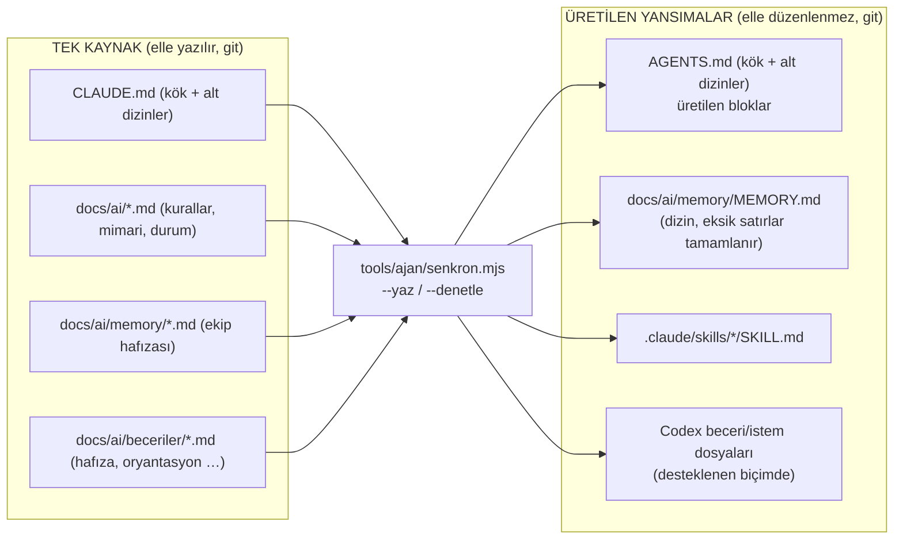

# 5.9 Yapay zekâ ajan bağlamı ve ekip hafızası (Claude ↔ Codex)

> Önce: [5.8 Depo yeniden yapılanması](08-depo-yeniden-yapilanmasi.md)
> Karar **D31** (24.10.2026, Hakan): Yeni yapıda da Claude, Codex ve benzeri yapay zekâ kullananların hafıza ve bağlam dosyaları **git ile paylaşılır ve sürümlenir**. Bir geliştirici Claude **veya** Codex ile değişiklik yaptığında öteki aracın dosyaları **otomatik ve karşılıklı** güncellenir (Claude → Codex, Codex → Claude). Claude kullananın işi bitince Codex tarafını, Codex kullananın işi bitince Claude tarafını güncelleyen betikler çalışır.

## 1. Bugün nasıl çalışıyor, eksik ne

| Bugün (`mukellef-takip/tools/ajan`, `tools/claude`) | Durum |
|---|---|
| Ortak hafıza dizini `docs/ai/memory/` (git'te). Claude, `autoMemoryDirectory` ile buraya yazar | ✅ |
| Claude: SessionStart kancası `claude.ps1 -Mod guncelle -Ajan` (çek + değişen bağlamı bildir), Stop kancası `-Mod bitir -Ajan` | ✅ otomatik |
| Codex: kanca yok; `AGENTS.md` "zorunlu ilk komut `codex.ps1 -Mod guncelle -Ajan`" ve "bitirmeden önce `-Mod bitir -Ajan`" der | ⚠️ Codex'in talimata uymasına bağlı |
| `AGENTS.md` kuralları tekrarlamaz, kaynak dosyaları gösterir | ✅ |
| Claude tarafında yeni bir bağlam dosyası (`@docs/ai/x.md` içe aktarımı, yeni `apps/*/CLAUDE.md`) eklenince `AGENTS.md`'deki okuma listesi **elle** güncellenmeli | ❌ unutulabilir |
| Codex hafıza kaydı yazıp `MEMORY.md`'ye satır eklemeyi unutursa Claude o kaydı görmez | ❌ |
| Codex kullanan biri bir kuralı `AGENTS.md`'ye yazarsa Claude görmez | ❌ |
| Betikler PowerShell'e bağlı | ⚠️ Mac/Linux'ta `pwsh` gerekir |

## 2. İlke: tek kaynak, üretilen yansımalar, araçtan bağımsız tetik



- **Kural, mimari, durum ve hafıza tek yerde yazılır:** `CLAUDE.md`, `docs/ai/`, `docs/ai/memory/`. Claude da Codex de **aynı dosyaları** okur ve yazar.
- **Araca özel dosyalar üretilir:** `AGENTS.md`'nin üretilen blokları, `MEMORY.md` dizini, beceri dosyaları. `senkron.mjs` bunları kaynaktan yeniden kurar. Böylece Claude tarafındaki değişiklik Codex'e, Codex'in yazdığı hafıza Claude'a kendiliğinden geçer.
- **Tetik araçtan bağımsızdır:** Asıl güvence **git kancalarıdır**. Claude kancaları ve Codex `AGENTS.md` talimatı ek katmandır. Hangi aracı kullanırsanız kullanın, commit ve pull sırasında senkron çalışır.

## 3. Dosya düzeni (yeni kök)

```
Ortakcalisma/
├─ CLAUDE.md                     ← kaynak: proje belleği, @docs/ai/* içe aktarımları
├─ AGENTS.md                     ← üretilen bloklar + kısa elle yazılmış giriş (aşağıda)
├─ apps/web/CLAUDE.md            ← kaynak (alt dizin kuralları)
├─ apps/web/AGENTS.md            ← üretilen: "bu dizinde CLAUDE.md'yi oku" + içeriğin başlık özeti
├─ docs/ai/
│  ├─ *.md                       ← kurallar, mimari, durum (kaynak)
│  ├─ beceriler/hafiza.md        ← kaynak beceri metinleri (araçtan bağımsız)
│  ├─ beceriler/oryantasyon.md
│  └─ memory/                    ← EKİP HAFIZASI (kaynak) + MEMORY.md (dizin, senkron tamamlar)
├─ .claude/
│  ├─ settings.json              ← kancalar: SessionStart, Stop → tools/claude/*.mjs
│  └─ skills/{hafiza,oryantasyon}/SKILL.md   ← üretilen (docs/ai/beceriler'den)
├─ .codex/ (veya Codex'in desteklediği proje içi yer)  ← üretilen beceri/istem dosyaları
└─ tools/
   ├─ ajan/
   │  ├─ senkron.mjs             ← çekirdek (Node, platformdan bağımsız)
   │  ├─ guncelle.mjs · bitir.mjs← ortak akışlar (Node)
   │  ├─ claude.ps1 · codex.ps1  ← ince sarmalayıcılar (Windows, mevcut alışkanlık)
   │  └─ claude.sh · codex.sh    ← ince sarmalayıcılar (Mac/Linux)
   ├─ claude/session-start.mjs · stop-bitir.mjs · check-memory.mjs
   └─ git-hooks/post-merge · post-checkout · pre-commit · pre-push
```

**`AGENTS.md`'nin yapısı:**

```markdown
# Eworks — kodlama ajanı talimatları (Codex vb.)
(elle yazılmış 5–10 satır: bu dosya üretilir, kural buraya yazılmaz, kaynak CLAUDE.md + docs/ai)

<!-- senkron:baslangic okuma-listesi — elle düzenlemeyin -->
1. CLAUDE.md'yi oku. İçe aktarımlar: docs/ai/vizyon.md, docs/ai/mimari.md, … (CLAUDE.md'den üretilir)
2. Alt dizin bağlamları: apps/web/CLAUDE.md, apps/sales/CLAUDE.md, … (dosya sisteminden üretilir)
<!-- senkron:bitis -->

<!-- senkron:baslangic hafiza — elle düzenlemeyin -->
(MEMORY.md'nin güncel kopyası + son değişiklikler için `git log` komutu)
<!-- senkron:bitis -->

<!-- senkron:baslangic akis — elle düzenlemeyin -->
Oturum başında: node tools/ajan/guncelle.mjs --ajan codex
Bitirmeden önce: node tools/ajan/bitir.mjs --ajan codex
<!-- senkron:bitis -->
```

Codex `AGENTS.md`'yi her oturumda kendiliğinden yükler. Hafıza dizini ve okuma listesi bu dosyanın içinde güncel durduğu için **Claude tarafında yazılan her şey Codex'in bir sonraki oturumunda bağlamdadır.**

## 4. `senkron.mjs` ne yapar

| Yön | İş | Ayrıntı |
|---|---|---|
| Claude → Codex | `AGENTS.md` okuma listesi | Kök `CLAUDE.md`'deki `@...` içe aktarımları ve tüm alt dizin `CLAUDE.md`'leri listelenir. Alt dizinlerde karşılık gelen `AGENTS.md` üretilir |
| Claude → Codex | `AGENTS.md` hafıza bloğu | `MEMORY.md` dizininin kopyası (bağlantılar köke göre) + son değişiklikler için `git log --since=14.days` komutu. Değişikliklerin kendisi bloğa yazılmaz: üretim tarihe bağlı olursa `--denetle` gün geçtikçe ve makineden makineye farklı sonuç verir (uygulamada değişti, 24.10) |
| Claude → Codex | Beceriler | `docs/ai/beceriler/*.md` → Codex'in desteklediği beceri/istem biçimi. Destek yoksa `AGENTS.md`'de "şu istekte şu dosyayı oku" eşlemesi yazılır |
| Codex → Claude | `MEMORY.md` tamamlama | `docs/ai/memory/*.md` içinde dizinde satırı olmayan kayıt varsa frontmatter'daki `description`'dan satır eklenir. Silinen kaydın satırı kaldırılır |
| Codex → Claude | Beceriler | `docs/ai/beceriler/*.md` → `.claude/skills/*/SKILL.md` |
| Codex → Claude | `AGENTS.md`'deki elle eklenmiş kural | Üretilen blokların **dışına** yazılmış yeni içerik `--denetle`'de hata verir: "kuralı CLAUDE.md veya docs/ai'ye taşı". `--yaz` kendiliğinden taşımaz (anlam kararı ajana/insana aittir); bitir akışı ajana taşıtır |
| Her iki yön | Hafıza denetimi | `check-memory.mjs`: frontmatter, dizin tutarlılığı, kişisel veri/sır kalıpları (TCKN, IBAN, e-posta, telefon, anahtar) |
| Her iki yön | Kanca kurulumu | `git config core.hooksPath tools/git-hooks` yoksa kurar. Claude için `autoMemoryDirectory` yerel ayarını yazar ya da eski yolu düzeltir (5.8 §3) |

Modlar:
- `--yaz`: üretilen dosyaları yeniden kurar ve değiştiyse `git add` ile sahneler.
- `--denetle`: hiçbir şey yazmaz; uyumsuzlukta 1 ile çıkar (CI, pre-push).

## 5. Tetikler — kim, ne zaman

| An | Claude kullanan | Codex kullanan | Araçtan bağımsız (git kancası) |
|---|---|---|---|
| Oturum başı | SessionStart kancası → `guncelle.mjs --ajan claude`: güvenliyse ileri sarar, `senkron --yaz`, değişen bağlamı özetletir | `AGENTS.md` "Oturum başında" → `guncelle.mjs --ajan codex` (aynı iş). Codex'in `AGENTS.md`'yi kendiliğinden yüklemesi, komut çalışmasa bile güncel hafızayı getirir | — |
| `git pull` / dal değişimi | — | — | **post-merge, post-checkout** → `senkron --yaz` + "ajan bağlamı değişti" uyarısı (değişen dosyalar listesi) |
| İş bitince | Stop kancası → `bitir.mjs --ajan claude` | `AGENTS.md` "Bitirmeden önce" → `bitir.mjs --ajan codex` | — |
| Commit | — | — | **pre-commit** → `senkron --yaz` (üretilenler aynı commit'e girer) + `check-memory` |
| Push / CI | — | — | **pre-push** ve CI → `senkron --denetle`. Üretilenler kaynakla uyumsuzsa birleştirme engellenir |

**`bitir.mjs` her iki araç için aynı adımları çalıştırır** (karşılıklılık burada sağlanır):
1. Değişikliği gözden geçirtir (git diff).
2. Kural, mimari, durum veya karar değiştiyse kaynak belgeyi (`CLAUDE.md`, `docs/ai`, `docs/adr`, `docs/baglamlar`) güncelletir.
3. Kodda görünmeyen öğrenim varsa `docs/ai/memory`'ye yazdırır.
4. `senkron --yaz` çalıştırır: **Claude kullandıysa Codex dosyalarını (`AGENTS.md`, Codex becerileri), Codex kullandıysa Claude dosyalarını (`MEMORY.md` dizini, `.claude/skills`) günceller.**
5. `check-memory` ve testleri (TDD, 5.6 §7) çalıştırır.
6. Commit ettirir.

`--ajan claude|codex` yalnız istemin dilini ve araç adlarını değiştirir. Senkron her durumda **iki tarafı da** kurar.

## 6. Kişisel ve paylaşılan ayrımı (değişmez)

| Bilgi | Yer | Git |
|---|---|---|
| Ekip kuralı, mimari, durum | `CLAUDE.md`, `docs/ai/*.md` | ✅ |
| Gerekçeli karar | `docs/adr/` | ✅ |
| Kodda görünmeyen öğrenim (feedback/project/reference) | `docs/ai/memory/` | ✅ |
| Kişiye özel tercih | `CLAUDE.local.md`, `~/.codex/AGENTS.md` | ❌ (gitignore / ev dizini) |
| Kişisel veri, sır, gerçek mükellef/müşavir bilgisi | Hiçbir yer | ❌ (`check-memory` + gitleaks engeller) |

Hafıza kaydı biçimi bugünküyle aynıdır: tek bilgi tek dosya, frontmatter (`name`, `description`, `metadata.type`), `**Why:**` / `**How to apply:**`, `[[bağlantı]]`.

## 7. Geçiş (5.8'deki taşıma adımlarına eklenir)

1. `mukellef-takip/tools/ajan/*.ps1` mantığı `tools/ajan/{senkron,guncelle,bitir}.mjs`'e taşınır. `.ps1`/`.sh` dosyaları yalnız sarmalayıcı olur.
2. `tools/claude/*.mjs` kök yollarına uyarlanır. `session-start.mjs`'e eski `autoMemoryDirectory` yolunu düzeltme davranışı eklenir.
3. `tools/git-hooks/*` eklenir. `pnpm install` sonrası (`prepare` betiği) `core.hooksPath` ayarlanır.
4. `.claude/skills/{hafiza,oryantasyon}` metinleri `docs/ai/beceriler/`'e kaynak olarak alınır, ilk `senkron --yaz` ile iki taraf üretilir.
5. Codex'in proje içi beceri/istem desteği o anki sürümde doğrulanır (§4'teki yedek yol: `AGENTS.md` eşlemesi).
6. Kabul testleri (`tools/ajan/test/`) şu senaryoları kapsar:
   - Claude tarafında yeni `@docs/ai/x.md` eklenince `AGENTS.md` güncellenir;
   - Codex'in dizine eklemediği hafıza kaydı `MEMORY.md`'ye eklenir;
   - `AGENTS.md`'ye elle yazılan kural `--denetle`'de yakalanır;
   - pull sonrası post-merge uyarısı verilir.

**Durum (24.10.2026): uygulandı** (`yeniden-yapilanma` dalı). 1–4 ve 6 tamam: kabul testleri `node --test tools/ajan/test/` (yukarıdaki dört senaryo + alt dizin `AGENTS.md`/beceri üretimi ve silinmesi + `autoMemoryDirectory` düzeltmesi + yerel taşıma betiği). 5 açık: Codex'in proje içi beceri desteği doğrulanmadı; şimdilik yedek yol (`AGENTS.md` "Beceriler" bloğu) kullanılıyor, `.codex/` üretilmiyor. Kullanım rehberi: [gelistirici-rehberi/claude-codex.md](../gelistirici-rehberi/claude-codex.md).
