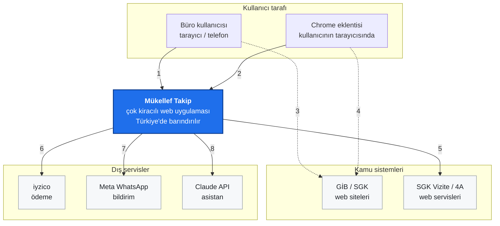
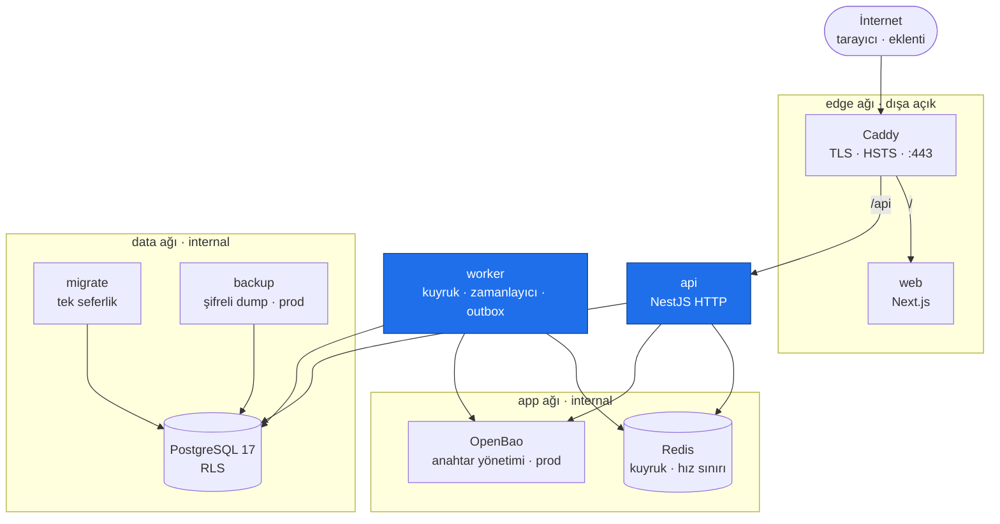
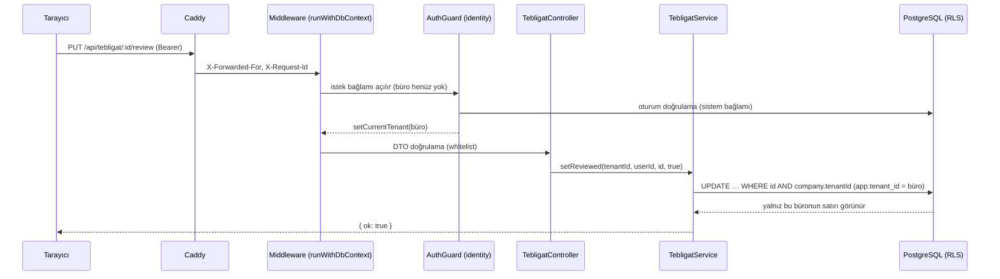

# 0 · Genel bakış

> Seviye 0 — Sistem ne yapar, kim kullanır, hangi parçalardan oluşur. Ayrıntı için alt seviyelere bağlantılar var.

## Bir cümlede

Mükellef Takip, mali müşavir bürolarının onlarca–yüzlerce mükellefi için **beyanname, e-Defter, e-Tebligat, SGK, fatura ve bordro yükümlülüklerini tek bir iş kutusunda** izlediği, çok kiracılı (büro başına izole) bir web uygulamasıdır.

## Kim kullanır

| Aktör | Ne yapar |
|---|---|
| **Büro yöneticisi** (ADMIN) | Kullanıcı, güvenlik politikası (2FA), lisans/ödeme, toplu aktarım, asistan onayı |
| **Büro personeli** (STAFF) | Günlük iş: iş kutusu, beyanname kontrolü, tebligat inceleme, SGK rapor onayı, dilekçe |
| **Chrome eklentisi** | Kullanıcının açtığı GİB/SGK sayfasındaki tabloyu (kullanıcı onayıyla) sisteme aktarır |
| **Zamanlanmış işler** (worker) | Gece SGK senkronu, sabah hatırlatıcıları, bildirim gönderimi, olay dağıtımı |

## Sistem bağlamı (C4 — seviye 1)



| # | Akış | Kural |
|---|---|---|
| 1 | Kullanıcı → sistem: HTTPS | Oturum, 2FA, büro izolasyonu |
| 2 | Eklenti → sistem: sayfadan okunan tablo | Eklenti anahtarıyla; önizleme → onay |
| 3 | Kullanıcı GİB/SGK sayfasını **kendisi** açar | Sistem GİB'e bağlanmaz, şifre saklamaz |
| 4 | Eklenti açık sayfadaki tabloyu okur | Yalnız kullanıcı onayıyla |
| 5 | Sistem → SGK: SOAP | Kurum şifresi KMS ile şifreli, her çözme denetim kaydında |
| 6 | Sistem → iyzico: ödeme formu, sorgu | Tutar sunucuda hesaplanır |
| 7 | Sistem → WhatsApp: şablon mesaj | Kişisel veri taşımaz |
| 8 | Sistem → Claude API: soru | Maskeli; büro onayı olmadan gitmez |

Sınır kuralları: **GİB'e sistem kendisi bağlanmaz** (şifre saklamaz, robot yok); veri kullanıcının açtığı sayfadan gelir. Yurt dışına çıkan iki kanal (WhatsApp, Claude) kişisel veri taşımaz / büro onayı ister. Gerekçe: [Güvenlik mimarisi](04-mimari/03-guvenlik-mimarisi.md).

## Kapsayıcılar (C4 — seviye 2)



- Dışarıya yalnız Caddy açıktır. `app` ve `data` ağları `internal` olduğu için dışarı çıkamaz. Ağlar arasında köprü kuran süreçler yalnız **api** (edge + app + data) ve **worker**'dır (app + data). Kaynak: `infra/docker/compose*.yml`.
- **api** ve **worker** aynı kod tabanı ve aynı imajdır; farklı giriş noktasıyla çalışır (`src/main.ts`, `src/worker.ts`). Ayrıntı: [Çalışma zamanı](04-mimari/01-calisma-zamani.md).
- Tek veritabanı, tek şema; büro izolasyonu satır düzeyinde (RLS). Ayrıntı: [Veri modeli](04-mimari/02-veri-modeli.md).

## Kod tabanı içinde (C4 — seviye 3, özet)

```
apps/api/src/
  modules/<13 bounded context>/   domain · application · infrastructure · interface/http · index.ts
  platform/                       config · database (RLS) · crypto (KMS) · audit · events (outbox) · logging · security · http
  shared-kernel/                  TCKN, para, tablo metni, PII maskeleme — saf yardımcılar
apps/web/src/                     Next.js App Router: app/ (sayfalar), components/ (görünümler), lib/api.ts
apps/extension/                   Chrome MV3 eklentisi
infra/docker/                     compose (dev/prod/test), Dockerfile'lar, Caddy, OpenBao, yedek
```

13 bounded context: `identity`, `taxpayers`, `tax-filing`, `tebligat`, `social-security`, `invoicing`, `payroll`, `billing`, `documents`, `assistant`, `notifications`, `workspace`, `data-intake`. Neden bu bölünme: [Bağlam haritası](01-stratejik-tasarim/03-baglam-haritasi.md); her birinin ayrıntısı: [Katalog](02-baglamlar/README.md).

## Bir isteğin yolculuğu (örnek: "Tebligatı incelendi işaretle")



Her adımın ayrıntısı: [Çapraz kesen konular](03-taktiksel-tasarim/05-capraz-kesen-konular.md).

## Temel kalite hedefleri (öncelik sırasıyla)

1. **Gizlilik ve izolasyon** — bir büro diğerinin verisini hiçbir koşulda göremez; kişisel veri şifreli, maskeli, denetimli.
2. **Doğruluk** — son günler, tebliğ tarihleri, mutabakat kuralları test edilmiş saf fonksiyonlardır.
3. **Kullanıcı kontrolü** — kuruma yazan her işlem açık kullanıcı eylemidir; toplu aktarım önce önizleme gösterir.
4. **Değiştirilebilirlik** — bağlam sınırları kodla zorlanır; bir bağlamı değiştirmek diğerlerini kırmaz.
5. **İşletilebilirlik** — tek komutla Docker yığını, test kapıları, şifreli yedek.

Sonraki seviye: [1 · Stratejik tasarım](01-stratejik-tasarim/01-is-alani-ve-alt-alanlar.md).
