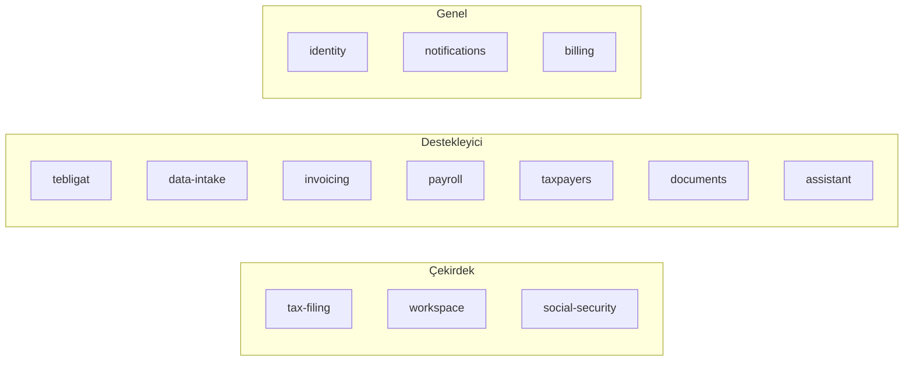

# 1.1 · İş alanı ve alt alanlar

> Seviye 1 — Stratejik tasarım. Önceki: [Genel bakış](../00-genel-bakis.md) · Sonraki: [Ortak dil](02-ortak-dil.md)

## İş alanı (domain)

**Mali müşavirlik bürosunun uyum (compliance) takibi.** Büro, her mükellefi için devletin farklı kurumlarına (GİB, SGK) karşı süreli yükümlülükleri yerine getirmekten sorumludur. Kaçırılan bir son gün mükellefe ceza, büroya itibar ve müşteri kaybı demektir. Bugün bu takip kurum ekranları arasında elle yapılıyor.

Değer önerisi: *"Bugün hangi mükellef için ne yapmam gerekiyor, ne gecikti, ne yaklaşıyor?"* sorusunun tek ekranda, doğru ve güvenli cevabı.

## Alt alanlar ve sınıflandırma

DDD'de alt alanlar yatırımın nereye yapılacağını belirler: **çekirdek** (rekabet avantajı — en iyi ekip, en fazla tasarım), **destekleyici** (işe özgü ama farklılaştırmaz — yeterince iyi), **genel** (her yazılımda var — hazır çözüm ya da en basit hâl).

| Alt alan | Tür | Neden | Bounded context(ler) |
|---|---|---|---|
| Yükümlülük ve son gün takibi (beyanname, e-Defter) | **Çekirdek** | Ürünün varlık sebebi; kurallar (son gün, dönem, hafta sonu kayması, e-Defter tercihleri) incelikli ve hatası pahalı | `tax-filing` |
| İş kutusu (bugün ne yapılacak) | **Çekirdek** | Farklılaştıran kullanıcı deneyimi: dağınık kaynakları tek önceliklendirilmiş listeye çevirir | `workspace` |
| SGK süreçleri (e-rapor, 4A, e-Bildirge) | **Çekirdek** | Kurum entegrasyonu + sağlık verisi; doğru ve güvenli yapmak zor | `social-security` |
| e-Tebligat takibi | Destekleyici | Kural basit (VUK 107/A, 5 gün) ama süre kaçırma riski yüksek | `tebligat` |
| Kurum sayfalarından veri alımı | Destekleyici | GİB/SGK ekranları değiştikçe uyarlanması gereken çevirmen katman | `data-intake` (+ bağlamların ayrıştırıcıları) |
| Fatura ön kontrolü (KDV) | Destekleyici | Değerli ama muhasebe yazılımının yerini almaz | `invoicing` |
| Bordro mutabakatı | Destekleyici | Bordro programının çıktısını e-Bildirge ile karşılaştırır, hesaplamaz | `payroll` |
| Mükellef kartı | Destekleyici (paylaşılan çekirdek varlık) | Herkesin referans aldığı kimlik; davranışı az | `taxpayers` |
| Dilekçe | Destekleyici | Şablon + doldurma | `documents` |
| Mevzuat asistanı | Destekleyici | Dış LLM; değerimiz güvenli kullanım (maskeleme, onay, kota) | `assistant` |
| Bildirim ve hatırlatma | Genel | Her üründe var; değerimiz kişisel veri sızdırmaması | `notifications` |
| Kimlik, oturum, yetki | Genel | Standart ama güvenlik kritik — en iyi uygulamalarla | `identity` |
| Lisans ve ödeme | Genel | iyzico'ya bırakılır; değerimiz doğrulama (tutar, sahtecilik) | `billing` |

### Yatırım ilkeleri

- **Çekirdekte**: iş kuralları saf fonksiyon olarak `domain/`'de, yoğun birim testi; kurallar yasal dayanağıyla yorumlanır (ör. "VUK 107/A"). Belirsiz kural uydurulmaz, "elle girilir" diye açıkça bırakılır (ör. Ekim–Aralık e-Defter son günü).
- **Destekleyicide**: basit uygulama servisi + Prisma yeterli; dış biçim değişikliklerine karşı ayrıştırıcılar ayrı ve testli.
- **Genelde**: kendi icadımız yok — argon2id, TOTP RFC 6238, iyzico'nun ödeme formu, Meta şablon mesajı; değerimiz güvenli entegrasyon.

## Problem alanı sınırları (bilinçli olarak dışarıda)

Beyanname hazırlama/gönderme, bordro hesaplama, muhasebe kaydı, GİB'e otomatik giriş, mükellefin (son müşteri) portala girişi. Neden: sorumluluk ve güvenlik riski ürün değerini aşar; ayrıntı [vizyon](../ai/vision.md).

## Alt alan → çözüm alanı eşlemesi

Bağlamlar arasındaki ilişkiler: [Bağlam haritası](03-baglam-haritasi.md).
