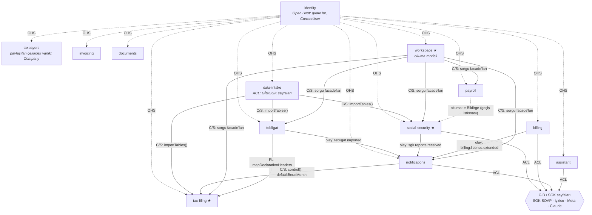

# 1.3 · Bağlam haritası ve ilişki kalıpları

> Seviye 1. Önceki: [Ortak dil](02-ortak-dil.md) · Sonraki: [İş akışları](04-is-akislari.md)

## Neden bu sınırlar?

Bounded context, bir modelin **tutarlı olduğu sınırdır**. Sınırları belirlerken üç soruya baktık:

1. **Değişim nedeni aynı mı?** e-Defter son gün kuralı ile beyanname son gün kuralı aynı mevzuat ekosistemiyle birlikte değişir → ikisi `tax-filing`'de. SGK web servisi değişince fatura etkilenmez → ayrı.
2. **Dil aynı mı?** "Dönem" beyannamede `2026-Q3` olabilir, bordroda yalnız `2026-09`'dur; "kayıt" SGK'da rapor, faturada belge demektir.
3. **Veri sahipliği net mi?** Her tablonun tek bir sahibi var (bkz. tablo); başka bağlam o tabloya yazmaz.

Sınırlar kodla zorlanır: bir bağlam diğerine yalnız `modules/<bağlam>/index.ts` üzerinden erişebilir (`npm run arch:check`).

## Harita

★ çekirdek alt alan · OHS = Open Host Service · C/S = Customer/Supplier · PL = Published Language · ACL = Anti-Corruption Layer

## İlişkiler ve kalıplar

| Yukarı akış (upstream) → aşağı akış | Kalıp | Nasıl uygulanıyor | Neden |
|---|---|---|---|
| identity → herkes | **Open Host Service** | `identity/index.ts`: `AuthGuard`, `AdminGuard`, `ImportGuard`, `CurrentUser`, `AuthUser` | Kimlik tek yerde; her bağlam aynı sözleşmeyi kullanır |
| taxpayers → herkes | **Paylaşılan çekirdek varlık** (bilinçli istisna) | `Company` ve `tenantId` üzerinden salt okuma JOIN'leri serbest | Mükellef her bağlamın kapsam anahtarıdır; facade'la sarmak her sorguyu karmaşıklaştırırdı |
| data-intake → tax-filing / tebligat / social-security | **Customer/Supplier** | Aşağı akış (data-intake) ihtiyacını tanımladı: her bağlam `importTables(tenantId, tables, dryRun)` sunar | Eklenti tek uç noktaya gönderir; her bağlam kendi tablosunu tanır |
| tebligat, social-security, billing → notifications | **Domain olayı (yayınla/abone ol)** | Outbox: `tebligat.imported`, `sgk.reports.received`, `billing.license.extended` | Bildirim hatası ana işlemi bozmasın; bağımlılık yönü üretici → tüketici değil |
| tax-filing → notifications | **Customer/Supplier** | notifications hatırlatıcıları `DeclarationsService.control()`, `EDefterService` kullanır | Son gün mantığı tek yerde; hatırlatıcı onu çağırır |
| tax-filing → tebligat | **Published Language** | `mapDeclarationHeaders` (beyanname tablosunu tanıma) | Tebligat ayrıştırıcısı beyanname tablolarını atlayabilsin |
| çok kaynaklı → workspace | **Customer/Supplier + okuma modeli (CQRS)** | workspace yazmaz (yalnız `InboxSnooze`); facade'lardan iş kutusu, özet, rapor üretir | Kullanıcının tek bakışlık ekranı; kaynak bağlamları kirletmez |
| social-security, billing, notifications, assistant → dış dünya | **Anti-Corruption Layer** | `infrastructure/` istemcileri: SOAP Vizite, iyzico, WhatsApp, Claude; `mock`/`live` | Dış modelin (alan adları, hata kodları) domain'e sızmasını engeller |
| data-intake → GİB/SGK sayfaları | **ACL** | Ayrıştırıcılar başlıktan tanır: `declaration-table-parser`, `tebligat-parser`, `ebildirge-parser` | GİB arayüzü değişince eklenti değil sunucu güncellenir |
| herkes → shared-kernel | **Shared Kernel** | `shared-kernel/`: TCKN, para (`roundKurus`), tablo metni, PII maskeleme | Küçük, saf, nadiren değişen ortak kavramlar; değişikliği tüm ekip onaylar |

### Anti-corruption layer

Dış sistemin modeli bize **çevrilerek** girer:

| Dış kavram | Çevirmen | İçerideki karşılığı |
|---|---|---|
| SGK `TCKIMLIKNO`, `MEDULARAPORID`, `VAKA`, `RAPORDURUMU` | `vizite-sync.service.ts` `upsert()` | `SgkReport` (kimlik alanları şifreli) |
| SGK hata kodu 105/106/503/505 | `ViziteError.isAuthError / isEmpty` | Yetki hatası / boş liste |
| GİB sayfa tablosu (`Vergi Kimlik No`, `Beyanname Türü`, `Dönem`) | `declaration-table-parser.ts` | `ParsedDeclaration` → `Declaration` |
| iyzico `paymentStatus`, `fraudStatus`, `paidPrice` | `verdictFromRetrieve()` | `PAID / REVIEW / FAILED` kararı |
| UBL-TR XML (`cbc:`, `cac:`) | `ubl-parser.ts` | `Invoice` |

## Veri sahipliği

| Bağlam | Sahip olduğu tablolar |
|---|---|
| identity | `Tenant` (politika alanları), `User`, `Session`, `ApiToken` |
| billing | `Subscription`, `Payment`, `Tenant` fatura alanları |
| taxpayers | `Company` |
| tax-filing | `CompanyObligation`, `Declaration`, `EDefterBerat`, `TaxCalendarEvent` |
| tebligat | `ETebligat` |
| social-security | `SgkWorkplace`, `SgkReport`, `EmploymentEvent`, `EBildirgeDocument` |
| invoicing | `Invoice` |
| payroll | `PayrollRun`, `PayrollLine` |
| documents | `PetitionTemplate`, `Petition` |
| assistant | `AssistantConversation`, `AssistantMessage` |
| notifications | `Notification`, `NotificationRead`, `NotificationDelivery` |
| workspace | `InboxSnooze` |
| platform (bağlam değil) | `AuditLog`, `OutboxEvent` |

Şema dosyaları bu bölünmeyi izler: `apps/api/prisma/schema/<bağlam>.prisma`.

## Bilinen sınır ihlalleri (geçiş istisnaları)

Import düzeyinde ihlal yoktur. Bazı bağlamlar başka bağlamın tablosunu **okuyor**; liste ve çözüm yolu: [Taktik borç](../03-taktiksel-tasarim/06-taktik-borc.md).

## Evrim: bir bağlam ne zaman ayrı servise çıkar?

Modüler monolit bilinçli bir tercihtir ([ADR 0001](../adr/0001-moduler-monolit.md)). Ayırma ancak şu durumlardan biri ölçülerek görülürse düşünülür: bağımsız ölçek ihtiyacı (ör. SGK senkronu), farklı güvenlik bölgesi (ör. kurum şifreleriyle çalışan bileşen), ayrı ekip sahipliği. Sınırlar hazırdır: `index.ts` API'si → HTTP/RPC, outbox olayları → mesaj kuyruğu.
