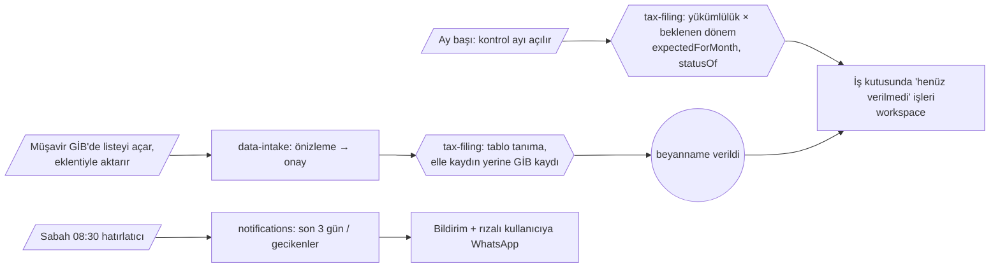
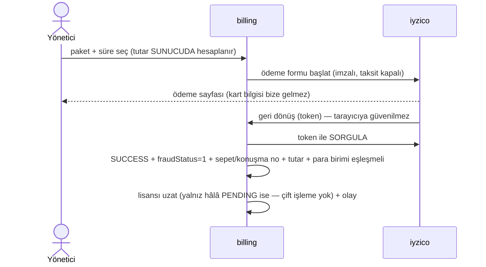

# 1.4 · Temel iş akışları

> Seviye 1. Önceki: [Bağlam haritası](03-baglam-haritasi.md) · Sonraki: [Bounded context kataloğu](../02-baglamlar/README.md)

Olay fırtınası (event storming) diliyle: **komut** (kullanıcı/zamanlayıcı ne ister) → **toplam/kural** (ne karar verir) → **olay** (ne oldu) → **tepki** (kim ne yapar). Her akışta hangi bağlamın sorumlu olduğu belirtilir.

## A · Aylık beyanname döngüsü (çekirdek)



Kurallar (`tax-filing/domain/declaration-rules.ts`): KDV ayın 28'i, MUHSGK ve Damga 26'sı; geçici vergi çeyreği izleyen 2. ayın 17'si; hafta sonu → ilk iş günü. **Resmi tatil ve süre uzatımı henüz yok** — bilinen sınır.

## B · e-Tebligat

```mermaid
sequenceDiagram
  actor M as Müşavir
  participant E as Eklenti
  participant DI as data-intake
  participant TB as tebligat
  participant OB as Outbox
  participant NT as notifications (worker)
  M->>E: GİB e-Tebligat listesinde "Bu sayfayı oku"
  E->>DI: POST /api/import/page (dryRun=true)
  DI->>TB: importTables → önizleme
  M->>E: "Aktar"
  E->>DI: dryRun=false
  DI->>TB: kaydet (belge no ile tekilleştir)
  TB->>TB: deemedServedAt = ulaşma + 5. gün sonu (VUK 107/A)
  TB->>OB: tebligat.imported (firma başına)
  OB-->>NT: worker dağıtır
  NT->>NT: Bildirim (uygulama içi: unvanlı; WhatsApp: unvansız)
```

## C · SGK e-rapor (çalışmazlık onayı)

1. **Gece 02:00** — worker `sync-all` → işyeri başına `sync-workplace` (eşzamanlı 2, dakikada 20).
2. `vizite-sync`: SGK'dan bekleyen raporları çek → **kişi alanları şifreli** kaydet → *sonra* SGK'da "okundu kapat" (kayıt başarılı olmadan kapatılmaz; rapor kaybolmaz).
3. Yeni rapor varsa → olay `sgk.reports.received` → bildirim (dış kanala isim gitmez).
4. Müşavir iş kutusunda raporu görür, **elle** "Onayla" der → sistem şifreli T.C. no'yu çözüp SGK'ya `raporOnay` gönderir → denetim kaydı.

İlke: **kuruma yazan işlem yalnız kullanıcı eylemiyle**; zamanlanmış iş yalnız okur.

## D · Bordro ↔ e-Bildirge mutabakatı

Bordro programının Excel çıktısı yüklenir (önizleme → kayıt). `payroll` satırları kontrol eder (SGK işçi %14, işsizlik %1, ≤ 30 gün, net ≤ brüt, geçerli ve tekil T.C.) ve aynı dönemin e-Bildirge belgeleriyle (asıl + ek − iptal) karşılaştırır: kişi sayısı, gün, PEK (1 TL tolerans). Sonuç iş kutusunda "bordro mutabakatı" işi olarak görünür.

## E · Lisans ödemesi (iyzico)



## F · Giriş ve oturum

E-posta + şifre (argon2id, 5 hatada 15 dk kilit, IP hız sınırı) → 2FA açıksa TOTP / kurtarma kodu → erişim + **tek kullanımlık yenileme anahtarı** (oturum ailesi). Şifre/2FA/rol değişikliği tüm oturumları düşürür; kullanılmış yenileme anahtarı tekrar gelirse aile iptal edilir. Ayrıntı: [identity](../02-baglamlar/identity.md).

## G · İş kutusu (her açılışta)

`workspace` kaynaklardan **türetir**, saklamaz: verilmemiş beyannameler, incelenmemiş tebligatlar, bekleyen e-raporlar, e-Defter beratları, bordro mutabakatı, lisans süresi. Her işin kararlı anahtarı vardır; "sonra hatırlat" bu anahtarla büro genelinde ertelenir. Avantaj: "iş kapandı mı?" durumu ayrıca tutulmadığı için tutarsızlık birikmez.
