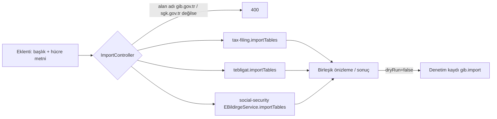

# data-intake

> Alt alan: Destekleyici · Kod: `apps/api/src/modules/data-intake/` · Kalıp: **Anti-Corruption Layer + Customer/Supplier**

## Sorumluluk

Chrome eklentisinin gönderdiği **kurum sayfası tablolarını** (GİB e-Beyanname, e-Tebligat; SGK e-Bildirge) alır, güvenlik kontrollerini yapar ve ilgili bağlamlara dağıtır. Tek uç nokta.
**Yapmaz:** tabloları kendisi yorumlamaz — her bağlam kendi tablosunu tanır (`importTables`); veritabanı tablosu yoktur.

## Akış

## Kurallar

- Yalnız resmi alan adları (`isAllowedImportHost`: `gib.gov.tr`, `sgk.gov.tr` alt alanları; geliştirmede `localhost`).
- Varsayılan **önizleme** (`dryRun=true`); yazma kullanıcı onayıyla.
- Boyut sınırları DTO'da: ≤ 50 tablo, tablo başı ≤ 5000 satır, gövde 2 MB.
- Kimlik: oturum **veya** `gib:import` kapsamlı eklenti anahtarı (`ImportGuard`); anahtar başka hiçbir uçta geçmez.

## HTTP uçları

`POST /api/import/page` `{ tables, pageUrl, dryRun?, taxNumber?, registryNo?, pageRegistryHints? }` — hız sınırı.

## Neden ayrı bir bağlam?

Kurum ekranı değiştiğinde değişiklik tek yerde kalsın (ayrıştırıcı + bu dağıtım) ve eklentinin yeniden dağıtılması gerekmesin. Eklenti "aptal" kalır: yalnız tablo metnini gönderir ([apps/extension/README.md](../../apps/extension/README.md)).

## Testler

e2e `test/sgk-tebligat-intake.e2e-spec.ts` (alan adı kontrolü, fazladan alan reddi, tebligat/beyanname/e-Bildirge yolları, başka büronun mükellefi), `test/identity.e2e-spec.ts` (eklenti anahtarıyla aktarım, iptal ve süre sonu).
