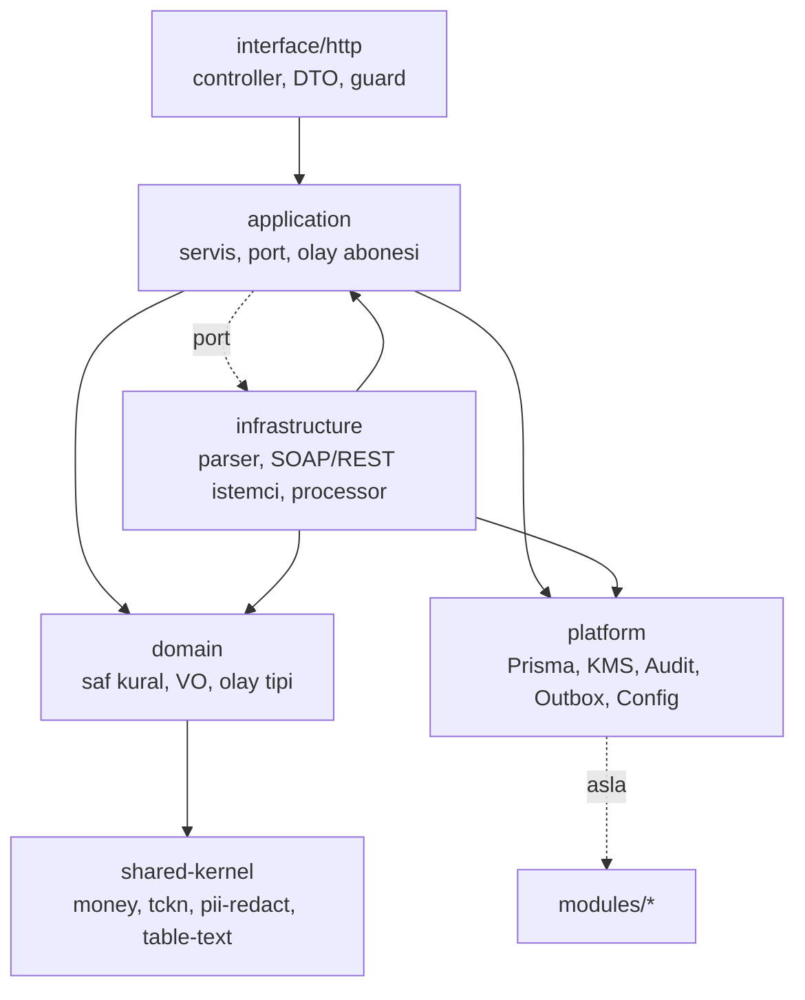

# 3.1 Katmanlar ve bağımlılık kuralları

> Üst: [Bağlam kataloğu](../02-baglamlar/README.md) · Karar: [ADR 0002](../adr/0002-ddd-katmanlari.md) · Zorlayan: `apps/api/.dependency-cruiser.cjs` (`npm run arch:check -w api`)

## Bir bağlamın iskeleti

```
apps/api/src/modules/<context>/
  domain/            saf iş kuralları, değer nesneleri, olay tipleri       (Nest/Prisma/HTTP YOK)
  application/       kullanım senaryoları (servisler), portlar, olay aboneleri
  infrastructure/    ayrıştırıcılar, dış sistem istemcileri, kuyruk işleyicileri
  interface/http/    controller + DTO (class-validator) + guard
  <context>.module.ts
  index.ts           PUBLIC API — başka bağlamlar yalnız bunu import eder
```

Her bağlamda dört katmanın hepsi olmak zorunda değildir: `taxpayers` henüz `domain/` ve `application/` içermez (controller Prisma'yı doğrudan kullanır — [taktik borç](06-taktik-borc.md)), `data-intake` yalnız `interface/`'tir.

## Bağımlılık yönü



| Kural (`.dependency-cruiser.cjs`) | Anlamı | İhlal örneği |
|---|---|---|
| `context-ici-dosyaya-erisim` | Başka bağlama yalnız `index.ts` üzerinden | `workspace` → `tax-filing/domain/declaration-rules.js` |
| `domain-saf-kalir` | `domain/` yalnız kendi domain'i, `shared-kernel`, Prisma **enum** tipleri ve Node çekirdeği (`crypto`) | `domain/` içinde `@nestjs/common` veya `PrismaService` |
| `domain-baska-context-kullanmaz` | Domain başka bağlamı bilmez | `billing/domain` → `taxpayers` |
| `application-interface-katmanini-kullanmaz` | Servis HTTP'yi bilmez (yalnız tip importu serbest) | servisin `Request` nesnesi alması |
| `shared-kernel-saf-kalir` | Ortak çekirdek hiçbir şeye bağımlı değil | `shared-kernel` → `platform` |
| `platform-is-kurali-icermez` | Altyapı bağlamlara bağımlı değil | `platform/audit` → `identity` |
| `dongusel-bagimlilik` | Bağlamlar arası döngü yok | `payroll` ↔ `social-security` |

## Katman katman: ne nereye yazılır?

| Soru | Katman | Örnek |
|---|---|---|
| "KDV'nin son günü ayın 28'i, hafta sonuysa ertesi iş günü" | **domain** | `tax-filing/domain/declaration-rules.ts` |
| "Bu tutar kuruşa yuvarlanır" | **shared-kernel** | `money.ts` `roundKurus` |
| "Bir mükellefin dönemlerini getir, kuralı uygula, eksikleri döndür" | **application** | `DeclarationsService.control` |
| "GİB tablosunun başlıkları şunlar, satırı şuna çevir" | **infrastructure** | `declaration-table-parser.ts` |
| "SGK SOAP servisine bağlan" | **infrastructure** (port `application/ports/`) | `soap-vizite.client.ts` ↔ `ViziteClient` |
| "`POST /api/declarations/import` gövdesi doğrulanır, rol kontrol edilir" | **interface** | `declarations.controller.ts` + DTO |
| "Tebligat gelince bildirim üret" | **application** (abone, *dinleyen* bağlamda) | `notifications/application/event-handlers.ts` |

**Pratik test:** Bir fonksiyonu veritabanı ve Nest olmadan, saf girdi → çıktı olarak test edebiliyorsan `domain/`'dedir. Prisma çağırıyorsa `application/`'dır. Dış dünyanın biçimini biliyorsa `infrastructure/`'dır.

## `index.ts` (public API) neyi dışa açar?

Yalnız şunları: modül sınıfı, başka bağlamların çağırabileceği **facade servis(ler)**, olay sabitleri ve yük tipleri, gerekiyorsa port tipleri.

```ts
// modules/tebligat/index.ts
export { TebligatModule } from './tebligat.module.js';
export { TebligatService } from './application/tebligat.service.js';
export { TEBLIGAT_IMPORTED, type TebligatImported } from './domain/events.js';
```

Bir ayrıştırıcıyı, Prisma seçimini veya DTO'yu dışa açma: tüketen bağlam, yayıncının iç biçimine bağlanır ve sınır anlamını yitirir.

## Nest modülleri

- Her bağlamın bir `<context>.module.ts`'i vardır; `exports` yalnız `index.ts`'teki facade'lardır.
- `PlatformModule` `@Global()`'dır (Prisma, Vault, Audit, Outbox, Config her yerde enjekte edilebilir).
- **İki kök:** `AppModule` (HTTP: controller'lar) ve `WorkerModule` (kuyruk işleyicileri, outbox dağıtıcısı, zamanlanmış işler). Kuyruk işleyicileri (`*.processor.ts`) bağlamın ayrı `*WorkerModule`'ünde (`SocialSecurityWorkerModule`, `NotificationsWorkerModule`) toplanır ve **yalnız** `WorkerModule` bunları import eder — HTTP süreci uzun iş yapmaz. Bkz. [Çalışma zamanı](../04-mimari/01-calisma-zamani.md).

## Web ve mobil katmanları

Faz 3 (web) ve Faz 4 (mobil) hedefi aynı bağlam sınırlarını istemciye taşımaktır: `apps/web/src/features/<context>/` (bileşen + hook + api) ve `packages/contracts` (paylaşılan DTO/enum tipleri). Bugün web sayfaları `src/app/(panel)/<sayfa>/` altında ve `src/lib/api.ts` üzerinden konuşur. Bkz. [apps/web/CLAUDE.md](../../apps/web/CLAUDE.md), [apps/mobile/CLAUDE.md](../../apps/mobile/CLAUDE.md), [ADR 0007](../adr/0007-expo-mobil.md).
