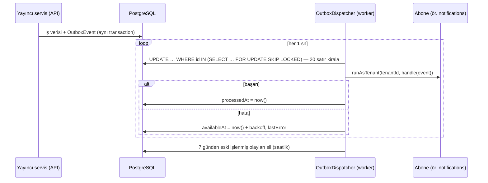

# 3.3 Domain olayları ve transactional outbox

> Karar: [ADR 0003](../adr/0003-outbox-domain-event.md) · Kod: `apps/api/src/platform/events/` · Testler: `test/worker.e2e-spec.ts`

## Neden olay?

Eskiden `tebligat`, `social-security`, `billing` doğrudan `NotificationsService`'i çağırıyordu: yayıncı bildirimin varlığını biliyor, bildirim hatası aktarımı bozuyordu. Şimdi yayıncı yalnız "**şu oldu**" der; kimin dinlediğini bilmez.



## Mevcut olaylar

| Olay | Yayıncı | Yük | Aboneler |
|---|---|---|---|
| `tebligat.imported` | `TebligatService.importTables` | `companyId, companyTitle, count, first{subject, sender, deemedServedAt}` | notifications |
| `sgk.reports.received` | `ViziteSyncService` | `workplaceId, companyTitle, count, names[≤3]` | notifications |
| `billing.license.extended` | `BillingService.markPaid` | `planName, expiresAt` | notifications |

## Sözleşme kuralları

1. **Ad** `<context>.<geçmiş zaman>`, sabit `domain/events.ts`'te, `index.ts`'ten dışa açılır.
2. **Yük kendine yeterlidir:** abone yayıncının tablosunu okumaz. Ekranda gereken bilgi yükte olmalı.
3. **Yük JSON'dur** ve sürümlenebilir biçimde *eklenerek* genişler; alan silmek/yeniden adlandırmak = yeni olay adı.
4. **Kişisel veri minimum:** yük veritabanında 7 gün kalır. Sağlık verisi (vaka, tanı) **asla** yüke girmez; ad soyad en fazla 3 kişi.
5. **Aynı transaction:** olay, değişikliği yapan transaction'ın istemcisiyle (`tx`) yazılır → veri yazıldıysa olay da yazılmıştır. Örnek: `markPaid` içinde `this.outbox.publish({...}, tx)`.

   > ⚠️ `tebligat` ve `vizite-sync` bugün olayı transaction dışında yazıyor (veri yazıldıktan sonra süreç çökerse olay kaybolabilir). Düzeltme [taktik borç](06-taktik-borc.md) listesinde.

## Abone yazmak

```ts
@Injectable()
export class NotificationEventHandlers {
  @OnDomainEvent(TEBLIGAT_IMPORTED)
  async tebligatImported(e: DomainEvent) {
    const p = e.payload as unknown as TebligatImported;
    await this.notifications.notify(e.tenantId, {
      category: 'TEBLIGAT',
      title: `Yeni e-tebligat: ${p.companyTitle}`,          // uygulama içi: ad olabilir
      body: '…',
      externalBody: `${p.count} yeni e-tebligat; …`,         // dış kanal: kişisel veri YOK
      link: '/tebligat',
      dedupeKey: eventKey(e),                                // event:<outboxId> → idempotent
    });
  }
}
```

- Abone **worker** sürecinde ve olayın bürosunun RLS bağlamında (`runAsTenant`) çalışır — başka büronun verisini göremez.
- Teslim **en az bir kez**dir: aynı olay iki kez gelebilir (çökme, kiralama süresi). Abone idempotent olmalı (`dedupeKey`, upsert, koşullu güncelleme).
- Bir olayın birden çok abonesi sırayla çalışır; biri hata verirse olay yeniden denenir ve **başarılı abone de yeniden çalışır** → her abone ayrı ayrı idempotent olmalı.
- Abone uzun dış çağrı yapacaksa kendi kuyruğuna iş bırakır (ör. WhatsApp teslimi `NotificationDelivery` + BullMQ `deliver`).

## Yeniden deneme ve gözlem

- Backoff: `2^(deneme-1) × 15 sn`, en fazla 1 saat (`backoffMs`). Kiralanan satır 5 dakika başka worker'a görünmez.
- Takılan olaylar: `SELECT type, attempts, "lastError" FROM "OutboxEvent" WHERE "processedAt" IS NULL ORDER BY "createdAt";` (owner rolüyle).
- Birden çok worker güvenle çalışır (`SKIP LOCKED`).

## Ne zaman olay, ne zaman doğrudan çağrı?

| Durum | Seçim |
|---|---|
| Yan etki, yayıncının sonucu ona bağlı değil (bildirim, istatistik) | **Olay** |
| Çağıranın yanıtı sonuca bağlı (iş kutusu verisi, kontrol listesi) | **Facade çağrısı** (`index.ts`, Customer/Supplier) |
| Birden çok bağlamı atomik değiştirmek | Tasarım hatası işareti — sınırı veya akışı gözden geçir (bkz. [Tutarlılık](04-tutarlilik.md)) |
