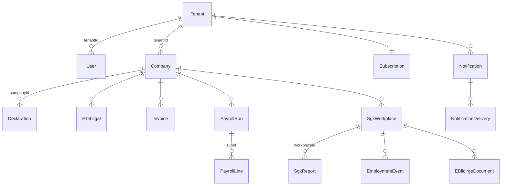

# 4.2 Veri modeli

> Şema: `apps/api/prisma/schema/*.prisma` (Prisma 7 çoklu dosya, yapılandırma `prisma7.config.ts`) · Migration'lar: `apps/api/prisma/migrations/` · RLS: `20261020110000_rls_ve_roller`

## Bağlam başına şema dosyaları

Tek veritabanı, tek migration geçmişi; ama her tablonun **sahibi tek bir bağlamdır** ve şeması o bağlamın dosyasındadır.

| Dosya | Modeller | Sahip bağlam |
|---|---|---|
| `identity.prisma` | `Tenant`, `User`, `ApiToken`, `Session` | identity |
| `taxpayers.prisma` | `Company` | taxpayers |
| `tax-filing.prisma` | `Declaration`, `EDefterBerat`, `TaxCalendarEvent`, `CompanyObligation` | tax-filing |
| `tebligat.prisma` | `ETebligat` | tebligat |
| `social-security.prisma` | `SgkWorkplace`, `SgkReport`, `EmploymentEvent`, `EBildirgeDocument` | social-security |
| `invoicing.prisma` | `Invoice` | invoicing |
| `payroll.prisma` | `PayrollRun`, `PayrollLine` | payroll |
| `billing.prisma` | `Subscription`, `Payment` | billing |
| `documents.prisma` | `PetitionTemplate`, `Petition` | documents |
| `assistant.prisma` | `AssistantConversation`, `AssistantMessage` | assistant |
| `notifications.prisma` | `Notification`, `NotificationRead`, `NotificationDelivery` | notifications |
| `workspace.prisma` | `InboxSnooze` | workspace |
| `platform.prisma` | `AuditLog`, `OutboxEvent` | platform |
| `main.prisma` | generator + datasource | — |

## Büro kapsamı (kiracılık zinciri)

RLS politikası bu zinciri izler:

| Tablo grubu | Politika |
|---|---|
| `tenantId` kolonu olanlar (`User`, `Company`, `Subscription`, `Payment`, `ApiToken`, `Session`, `AuditLog`, `Notification`, `Assistant*`, `InboxSnooze`, `OutboxEvent`) | `"tenantId" = app_tenant()` |
| Firma üzerinden (`Declaration`, `ETebligat`, `Invoice`, `PayrollRun`, `SgkWorkplace`, `Petition`, `EDefterBerat`, `CompanyObligation`) | `EXISTS (Company c … c."tenantId" = app_tenant())` |
| İşyeri üzerinden (`SgkReport`, `EmploymentEvent`, `EBildirgeDocument`) | `EXISTS (SgkWorkplace ⋈ Company …)` |
| `PayrollLine`, `NotificationRead/Delivery` | Ebeveyn üzerinden `EXISTS` |
| `PetitionTemplate` | Okuma: `tenantId IS NULL` (sistem) veya kendi; yazma yalnız kendi |
| `TaxCalendarEvent` | Ortak takvim, RLS yok |

Tüm politikalarda `app_bypass()` sistem bağlamı için kaçış kapısıdır; `FORCE ROW LEVEL SECURITY` tablo sahibini de bağlar (owner rolü ayrıca `BYPASSRLS` ile migration çalıştırır).

## Veritabanı rolleri

| Rol | Kim kullanır | Yetki |
|---|---|---|
| `mukellef_owner` | `migrate`, `backup` | Tablo sahibi, BYPASSRLS |
| `mukellef_app` (`app_user` üyesi) | api, worker | DML; RLS'e tabi; `_prisma_migrations` erişimi yok; `AuditLog` UPDATE/DELETE/TRUNCATE yok |

> Süper kullanıcı RLS'e tabi değildir: yerelde süper kullanıcıyla bağlanırsan politikalar çalışmaz. E2E testleri uygulama rolüyle koşar.

## Kişisel veri kolonları

| Tablo | Şifreli | Blind index | Geçiş (kaldırılacak) |
|---|---|---|---|
| `SgkReport` | `tcknEnc`, `fullNameEnc` (vaka kodu/tarihler düz: kimlik şifreli olduğundan kişiyle bağ yalnız anahtarla kurulur) | `tcknHash` | `tckn`, `fullName`, `raw` |
| `EmploymentEvent` | `tcknEnc`, `fullNameEnc` | `tcknHash` (tekillik anahtarında) | `tckn`, `fullName`, `raw` |
| `PayrollLine` | `tcknEnc`, `fullNameEnc` | `tcknHash` | `tckn`, `fullName` |
| `SgkWorkplace` (Vizite ve 4A tescil şifreleri) | `viziteSecretEnc`, `tescil*PasswordEnc` | — | — |
| `User` | `totpSecretEnc`; şifre argon2id hash; kurtarma kodları SHA-256 | — | — |
| `Session`, `ApiToken` | Belirteçler yalnız hash (`tokenHash`) | — | — |

Okuma `PersonalDataService.open` ile hem yeni hem eski biçimi çözer; yeni yazma her zaman şifrelidir. Eski kayıtlar `personal-data.backfill.ts` ile dönüştürülür. Düz kolonların kaldırılması: [taktik borç 4.2](../03-taktiksel-tasarim/06-taktik-borc.md).

## Migration kuralları

1. Şemayı ilgili bağlamın `.prisma` dosyasında değiştir; `apps/api` içinde `npx prisma migrate dev --name <kisa_ad>` (gerekirse oluşan SQL'e RLS/REVOKE/backfill elle eklenir).
2. **Uygulanmış migration dosyası asla değiştirilmez** (checksum). Satır sonları LF; Windows'ta oluşturulan dosyayı kontrol et.
3. Yeni tenant'lı tablo → aynı migration'da `ENABLE` + `FORCE ROW LEVEL SECURITY` + politika. E2E'de çapraz büro testi ekle.
4. Kolon kaldırma iki adımda: (a) kodu yeni kolona geçir + backfill, (b) sonraki sürümde düşür.
5. Üretimde migration yalnız `migrate` servisiyle (owner rolü) çalışır; uygulama rolünün DDL yetkisi yoktur.
