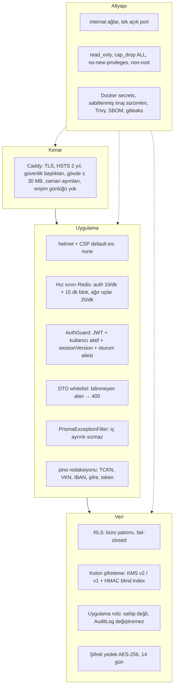
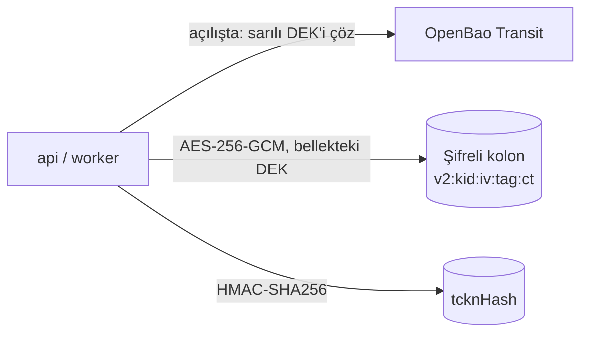

# 4.3 Güvenlik mimarisi

> Kurallar ve KVKK/GİB yükümlülükleri: [security-kvkk.md](../ai/security-kvkk.md) · Kod düzeyi: [Çapraz kesen konular](../03-taktiksel-tasarim/05-capraz-kesen-konular.md) · ADR: [0004 RLS](../adr/0004-postgres-rls.md), [0005 KMS](../adr/0005-openbao-kms.md), [0006 BFF oturum](../adr/0006-bff-cerez-oturum.md), [0008 TR barındırma](../adr/0008-tr-barindirma-docker.md)

## Neyi koruyoruz?

| Varlık | Neden kritik | Başlıca tehdit |
|---|---|---|
| Çalışan sağlık raporları + kimlik | KVKK md.6 özel nitelikli veri | Büro arası sızıntı, veritabanı dökümü, dış kanala taşma |
| TCKN, ad soyad, bordro | KVKK kişisel veri | Aynı |
| SGK kurum şifreleri | Büro adına SGK'da işlem yapılabilir | Anahtar sızıntısı, log'a düşme |
| Kullanıcı oturumu | Büronun tüm verisine erişim | Kaba kuvvet, XSS ile belirteç çalma, oturum yeniden kullanımı |
| Denetim kaydı | Hesap verebilirlik / delil | Sonradan değiştirme |
| Ödeme akışı | Lisansı bedavaya uzatma | Geri dönüş sahteciliği, eşzamanlılık |

## Katmanlı savunma

## Kimlik doğrulama ve oturum

| Öğe | Bugün | Hedef |
|---|---|---|
| Şifre | argon2id; eski bcrypt girişte yeniden özetlenir | — |
| Kaba kuvvet | 5 hatalı giriş → hesap 15 dk kilit + IP bazlı hız sınırı | — |
| 2FA | TOTP + tek kullanımlık kurtarma kodları; büro geneli zorunlu kılınabilir; aynı adım tekrar kullanılamaz | — |
| Erişim belirteci | JWT (`ACCESS_TOKEN_TTL`, vars. 8 saat), içinde `sv` + `fid` → şifre/rol değişince veya oturum kapatılınca anında geçersiz | Faz 3: 15 dk |
| Yenileme | DB'de hash'li, dönen refresh token (7 gün), yeniden kullanımda aile iptali, cihaz listesi | — |
| Web saklama | `localStorage` ⚠️ | Faz 3: BFF + `HttpOnly; Secure; SameSite=Strict` çerez |
| Eklenti anahtarı | `mt_` önekli, yalnız hash saklanır, `gib:import` kapsamı, 90 gün süre, iptal edilebilir | — |

## Kriptografi

- **Zarf şifreleme:** veri anahtarı (DEK) OpenBao Transit ile sarılı hâlde secret olarak durur; uygulama açılışta çözer, bellekte tutar. Ana anahtar OpenBao'dan çıkmaz.
- Biçim sürümlü: `v2:<kid>:…` (OpenBao), `v1:` (yerel anahtar, geliştirme/geçiş). Okuma her ikisini çözer; `needsRotation` eski sürümü işaretler.
- Blind index: eşitlik araması ve tekillik için ayrı HMAC anahtarıyla; geri çevrilemez.
- Üretimde `KMS_PROVIDER=local` yapılandırma doğrulamasında reddedilir.

## Dışa veri akışları ve kurallar

| Akış | Ne gider | Koruma |
|---|---|---|
| WhatsApp (Meta, yurt dışı) | Yalnız `externalBody` — sayı/tarih, **ad ve sağlık verisi yok** | Kullanıcı rızası numaraya bağlı; şablon mesaj |
| Claude API (yurt dışı) | Kullanıcının sorusu, maskelenmiş | Varsayılan kapalı; büro yöneticisi onayı (KVKK md.9); günlük kota |
| iyzico | Fatura bilgisi + tutar | Kart bilgisi iyzico sayfasında; sonuç sunucudan sorgulanır |
| SGK web servisleri | İşyeri kimlik bilgileri | Şifreler KMS ile; her şifre çözme denetim kaydı (`vizite.credentials.decrypt`, `tescil.credentials.decrypt`) |
| GİB | **Hiçbir şey** — otomatik giriş yok | Veri kullanıcının kendi oturumundan eklentiyle gelir |
| Mobil push (Faz 4) | "Yeni iş var" + derin bağlantı | PII yok |

## Barındırma

Türkiye'de VM / kurum içi sunucu (KVKK yurt dışı aktarımından kaçınmak için veri yerleşimi), tek açık port, yedekler şifreli ve kurum dışına yalnız şifreli taşınır. Ayrıntı: [ADR 0008](../adr/0008-tr-barindirma-docker.md), [infra/docker/README.md](../../infra/docker/README.md).

## Güvenlik doğrulaması (otomatik)

| Kontrol | Nerede |
|---|---|
| Çapraz büro erişimi her uç için reddediliyor; doğrudan SQL ile RLS | `apps/api/test/security.e2e-spec.ts` |
| Yanıtlarda tam TCKN yok | e2e yardımcı `expectNoFullTckn` |
| Hız sınırı, kilit | `throttle.e2e-spec.ts`, `identity.e2e-spec.ts` |
| Zayıf/eksik yapılandırma açılmıyor | `platform/config/config.spec.ts` |
| Denetim zinciri bozulması yakalanıyor | `platform/audit/audit-chain.spec.ts` |
| Sır taraması, imaj açıkları | CI: gitleaks, Trivy |

## Olay müdahalesi

Şüpheli erişimde: kullanıcının `sessionVersion`'ını artır / hesabı devre dışı bırak (tüm oturumlar düşer) → eklenti anahtarlarını iptal et → denetim zincirini doğrula → KVKK 72 saat bildirim değerlendirmesi. Adımlar: [security-kvkk.md](../ai/security-kvkk.md).
