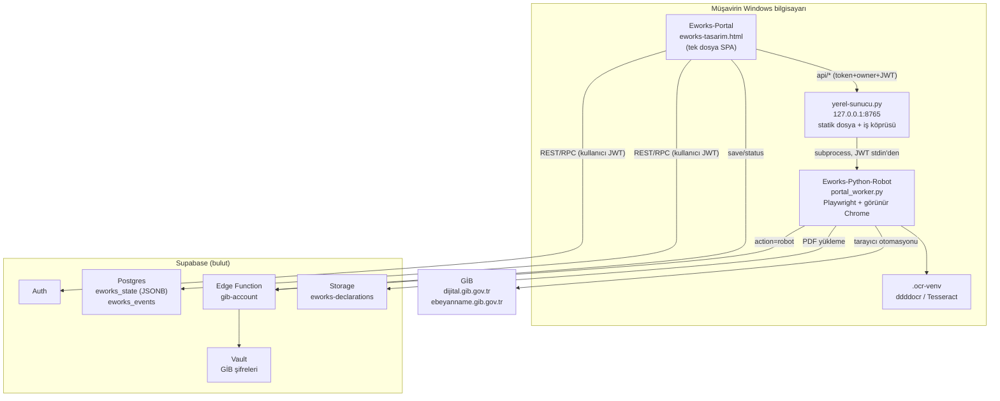

# 0. Genel bakış

> Önce: [README](README.md) · Sonra: [Sistem mimarisi](02-mimari/01-sistem-mimarisi.md)

## Ne yapar

Mali müşavir, GİB'de (dijital.gib.gov.tr, İnternet Vergi Dairesi, e-Beyanname) kendi hesabıyla görebildiği bilgileri elle toplamak yerine Eworks portalındaki **"Bilgileri Güncelle"** düğmesine basar. Müşavirin bilgisayarında görünür bir Chrome açılır, Python robotu GİB ekranlarını gezer ve şunları okur:

| Veri | Durum (21.10.2026) |
|---|---|
| Geçerli e-Beyanname sözleşmeleri listesi (mükellef VKN/TCKN, unvan, sözleşme) | Canlı kabul: 17.10.2026, 274 sözleşme (`GIB-Canli-Akis.md`) |
| e-Beyanname listesi (dönem/mükellef kapsamlı) | Kod + sentetik test; canlı tam tarama iddia edilmez |
| Beyanname ve vergi tahakkuk PDF'leri → Supabase Storage | Kod + sentetik test |
| MUHSGK içindeki SGK tahakkuk / hizmet belgeleri, çalışan sayısı | Kod + sentetik test |
| e-Tebligat, e-Defter | Menü/adaptör var; **tamamlanmış değil** |

Okunan veri, portalın Supabase'deki kullanıcı kaydına (tek JSONB belge) yazılır; portal firma, görev, not, beyanname takibi ekranlarını bu kayıttan üretir.

## Kimin için

Tek bir mali müşavir (tek Supabase kullanıcısı = tek "kiracı"). Büro içinde birden fazla personelin aynı veriyi paylaşması **modellenmemiştir** (bkz. [M-03](04-eksikler-ve-riskler/01-mimari-yapisal-eksikler.md)).

## Parçalar

| Proje | Dil/Teknoloji | Giriş noktası |
|---|---|---|
| `E1/Eworks-Portal` | Vanilla HTML/JS (build yok), PDF.js 6.4.299 (vendor) | `eworks-tasarim.html` |
| Yerel köprü | Python 3.11+ stdlib `ThreadingHTTPServer`, xlrd | `E1/Eworks-Portal/yerel-sunucu.py`, `Baslat.ps1` |
| `E1/Eworks-Python-Robot` | Python, Playwright, requests, supabase-py, OpenCV/pytesseract, pypdf | `portal_worker.py` (köprüden), `main_orchestrator.py` (eski CLI) |
| OCR alt ortamı | ddddocr 1.6.1 ayrı venv | `local_ocr_worker.py` |
| Supabase | Postgres SQL betikleri (elle), Deno Edge Function | `E1/Eworks-Portal/supabase-*.sql`, `supabase/functions/gib-account/index.ts` |

## Temel tasarım fikirleri

1. **Robot veri tabanına yazmaz.** Sonucu köprüye döndürür; kaydı portal, kullanıcının kendi oturumuyla `eworks_commit` RPC'si üzerinden yapar. (İstisna: PDF'ler robot tarafından kullanıcı JWT'si ile Storage'a yüklenir.)
2. **Service-role anahtarı yalnızca Edge Function'da.** Tarayıcı ve robot publishable key + kullanıcı JWT'si kullanır.
3. **GİB şifresi Vault'ta.** Tarayıcı şifreyi kaydedebilir ama geri okuyamaz; yalnızca Origin başlığı göndermeyen istemci (robot) okuyabilir.
4. **Hata = kayıt yok.** Sayı/başlık/sayfa tutarsızlığında sonuç kaydedilmez (fail-closed).
5. **İsteğe bağlı çalışma.** Zamanlanmış görev, kuyruk veya sunucu tarafı robot yoktur; aynı anda tek iş.

## Mükellef Takip ile ilişkisi

Aynı depodaki `mukellef-takip/` (NestJS + Next.js + Chrome eklentisi) aynı iş alanında, farklı yaklaşımla çalışan ana üründür: GİB şifresi saklamaz ve **otomatik GİB girişi yapmaz** (Mükellef Takip pazarlıksız kural #3). Eworks ise şifreyi Vault'ta saklar ve 21.10 sürümünde OCR ile otomatik giriş yapar. Önerilen ilişki: Eworks robotunun `eworks.gib.contracts.v1` çıktısı Mükellef Takip'e bir **veri kaynağı** olarak içe aktarılır (ayrıntı: [../mert-technical-analiz.md](../mert-technical-analiz.md) §9, [03-iyilestirme-plani.md](04-eksikler-ve-riskler/03-iyilestirme-plani.md) Faz C).

## Depodaki konum ve kaynak doğruluğu

`mert/eworks/entegrasyon-1-tarayici/` 21.10.2026 ilk entegrasyonunun **paylaşım kopyasıdır**; Mert'in yerelinde çalışan portal ve ikinci yöntem (`02-developer-servis-denemesi`) depoda değildir. Canlı Supabase URL/anahtarları şablonla değiştirilmiştir. Yani depodaki kod, sahadaki çalışan sürümle birebir aynı olmayabilir ([M-15](04-eksikler-ve-riskler/01-mimari-yapisal-eksikler.md)).
