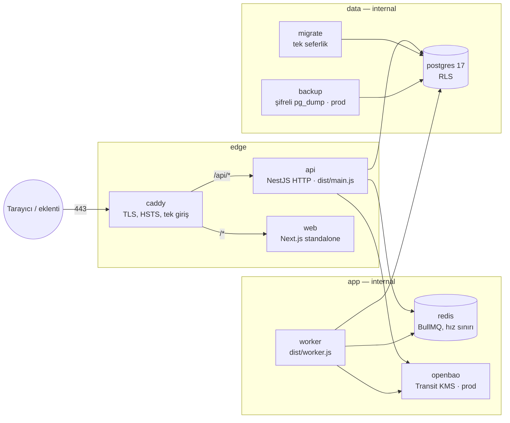
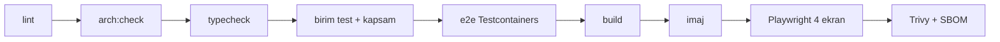

# 4.1 Çalışma zamanı ve dağıtım

> Kararlar: [ADR 0001 modüler monolit](../adr/0001-moduler-monolit.md), [ADR 0008 TR barındırma + Docker](../adr/0008-tr-barindirma-docker.md) · Kod: `infra/docker/` · İşletim ayrıntısı: [infra/docker/README.md](../../infra/docker/README.md)

## Süreçler ve ağlar

| Servis | İmaj | Görev | Ağ |
|---|---|---|---|
| `caddy` | `caddy:2.11.7-alpine` | Tek açık port; TLS, güvenlik başlıkları, `/api` → api, diğer → web; erişim günlüğü **yazmaz** (URL'de PII olabilir) | edge |
| `web` | `mukellef-takip/web` | Next.js `output: 'standalone'` | edge |
| `api` | `mukellef-takip/api` | HTTP uçları; uzun iş yapmaz, kuyruğa bırakır | edge, app, data |
| `worker` | aynı api imajı, `node dist/worker.js` | BullMQ işleyicileri, outbox dağıtıcısı, zamanlanmış işler | app, data |
| `migrate` | `mukellef-takip/migrate` | `prisma migrate deploy` (owner rolüyle), sonra çıkar; api/worker onu bekler | data |
| `postgres` | `postgres:17.11-alpine` | Tek veritabanı, RLS; rol kurulumu `postgres/init/01-roles.sh` | data |
| `redis` | `redis:7.4.11-alpine` | Şifreli (`requirepass`), AOF | app |
| `openbao` | `openbao/openbao:2.7.1` | **prod:** Transit anahtar (raft depolama) | app |
| `backup` | `mukellef-takip/backup` | **prod:** `pg_dump` → AES-256 (`openssl -pbkdf2`), varsayılan 24 saatte bir, 14 gün saklama | data |

`app` ve `data` ağları `internal: true` — dış dünyaya çıkışları yoktur. Geliştirmede host'a port açmak için ayrı `devhost` ağı kullanılır.

## Zamanlanmış işler (worker)

| İş | Zaman (Europe/Istanbul) | Bağlam |
|---|---|---|
| SGK e-Rapor senkronu (tüm işyerleri) | 02:00 | social-security |
| Günlük hatırlatıcılar | 08:30 | notifications |
| WhatsApp teslimi | kuyruk (saniyede ≤ 10) | notifications |
| Outbox dağıtımı | 1 sn aralıkla; işlenmiş olaylar 7 gün sonra silinir | platform |

Tekrarlanan işler BullMQ'da sabit kimlikle kaydedilir: birden çok worker aynı işi iki kez çalıştırmaz. Worker yatay ölçeklenebilir (outbox `SKIP LOCKED`, BullMQ kilitleri).

## Compose dosyaları

| Dosya | Ne ekler | Kullanım |
|---|---|---|
| `compose.yml` | Temel servisler, sertleştirme (`read_only`, `cap_drop: ALL`, `no-new-privileges`, non-root, `tmpfs`), healthcheck, secrets | her zaman |
| `compose.dev.yml` | `http://127.0.0.1:8080`, mock dış servisler, demo veri, yerel KMS | `npm run stack:dev` |
| `compose.prod.yml` | Alan adı + otomatik TLS (80/443), OpenBao, yedekleme, `NODE_ENV=production` | `npm run stack:prod` |
| `compose.test.yml` | Yalıtılmış test yığını (`verify`, `ui` hedefleri) | `npm run verify`, CI |

## Yapılandırma ve sırlar

- Tüm ayarlar `apps/api/src/platform/config/config.ts`'te **zod** şemasıyla doğrulanır; geçersiz/zayıf ayarla süreç **açılmaz** (fail-fast). Örnekler: üretimde `KMS_PROVIDER=local` reddedilir, `RATE_LIMIT=off` yalnız `NODE_ENV=test`'te, `BILLING_PROVIDER=demo` üretimde yalnız `DEMO_MODE=true` ile.
- Sırlar Docker secret dosyalarıdır (`infra/docker/secrets/`, git'e girmez); uygulama `X_FILE` değişkeniyle okur. Üretim: `npm run secrets:init` → `openbao-init`.
- `.env` dosyaları Claude Code tarafından okunamaz (`.claude/settings.json` `deny`).

## Derleme hattı

Her uygulamanın `prebuild` betiği testleri çalıştırır: **testler geçmeden imaj oluşmaz.** Ayrıntı: [Test stratejisi](../ai/testing.md). CI: `.github/workflows/mukellef-takip.yml` (verify → ui → images; gitleaks ayrı iş).

## Ölçekleme yolu

1. **Dikey + worker çoğaltma** (bugünkü yapı yeterli: birkaç yüz büro).
2. API çoğaltma: durumsuz; oturum DB'de, hız sınırı Redis'te → Caddy arkasında birden çok `api`.
3. Okuma yükü: PostgreSQL okuma kopyası; `workspace` okuma modelini önbelleğe alma ([workspace](../02-baglamlar/workspace.md)).
4. Bağlam ayırma (mikroservis) **yalnız** ölçüm gerektirirse: sınırlar, olaylar ve `index.ts` sözleşmeleri buna hazırdır; ilk aday `social-security` senkronu (dış servis yoğun). Bkz. [ADR 0001](../adr/0001-moduler-monolit.md).
